# Roadside-Picnic: detailed architecture

A deep companion to `arch-readme.md`. That file is the map: module layout, the
per-frame schedule in brief, pitfalls and the "How to add ..." recipes. This one
follows the code paths end to end, with diagrams, the constants that shape them
and, for each design, **why it is built that way**, citing the comment, test or
commit that says so. Where no source says why, the reason is marked
*(inferred)*.

| Read | For |
|---|---|
| `CLAUDE.md` | Controls, rules that hold everywhere, build commands, conventions |
| `arch-readme.md` | Module map, recipes, verification checklist, troubleshooting |
| **this file** | How each subsystem works inside, and why |
| `doc/world-reference.md` | Behaviour, measured numbers and asset pipelines per system |

References are `path:line` against the tree at the time of writing (the
`arch-detailed` branch, after `f53efef`). Line numbers drift; the function and
constant names do not, so search for the name when a line is off. All paths are
under `src/` unless they start with `assets/`, `tools/` or `doc/`.

**Contents**

1. Shape and principles
2. Boot, states and the loading screens
3. Memory: RAM fill, GPU scan budget, recovery, GPU tier
4. Saved progress
5. The ground: terrain, water, roads and the landscape
6. Things on the ground: scenery, vegetation, sites, collision, the Golden Sphere
7. The stalker, orders and vehicles
8. Time, weather, light and fog
9. Living things: wildlife, mutants, people, guns, helicopters
10. Audio, UI, the Zone loop and messages
11. Anatomy of one in-game frame
12. Invariants, observed inconsistencies and glossary

## 1. Shape and principles

### 1.1 The layers

About 90,000 lines of Rust in 160 files, more than half of the lines generated collision
data (`world/pillars/`). One crate, one Bevy app, no physics or networking
crate.

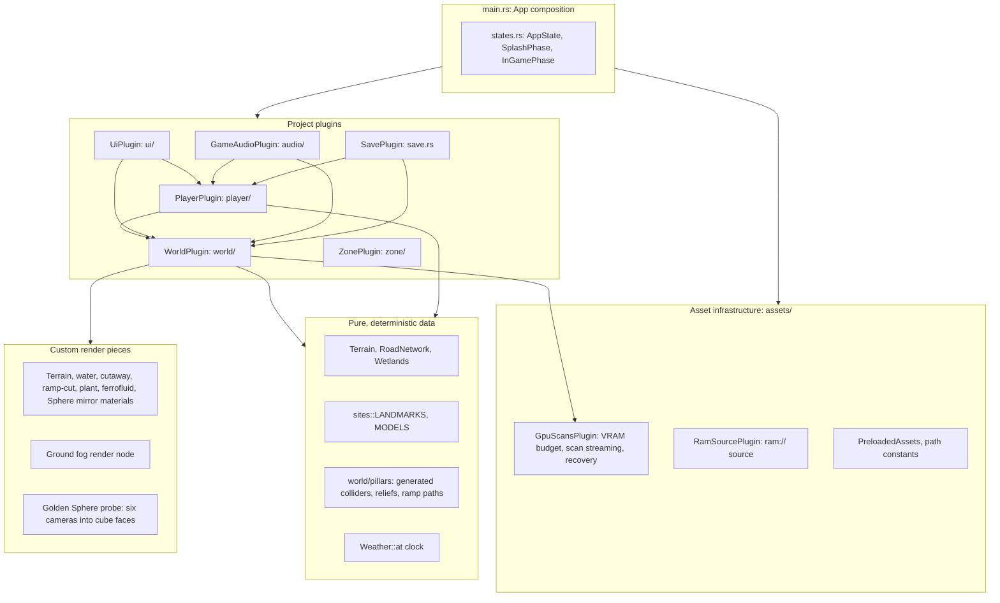

The world module is the centre: it owns the ground, everything on it and the
atmosphere, and the other plugins read its resources (`Terrain`, `Explored`,
`Wind`, `WorldClock`). The player module reads the world but the world only
reads the player through components (`Player`, `StreamAnchor`, `Crusher`) and
messages.

### 1.2 Principles, and why

| Principle | What it means here | Why |
|---|---|---|
| **The world is a function** | `Terrain`, roads, water, weather and placements are pure functions of fixed seeds and tables; nothing about them is saved | Every system, thread and test asks the same question and gets the same answer; the save stays a few lines (section 4) |
| **Precalculate once** | Bake what assets and seeds determine (collision pillars, reliefs, the pit roads, tangents, KTX2 textures); compute the rest once per run and cache it | User rule (CLAUDE.md); runtime exceptions are commented where they stand, e.g. the wall shear (`cordon.rs:1117-1118`) and the ramp cut image (`ramp_cut.rs:97-99`) |
| **Stream by distance, cap by frame** | `StreamAnchor` tiles, one chunk or tile per frame, fixed per-frame spawn and despawn budgets | Bevy's per-entity bookkeeping stalled whole tile rows: 180 ms frames, now 23 ms (commit `374be19`) |
| **VRAM is a budget, not a hope** | Dense scans only through `GpuScans`; stand-ins elsewhere; the live driver budget decides | All scans at once outgrow a 6 GB card; a 4 GB laptop is a target (section 3) |
| **Tier by the card, once** | `GpuTier` is decided at `Startup` from the card's size and never changes in a session | The live VRAM budget moves with other programs; an effect sized by it would flip tier mid-run (section 3.6) |
| **Keep model fidelity** | Native textures, error-bounded simplification, far LODs instead of degraded near models | User rule ("do not nerf models") |
| **Pause is an overlay** | `InGamePhase` sub-state; Running gates simulation, InGame gates streaming | Nothing despawns on pause; the view stays complete (`states.rs:28-31`) |
| **States, not booleans** | `AppState`, `SplashPhase`, `InGamePhase`, `Shroud`, enums for every mode | CLAUDE.md; run conditions stay declarative |
| **Collision is pillars** | Upright cylinders, `Weight`, `Crusher`, `Unclimbable`; no physics crate | Answers block, step, pass under, stand on, climb, crush with no solver or compile cost (section 6.5) |
| **Messages are events** | `Respawn`, `TreeBreak`, `CreatureSound`, `GunSound`, `ProgressSaved` | "A message is an event, not storage" (`arch-readme.md`) |
| **Text in one place** | `ui/text.rs` | Localization later (`ui/text.rs:3-4`) |
| **WASM stays possible** | No threads or sockets in game code; native-only paths are `cfg`-gated | Project goal (CLAUDE.md); the RAM source and VRAM probe are native-only |

## 2. Boot, states and the loading screens

### 2.1 Composition order in `main`

`main` (`src/main.rs:31`) builds the app in an order that is itself a contract:

| Step | Code | Why this position |
|---|---|---|
| 1 | `register_ram_source(&mut app, "assets")` (`main.rs:34-35`) | Asset sources are built by `AssetPlugin`, so the `ram` source must exist before `DefaultPlugins` |
| 2 | `DefaultPlugins.set(RenderPlugin { memory_hints: MemoryHints::MemoryUsage })` (`main.rs:40-48`) | wgpu's default 256 MiB blocks left ~1.2 GB of a 6 GB card reserved but unused, and a dropped scan freed nothing while its block held anything else; 8-64 MiB blocks keep ~0.4 GB less in use at the same frame rate (comment at `main.rs:36-39`, measured on the RTX 2060) |
| 3 | `insert_resource(LaunchOptions::from_env())` (`main.rs:51`) | Parsed once the log is up, so a bad `--vram` or `--gpu-tier` is reported |
| 4 | `GpuScansPlugin` (`main.rs:53`) | After the options (its fallback budget reads `--vram`, its fallback `GpuTier` reads `--gpu-tier` too) and after `DefaultPlugins` (it needs the render sub-app) |
| 4a | `render::RenderTuningPlugin` (`main.rs:55`) | After `DefaultPlugins`: its `finish` runs after `PbrPlugin`'s, which inserts the `GlobalClusterSettings` it switches to CPU clustering |
| 5 | `init_state::<AppState>`, `add_sub_state::<SplashPhase>`, `add_sub_state::<InGamePhase>` (`main.rs:56-58`) | States before any plugin that uses `in_state` |
| 6 | `PreloadedAssets` + `Startup: preload_game_assets` (`main.rs:59-60`) | The splash's readiness list |
| 7 | the six project plugins (`main.rs:61-68`) | Audio, World, Player, Zone, Ui, Save |
| 8 | `toggle_pause`, `quit_on_q` in `Update` while `InGame` (`main.rs:69-70`) | App-wide keys |
| 9 | `RamSourcePlugin` (native only, `main.rs:71-72`) | Its `start_ram_fill` needs `UhdFiles`, which `WorldPlugin::build` inserts |


### 2.2 The state machine

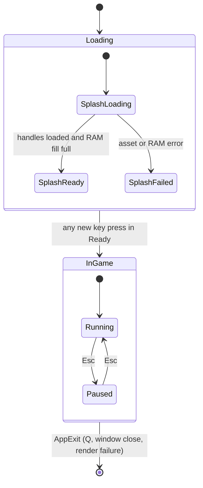

| State | Declared | Set by |
|---|---|---|
| `AppState {Loading, InGame}` | `states.rs:11` | `continue_from_splash` (`ui/splash.rs:260`) |
| `SplashPhase {Loading, Ready, Failed}`, a sub-state of `Loading` | `states.rs:21` | `finish_loading` (`ui/splash.rs:217`) |
| `InGamePhase {Running, Paused}`, a sub-state of `InGame` | `states.rs:34` | `toggle_pause` (`states.rs:43`) |

**Why sub-states.** Pausing is an overlay: "world, player, and HUD stay spawned
while paused, so this is a sub-state rather than a top-level one"
(`states.rs:28-31`). The splash phases are a sub-state for the same rule: never
model state with boolean resources (`states.rs:9`, CLAUDE.md). Nothing ever sets
`AppState::Loading` again after boot, so the world is built exactly once per
run; `SplashPhase::Failed` is terminal.

Two consequences follow everywhere in the code:

- systems that **stream** (`PreUpdate`) run under `in_state(AppState::InGame)`
  and keep working while paused, so the view stays complete;
- systems that **simulate** (`Update`, `PostUpdate`) run under
  `in_state(InGamePhase::Running)`, so pause freezes motion without despawning
  anything.

### 2.3 Startup to "Press any key"

1. `Startup` runs, unordered:
   - `preload_game_assets` (`assets/mod.rs:253`): the scenes, artifact previews,
     primitives, vehicle scenes, atlas, decals, map, terrain and hangar textures,
     splash image and shaders;
   - every `WorldPlugin` preloader (`world/mod.rs:133-149`). `prepare_landscape`
     starts the whole distant landscape as one async asset (`server.add_async`,
     `landscape.rs:127-185`) and pushes its handle into `PreloadedAssets`, so the
     splash waits for it like any file;
   - `canopy::pin_tree_scans` pins the three tree scans in `GpuScans`
     (`canopy.rs:345-349`);
   - `settle_gpu_tier` (`gpu_scans/vram.rs:69`) decides the `GpuTier`, so the
     pool and the probe built on entering the Zone already know it (section 3.6);
   - `read_progress` (`save.rs:133`) and `start_ram_fill` (`ram_source.rs:229`).
2. `OnEnter(AppState::Loading)` spawns the hangar backdrop, titles and an idle
   stalker (`ui/splash.rs:33-36`) and starts the hangar audio loop
   (`audio/mod.rs:51`).
3. Every Loading frame `finish_loading` (`ui/splash.rs:217`):
   - fails if `RamFill::failed()`;
   - stays pending while the RAM fill is not full (`:231`);
   - checks `get_load_states` of every handle; a failure of the asset **or of a
     recursive dependency** sets `Failed`, anything not `Loaded` on both axes
     keeps it pending (`:233-244`);
   - sets `Ready` only when nothing is pending **and the list is non-empty**
     (`:245`).
4. `OnEnter(SplashPhase::Ready)` shows "Press any key" and plays the ready chime
   (`ui/splash.rs:48, 250`; `audio/mod.rs:52`).

**Why the preload list is a contract.** The splash only knows what is in
`PreloadedAssets`. An asset an `OnEnter(InGame)` spawn needs but nobody
preloaded lets the splash report Ready too early; `spawn_world` even `expect`s
the landscape (`world/mod.rs:413-415`).

### 2.4 Key press to the first playable frame

1. `continue_from_splash` (`ui/splash.rs:260`) only runs in `Ready` and only
   accepts a key *just pressed* (`:264-265`), so a key held since before Ready
   does not skip the screen (test at `:343`).
2. `OnExit(Loading)` despawns everything tagged `DespawnOnExit(Loading)`.
3. `OnEnter(InGame)` runs the world, player, zone, ambience and HUD spawns,
   `estimate_scans` (`gpu_scans/streaming.rs:157`, every scan sized as its file
   length x 1.65 until measured) and `spawn_curtain` (`ui/curtain.rs:56`), a
   full-screen node at `GlobalZIndex(i32::MAX)`.
4. The curtain (`lift_curtain`, `ui/curtain.rs:93`) stays while any of these is
   busy (`:111`):
   - **the pipeline backlog**: a render-world system,
     `publish_pipeline_backlog` (`curtain.rs:42-50`), writes
     `PipelineCache::waiting_pipelines().count()` into an `Arc<AtomicUsize>`
     the main world reads;
   - **`PlantsGrowing`** (`world/plants.rs:551`), true while a streamed tile
     still has plants to grow or spawn;
   - **`!GpuScans::settled()`**: a scan loading, or a pinned tree not yet on
     the GPU.
5. Once all have been idle for `SETTLE_SECONDS` 0.4 s, or the curtain has shown
   `MAX_SECONDS` 12 s, it despawns, calls `GpuScans::entered()` and logs
   `Entered the Zone` (`:113-117`).

**Why a curtain.** It hides shader compilation, first-frame spawn hitches, the
trees' scan uploads and the plants filling in (`curtain.rs:1-4`); the 12 s cap
means "never hold the player longer than this" (`:21-22`). `entered()` also
ends the cautious admission mode (section 3.3): only `lift_curtain` calls it.

## 3. Memory: RAM fill, GPU scan budget, recovery, GPU tier

The game shows ~30 photogrammetry scans of 16-50 MiB of vertices each. Together
they outgrow a 6 GB GPU, and the target laptop has 4 GB. Three layers keep
them flowing without a stall or an out-of-memory crash:

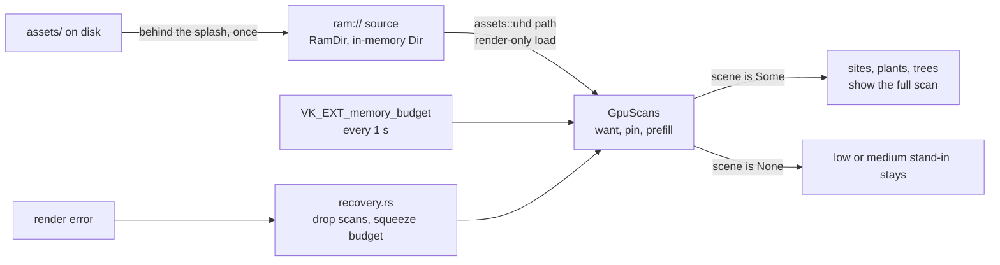

### 3.1 The `ram://` source (native only)

| Step | Code | What happens |
|---|---|---|
| Register | `register_ram_source` (`assets/ram_source/reader.rs:23`) | Makes a `Dir`, registers source `ram` backed by `RamOrDisk`, inserts `RamDir` |
| Measure | `start_ram_fill` → `RamFill::start` (`ram_source.rs:229, 92`) → `measure_files` on the IO pool (`:291`) | Every file of `UhdFiles` is opened and seeked to its end; reads start only once every length is known (`:90-91`) |
| Read | `collect_ram_files` (`:235`, Update while Loading) → `start_reads` (`:132`) | Up to `READS_IN_FLIGHT` = 4 reads; each must pass `fits_in_ram(available, in_flight, len)` (`:254`) |
| Stop | `leave_rest_on_disk` (`:164`) | The first file that does not fit ends the fill; the rest is logged as left on disk |
| Insert | `read_file` (`:326`) | Exact-size `Vec`, `read_exact`, `Dir::insert_asset` without a copy |
| Done | `is_full()` (`:99`) | Logs `Read N UHD files (X GB) into RAM in S s`; the splash waits for it |
| Serve | `RamOrDisk::reader_for` (`reader.rs:54`) | RAM if the file is there, otherwise `assets/`; a RAM file takes its `.meta` from RAM too |

**Why.**

- **No file is opened during play.** UHD files are "read from `assets/` once
  behind the splash while the machine has RAM to spare, so later loads decode
  from memory" (`ram_source.rs:1-3`).
- **4 GiB headroom** (`RAM_HEADROOM`, `:34-39`). The game's RAM grows up to
  3.2 GiB after the fill (peak RSS 11.7 GiB after a fill that ended near
  8.5 GiB); less headroom would push a tight host into swap or the OOM killer.
- **Linux only checks `MemAvailable`** (`:258-274`). Linux kills a process that
  runs out of memory; Windows and macOS page out, so the fill reads everything
  there.
- **Four reads at once**, because each open file holds an 8 MiB read pipe
  (`:31`).
- **Exact-size buffers**, because `read_to_end` could keep up to twice the
  file's size in RAM (`:323-325`).
- **`RamOrDisk` falls back to disk**, so a `ram://` path loads whether or not
  the fill reached it (`reader.rs:1-4, 50-53`).

**Fill order is gameplay order.** `UhdFiles` (`world/mod.rs:322-333`) lists
the trees, then the plants, then the sites nearest the hangar, and the fill
stops at the first file that does not fit. A missing file fails the whole
fill and with it the splash (`measure_files` uses `?`, `ram_source.rs:296`).

### 3.2 `GpuScans`: which scans may be on the GPU

`GpuScans` (`assets/gpu_scans.rs:167`) is a resource holding a budget and one
`Scan` per file (`:99-129`: bytes, measured, pinned, last shown, wanted,
speculative, waiting, handles, resident). Callers never load a UHD scan
themselves. They *ask* every frame and show what they are given:

| Call | Who | Meaning |
|---|---|---|
| `want(path, distance)` (`:342`) | `sites::stream_full_sites`, `plants::stream_full_plants`, `canopy::stream_close_trees`, `golden_sphere::stream_uhd_sphere` (exceptional GPUs only) | Says "I would show this scan"; `distance` is how far the nearest asking anchor is from where it would show (`:336-341`); must be repeated every frame |
| `pin(path)` (`:331`) | `canopy::pin_tree_scans` once | Always keep it; the three tree scans |
| `prefill(path)` (`:354`) | `prefill_scans` | Nobody asked; load it while there is spare room |
| `scene()` (`:309`) | callers | `Some` only once the scan is resident on the GPU |

The life of one scan:

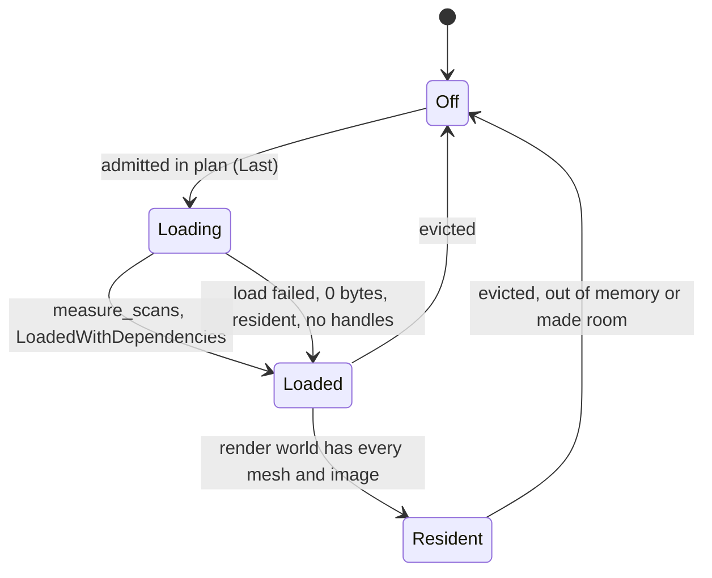

1. **Plan** (`admit_scans`, `streaming.rs:166`, `Last` while InGame) calls
   `GpuScans::plan(now)` (`gpu_scans.rs:388`):
   - `begin_plan` (`:476`) stamps `last_shown` for scans wanted at distance 0;
   - if resident bytes exceed the budget, `evict_over_budget` (`:544`) drops
     **one** scan (unwanted and resident only, unpinned before pinned, least
     recently shown first) and admits nothing that frame (`:391-394`). One per
     plan because "the reading's numbers lag the GPU's frees" (`:392`);
   - otherwise `admit` (`:583`) walks `pending()` (`:561`): pinned first, then
     the nearest ask, then prefills;
   - it clears `wanted` and `speculative` (`:399-402`). That is why callers
     ask every frame.
2. **Admit** an `Off` scan (`:583`):
   - a prefill loads only if `fits_prefill` (`:591`), never evicts and never
     waits;
   - a pinned or wanted scan loads if it `fits` (`:597`);
   - a wanted scan that does not fit calls `make_room` (`:615`), which drops
     loaded, unpinned scans unshown for at least `KEEP_SECONDS` 120 s that are
     unwanted or wanted farther away (`making_way`, `:642`), and failing that
     `try_stuck_room` (`:666`);
   - still no room: the scan is marked `waiting`.
3. **Load** (`GpuScans::load`, `streaming.rs:78`) loads `assets::uhd(path)`
   with `RenderAssetUsages::RENDER_WORLD` on meshes and materials
   (`:146-149`). The main world keeps no CPU copy.
4. **Measure** (`measure_scans`, `streaming.rs:248`, Update). On the glTF's
   `LoadedWithDependencies` it finds the scene, collects the parts
   (`ScanParts`, `:210`) and measures the real bytes (`scan_bytes`,
   `residency.rs:47`), **in that frame, before extract moves the vertex data
   out** (`streaming.rs:245-247`). A failed load becomes `Loaded` with 0
   bytes, resident and no handles, so `scene()` stays `None` and the caller
   keeps its lower tier (`fail`, `:129`).
5. **Resident** is decided in the render world: `publish_scan_residency`
   (`residency.rs:81`, `RenderSystems::PrepareResources`) moves a scan to
   `ready` once every mesh is in `RenderAssets<RenderMesh>` and every image in
   `RenderAssets<GpuImage>` (`settle`, `:64`). Next frame
   `note_resident_scans` (`First`) calls `mark_resident` (`streaming.rs:293,
   137`) and logs `UHD scan X on the GPU`. The two worlds talk through
   `ScanResidency(Arc<Mutex<Residency>>)` (`residency.rs:36`).
6. **Evict** (`unload`, `streaming.rs:89`) drops the strong handles, which
   frees the GPU copy; `drop_scan` (`gpu_scans.rs:487`) books the bytes in
   `frees` once a live reading exists.
7. **Prefill** (`prefill_scans`, `streaming.rs:190`, after `admit_scans`)
   picks the first `Off`, non-failed file of `UhdFiles` that fits with
   `PREFILL_HEADROOM_GB` 0.5 to spare, one at a time, and only while nothing
   is loading or waiting (`next_prefill`, `gpu_scans.rs:411`).

**Why each scheduling slot.** `track_vram_budget` and `note_resident_scans`
run in `First`, so callers in `PreUpdate`/`Update` see this frame's residency;
`admit_scans` runs in `Last`, after every caller's `want` (inferred from the
schedule). It runs only in InGame "so no `ram://` load starts before the fill
is full" (`streaming.rs:163-165`).

### 3.3 The live budget

`track_vram_budget` (`gpu_scans/vram.rs:30`) reads the driver once a second
(`READ_EVERY`, on `Time<Real>`):

1. `read_vram` (`:90`) reaches into wgpu's Vulkan HAL and calls
   `get_physical_device_memory_properties2` with
   `PhysicalDeviceMemoryBudgetPropertiesEXT` chained (`:107-117`), only when
   `VK_EXT_memory_budget` and `VK_KHR_get_physical_device_properties2` are
   enabled. `heap_reading` (`:67`) takes the largest device-local heap.
   Elsewhere (web, macOS) it is `None` (`:135-143`).
2. `GpuScans::apply_reading` (`gpu_scans.rs:243`):
   - keeps the last budget while any scan is still uploading. "While a scan
     uploads, the reading may already hold part of it, which would count as the
     rest of the game, and for good" (`:240-242`);
   - `rest = usage - resident scan bytes`, minus bytes still being freed;
   - `rest_peak = max(rest_peak, rest)`, a high-water mark, "so a scan leaving
     never shrinks it" (`:233-236`). The earlier behaviour emptied the GPU of
     scans one per second (commit `d8dde99`);
   - `budget = min(--vram cap, driver budget) - rest_peak - MARGIN_GB 0.5 -
     squeeze` (`live_scan_budget`, `:86, 254`).
3. Without a reading, the budget stays at the fallback `scan_budget(vram_gb)`
   (`:95`) = `vram - (GAME_VRAM_GB 2.4 + DESKTOP_GB 0.6 + MARGIN_GB 0.5)`,
   2.5 GiB at the default 6 GB, and the game warns once
   `The driver cannot report VRAM; assuming N GB` (`vram.rs:43-50`).

**Freed bytes that do not show.** wgpu keeps freed memory in its blocks until a
block empties, so a dropped scan may not lower the reading; a later load usually
reuses it, which only a reading after that load can show (`gpu_scans.rs:49-53,
660-665`). `try_stuck_room` therefore lets one wanted scan at a time load into
that "stuck" room; if the next reading shows no reuse (`judge_try`, `:679`), the
next try waits `FREE_WAIT_SECONDS` 30 s. Without it, one burst of evictions lost
that room, and the close-ups with it, for the rest of the run.

**Entering mode.** Until the curtain lifts, every admission leaves 0.5 GiB free
(`gpu_scans.rs:207-211, 452-458`): the world's own uploads raise the rest of the
game from 1.8-2.0 GiB at the first reading to 2.4 GiB on the 2060, and the
budget shrinks with them.

### 3.4 Surviving a render error

Bevy quits on any render error by default. `handle_render_error`
(`gpu_scans/recovery.rs:55`) is installed as the `RenderErrorHandler` and called
from the render sub-app's extract step:

1. `RenderTrouble::recovers` (`:37`) accepts an `OutOfMemory`, or a validation
   error within `ECHO_SECONDS` 2 s of the last recovery, and refuses a fourth
   recovery within `TROUBLE_SECONDS` 60 s (`MAX_RECOVERIES` 3).
2. Refused: log, `AppExit::error()`, `StopRendering` (`:65-67`).
3. Accepted: reset the render world's `TextureCache` (`:69`), call
   `GpuScans::out_of_memory` (`gpu_scans.rs:272`) which drops every non-`Off`
   scan and adds `OOM_SQUEEZE_GB` 0.5 to `squeeze`, unload them (`:73-76`),
   return `Ignore` (`:83`). Stand-ins show; scans return as the smaller budget
   allows.

**Why not Bevy's full `Recover`.** The terrain, roads and scenery meshes are
render-only, with no copy left in the main world to upload again
(`recovery.rs:1-9`). Scans can be dropped because they reload from RAM. The cap
exists because an error that keeps coming back makes the screen flash
(`:18-19`).

### 3.5 Keeping big meshes out of shared slabs

`world::mesh_allocator_settings` (`world/mod.rs:335-355`, inserted into the
render app at `world/mod.rs:124-126`) caps shared vertex/index slabs at 128 MiB
and gives every allocation of 4 MiB or more its own buffer. Bevy grows a shared
slab 1.5x at a time while holding the old buffer, which ran a 6 GB card out of
memory at the default 512 MiB cap, and with the old 32 MiB threshold a 4 GB
T1200 ran out of memory while streaming sites. A scan in its own buffer is never
copied by a growth and is freed exactly when it unloads.

### 3.6 The GPU tier

Effects that scale with the GPU (so far the Golden Sphere's, section 6.9) read
one `TierLevel`: `Modest`, `Strong` or `Exceptional`. `GpuTier`
(`gpu_scans/tier.rs:55`) holds the level and a `settled` flag.

| Step | Code | What happens |
|---|---|---|
| Assume | `GpuScansPlugin::build` (`streaming.rs:43`) → `GpuTier::fallback` (`tier.rs:62`) | Before any reading: `--gpu-tier` if given, else the level of `--vram` (6 GB without it, `Strong`) |
| Settle | `settle_gpu_tier` (`vram.rs:69`, `Startup`) → `GpuTier::settle_with` (`tier.rs:76`) | The first call only: a forced tier wins; else the card's size from the driver's reading (`VramReading::card`, the largest device-local heap), capped by `--vram`, with the adapter's ray-query feature (`WgpuFeatures::EXPERIMENTAL_RAY_QUERY` on `RenderAdapter`); else the fallback stays. Logs `GPU: effects at the Strong tier` |
| Read | `GpuTier::level` | `OnEnter(InGame)` builds what the level sizes; `Update` systems pick their branch by `run_if` |
| Say | `track_vram_budget` (`vram.rs:62`) | With the first reading: `GPU: a N GB card, effects at the X tier` |

`tier_for` (`tier.rs:41`) maps a size to a level: under `STRONG_GB` 4.75 GiB is
Modest, from there to under `EXCEPTIONAL_GB` 15 GiB Strong, above Exceptional;
a card with hardware ray tracing is Exceptional from `EXCEPTIONAL_RT_GB` 5.75 GiB.

**Why.**

- **The card's size, not the budget.** "The live budget drops whenever another
  program holds VRAM, which would judge a 6 GB card as a 4 GB one; the card's
  size does not" (`tier.rs:3-5`). The scan budget follows the live reading
  because it must; a look that changes with it would flicker between tiers.
- **Once.** `settle_with` changes nothing after the first call, so the pool's
  grid and the probe's faces, sized at entry, never meet a different level
  (`the_tier_is_decided_once`).
- **Thresholds in reported GiB.** "Drivers report a little under the size
  sold" (`tier.rs:11-13`): a 5 GB card reports about 4.9 GiB, hence 4.75; a
  16 GB card, 15. The user chose the sizes (a 5 GB card is the first Strong
  one, a 16 GB card the first Exceptional one).
- **Ray tracing as the class marker.** Exceptional costs no more than Strong
  where it matters: on the 6 GB RTX 2060 at the Sphere, 42 FPS against 38
  (one probe face a frame, the Sphere's shadow from its medium model). Hardware
  ray queries roughly mark that card's class (`tier.rs:15-19`); a 6 GB card
  without them (a GTX 1660) stays Strong
  (`a_six_gb_rtx_card_runs_exceptional_effects`). It is a heuristic: slower
  cards report ray queries too (an RTX 3050 6 GB, an RX 6500 XT, an Arc A380),
  so `settle_gpu_tier` logs `--gpu-tier strong` as the way back when ray
  tracing decided.
- **`--vram` caps the tier too.** Someone who limits the game to leave room for
  other programs gets the effects of that smaller card (`--vram 4` on a 16 GB
  card is Modest).
- **`--gpu-tier` is for testing.** It forces the level whatever the card, so
  the Exceptional path can be run on a 6 GB card (and measured: section 6.9).
- **Startup, before the Zone.** `settle_gpu_tier` runs before `OnEnter(InGame)`
  builds anything the level sizes. It takes `RenderDevice` as an `Option`, so an
  app without one settles on the fallback.

### 3.7 Constants

| Constant | Value | Where |
|---|---|---|
| `DEFAULT_VRAM_GB` | 6.0 | `launch.rs:10` |
| `READS_IN_FLIGHT` | 4 | `ram_source.rs:32` |
| `RAM_HEADROOM` | 4 GiB | `ram_source.rs:39` |
| `KEEP_SECONDS` | 120 | `gpu_scans.rs:26` |
| `UPLOAD_LEAD` | 40 m | `gpu_scans.rs:29` |
| `MARGIN_GB` | 0.5 | `gpu_scans.rs:31` |
| `DESKTOP_GB` / `GAME_VRAM_GB` | 0.6 / 2.4 | `gpu_scans.rs:33, 36` |
| `GPU_BYTES_PER_FILE_BYTE` | 1.65 | `gpu_scans.rs:38` |
| `PREFILL_HEADROOM_GB` | 0.5 | `gpu_scans.rs:47` |
| `FREE_WAIT_SECONDS` | 30 | `gpu_scans.rs:53` |
| `OOM_SQUEEZE_GB` | 0.5 | `gpu_scans.rs:56` |
| `READ_EVERY` | 1 s | `vram.rs:12` |
| `STRONG_GB` / `EXCEPTIONAL_GB` / `EXCEPTIONAL_RT_GB` | 4.75 / 15 / 5.75 GiB | `tier.rs:14-19` |
| `MAX_RECOVERIES` / `TROUBLE_SECONDS` / `ECHO_SECONDS` | 3 / 60 / 2 | `recovery.rs:20-24` |

### 3.8 Invariants

- Load streamed UHD scans only through `GpuScans` and `assets::uhd`. The
  always-shown stalker and checkpoints are the exception and load from
  `assets/` (`player/mod.rs:236`, `cordon.rs:499`).
- Ask every frame before `Last`; show only while `scene()` is `Some`; despawn
  the instance when it turns `None` (that is when the GPU frees it).
- Never call `Mesh::attributes()` on a scan mesh after extract; use
  `try_attributes()` (`residency.rs:51-54`).
- Only the five core PBR maps are tracked (`streaming.rs:230-243`). Enabling a
  `bevy/pbr_*_textures` feature would bind images the residency check never
  waits for.
- `GpuScans` uses `Time<Real>`, which does not pause; callers gated on
  `InGamePhase::Running` stop asking while paused, `stream_full_sites` (in
  `PreUpdate`) does not.
- On the web build there is no RAM source, no estimate and no prefill; `uhd()`
  returns the plain path (`assets/mod.rs:248-251`).
- The tier comes from the card's size, decided once; no effect reads the live
  budget to choose its look.

## 4. Saved progress

`SavePlugin` (`save.rs:29-42`) keeps only the player's progress; the world itself
is rebuilt from fixed seeds every run, so nothing else needs saving.

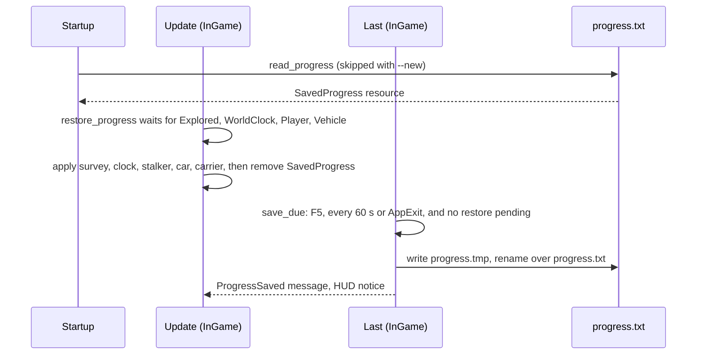

- **Format** (`to_text`, `save.rs:59`): header `roadside-picnic progress 1`,
  then `hours`, `stalker x y z`, `car x y z yaw`, optional `carrier x z yaw`, and
  `surveyed` as a 0/1 string. A wrong header, a non-finite number or a parse
  error starts afresh with a warning (`:79, 124`).
- **Restore** (`restore_progress`, `:157`) runs every frame until the resources
  and the single `Player` and `Vehicle` exist, then removes `SavedProgress`
  (`:182`). A survey of the wrong length is ignored, the rest still restores
  (`:172-174`).
- **Why `save_due` waits for the restore** (`:185-186`): an early F5 or quit
  would otherwise overwrite the save with a fresh world.
- **Why a stalker saved at the wheel comes back on foot** (`:217-228`,
  `Seat::beside`): "the stalker comes back standing beside what they drove".
- **Why write-then-rename** (`:271`): "a crash never leaves half a file". There
  is no fsync, so this guards against the game crashing, not the machine
  (inferred).
- `--new` ignores the save but does not delete it; the next save overwrites it.
  Quitting from the splash never saves. The web build saves nothing
  (`Unsupported`).

## 5. The ground: terrain, water, roads and the landscape

### 5.1 `Terrain` is a function, not a mesh

`Terrain` (`world/terrain.rs:99-102`) holds exactly one field, `roads:
RoadNetwork`. Every height, depth, slope and mask is evaluated as pure math at
the moment it is asked for: "Pure math until `Terrain::build_grid` is called — insert as
a resource so any system can sample the ground" (`terrain.rs:97-98`);
"everything is deterministic — same seed" (`terrain.rs:6`, `SEED` =
`0x1972_2016` at `:64`). `init_resource::<Terrain>()` (`world/mod.rs:127`)
builds it at app build time on the main thread; only the road network costs
anything to construct (`Terrain::new`, `terrain.rs:105-109`).

**Why a function.** The same answer is needed by the async landscape build, the
streamed 2 m tiles, collision, pathfinding, wildlife routes, scenery scatter,
the ramp cut images and every test, on any thread, with no shared mutable state.
`Terrain` is `Clone`, so a worker gets its own copy (`landscape.rs:127`) or an
`Arc` (`scenery.rs:222-248`).

### 5.2 The height stack

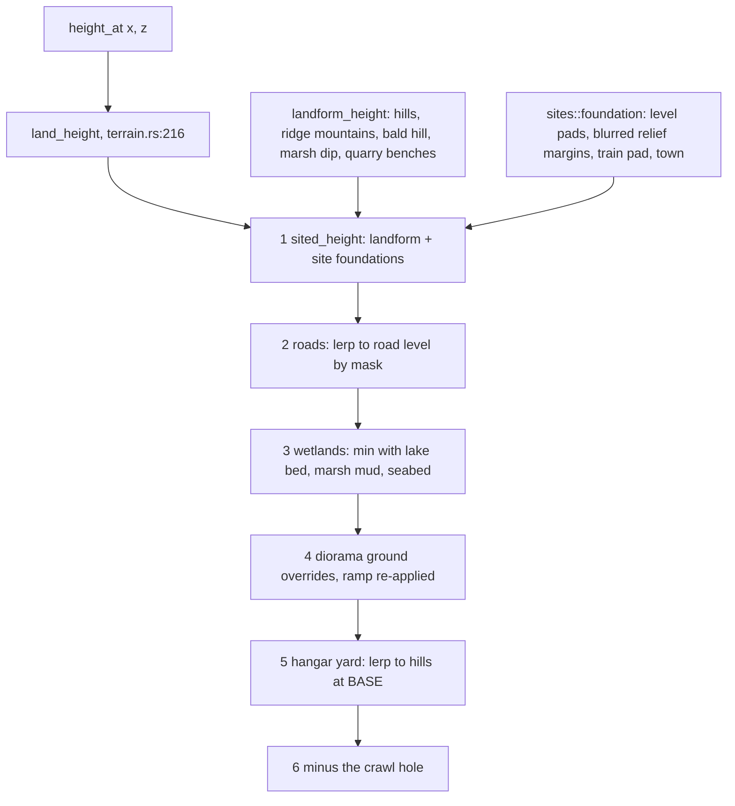

`land_height` (`terrain.rs:216-242`), in order:

1. **`sited_height`** (`:514`): `landform_height` (`:524-552`, regional hills x
   lowland, the Zone's mountains, frontier relief, the bald hill gaussian, the
   marsh dip, the quarry's benches, lip and floor noise) lerped toward
   `sites::foundation` (`sites.rs:868`) by the foundation's weight.
2. **Roads**: `h = lerp(h, road.height, road.mask())` (`:221-224`).
3. **Wetlands**: `Wetlands::soil_height` takes the minimum with the lake bed,
   marsh mud and coast seabed (`:225`, `hydrology.rs:25-29`).
4. **Dioramas**: `sites::diorama_ground` overrides `h` outright inside a scan
   that carries its own ground, so roads and water vanish there; only a `Ramp`
   sample is applied again on top (`:226-233`). "A diorama's own ground hides
   every road but a ramp, which is cut into it (or built up on it)" (`:226-229`).
5. **Yard**: `lerp(h, hills(BASE), base_mask)` (`:236-239`).
6. **Crawl hole**: minus `cordon::hole_depth` (`:241`).

**Why roads are graded over `sited_height` and not `land_height`.** The road
levels are baked once, in `RoadNetwork::new`, from the landform plus the
foundations (`terrain.rs:105, 512-513`). A spur therefore meets a building pad
or a diorama's front edge exactly, and the road never sees the wetlands, the
dioramas or the yard, which come after it in the stack.

### 5.3 Which query to use

| Query | Where | Answers | Use it for |
|---|---|---|---|
| `height_at(x, z)` | `terrain.rs:112, 211` | The analytic surface | Building other fields, scatter, tests |
| `mesh_height_at(at)` | `:117` | The rendered triangles: 2 m inside 1,792 m, 8 m or 16 m beyond, with the same anti-diagonal split as the index buffer (`[a, c, b, b, c, d]`, `:383`) and the same edge stitching (`vertex_height`, `:151`) | Feet, wheels, clicks, the camera, pads, the cut images |
| `water_depth_at(x, z)` | `:180` | `Wetlands::depth(land_height)`, clamped at 0 | Walking, driving, routes, scatter |
| `can_wade(from, to, depth)` | | Whether a move stays in shallow enough water | `move_player`, vehicles |
| `normal_at(x, z)` | `:256` | Central difference, e = 0.25 m | Slope tests, grounding |
| `mesh_patch(box)` → `MeshPatch` | `:189, 407-474` | The 2 m vertices of a box once; `grade_at` (`:416`) is the slope of the triangle under a point, `steep_rims` (`:427`) the steep triangles bordering gentle ones | The route planner's per-mover grade limits |
| `woodland_at`, `surface_weights_at` | `:266, 292` | Masks from roads, base, quarry, ash and slope | Vegetation, terrain vertex colours |
| `road_mask` | | The road's blend at a point | Exposure, grading, clearances |

**Why `mesh_height_at` exists.** The movers stand on the rendered mesh, and
`height_at` between its vertices misses where a triangle spans a bank's foot,
by up to 4 m (`doc/world-reference.md:57-58`). The ramp cut follows it for the
same reason: `height_at` differs by up to 0.11 m on the bed and by metres on the
banks (`doc/world-reference.md:476-480`).

### 5.4 Tiles and LODs

```text
Playable world   3,440 m square (HALF_SIZE 1,720)          terrain.rs:15-17
Ground tile      128 m, 64 cells, 2 m spacing              terrain.rs:19-22
Playable tiles   -14..14 (TILE_RADIUS 14)                  terrain.rs:20
Scenic tiles     -16..16 at 8 m (DISTANT_SPACING)          terrain.rs:23, 27
Horizon tiles    512 m at 16 m, -9..9 minus the inner block terrain.rs:24-28
Detail radius    2 tiles around each anchor                landscape.rs:46
```

`build_grid(grid)` (`terrain.rs:322-396`) turns a `TerrainGrid`
(`detail`/`distant`/`horizon`, `:30-61`) into a mesh:

1. sample a (cells+3)² halo (`:328-339`);
2. call `stitched_sample` per vertex (`:157`): on a tile edge between coarse
   vertices (`edge_segment`, `:477`) it interpolates the coarser neighbour's two
   vertices, for height and for water depth, marsh and flow;
3. normals from the halo; edge vertices of coarse tiles use 2 m differences, so
   every LOD agrees on the seam (`:353-360`);
4. vertex colours `[exposed, wetness, ash, variation]` from
   `surface_weights_at` (`:371`), "shader data, not a tint" (`:291`);
5. `u16` indices, so a grid may not exceed 255 cells a side.

**Why stitch.** "A shared lattice and normal halo make neighboring chunks meet
exactly" (`:321`); "intermediate land and water vertices share the straight
segments of the coarser tile" (`:476`). The cost: near tiles stitch their edges
at 8 m, so a narrow road in a deep cut or fill dips where it crosses a tile
edge. Keep pits and steep relief back from roads.

### 5.5 Building and streaming the landscape

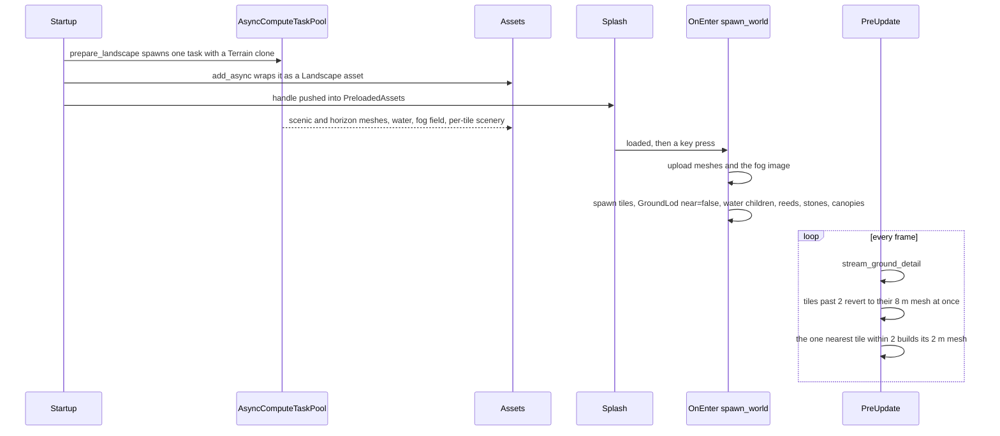

1. `prepare_landscape` (`landscape.rs:120`) spawns one sequential task
   (`:127`):
   - scenic tiles -16..16 at 8 m: `build_grid(distant)`, `fog.add_tile`
     (`:136`), and for the playable tiles `scenery::build_tile` (sites,
     reeds, stones) and `water::build_tile` (`:131-155`);
   - horizon tiles (`:157-175`).
2. `server.add_async(...)` (`:184`) wraps the task as a `Landscape` asset
   (`:108-115`); its handle goes into `PreloadedAssets` (`:185`), so the splash
   waits for it like a file (inferred: that is why it is an asset at all).
3. `spawn_world` (`world/mod.rs:405`) calls `landscape.upload`
   (`landscape.rs:190`), inserts `GroundFogField` (`world/mod.rs:417`) and
   `Scenery`, and spawns everything under one `WorldRoot` (`landscape.rs:206`).
   Ground tiles are `NotShadowCaster` while they show the distant mesh.
4. `stream_ground_detail` (`landscape.rs:50-88`) swaps **one** tile per frame
   to its 2 m mesh, nearest an anchor first, building it synchronously; tiles
   leaving the radius revert at once to their cached distant handles. "New
   ones switch one per frame, nearest an anchor first, since each mesh is built
   on this thread" (`:48-49`). That change took a walk's worst frame from 180 to
   23 ms on the RTX 2060 (commit `374be19`).

**Anchors.** `StreamAnchor` (`world/mod.rs:275`) is on the stalker (required by
`Player`) and on the camera's `Ears` while zoomed under `DETAIL_ZOOM` 250 m
(`player/camera.rs:35, 316-322`). `anchor_tiles`, `neighborhoods` and
`anchor_distance` (`world/mod.rs:283-318`) are the shared helpers every streamer
uses. `ViewFocus` is on `Ears` and is what the fog layers follow.

### 5.6 Water

`water::build_tile` (`water.rs:69`) clips each ground triangle against depth 0
and fan-triangulates the wet part, all at `WATER_LEVEL` -3.0
(`hydrology.rs:9`). The vertex colour carries `[depth, marsh, flow.x, flow.y]`
(`water.rs:110`), which `water.wesl` turns into three ripple layers, a depth
tint, foam and a Fresnel alpha (`water.wesl:27-43`). "Clip the flat surface
against the same triangles that draw the riverbed" (`water.rs:68`), so the shore
line is exactly the mesh's. There is no river: the water is the marsh pools, the
eastern lake basin and the sea beyond the map edges (`hydrology.rs:1-3`).

### 5.7 Roads

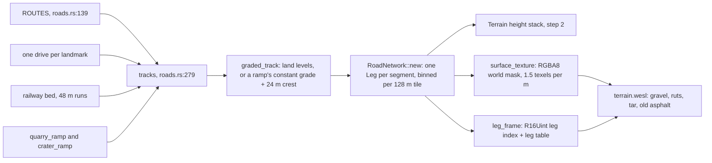

- **`tracks()`** (`roads.rs:279-295`) gathers `ROUTES` (`:139-217`), a drive to
  each landmark's junction (except the Quarry's and the Golden Sphere's,
  `:285`), the railway bed (`:266`) and the two `Ramp` tracks (`:291-292`).
- **`graded_track`** (`:379-431`) takes the land's level at each vertex. A ramp
  instead falls at one constant grade from its entrance (its second point) to
  its last point, with a 24 m parabola (`CREST_LENGTH`, 1 m steps) rounding the
  break. Left sharp, "it launches a car at full throttle off the entrance"
  (`:373-378`).
- **`RoadNetwork::new`** (`:434-483`) makes one `Leg` per segment (start,
  direction, length, two levels, `Surface`, box padded by the shoulder) and
  files it in every 128 m tile its box touches. `sample_legs` (`:493-514`)
  picks the leg with the smallest `distance / shoulder`.
- **`Surface`** (`:73-87`): `Dirt`, `Asphalt` (the old broken roads), `Street`
  (New Harmont), `Ballast` (the rail bed), `Ramp` (a pit's haul road), each
  with its bed half-width and shoulder.
- **The mask** (`surface_texture`, `:545-561`) is one world-space `Rgba8Unorm`
  image over the network's bounds; town plaza texels are forced to tar
  (`:543-546`). "A world-space mask keeps the same road width across coarse and
  fine terrain tiles" (`:516-517`). `mask_grid` (`:518`) and `each_texel` (`:525`)
  give the mask and the leg frame one grid (`MASK_TEXELS_PER_METRE`, 1.5).
- **The leg frame** (`leg_frame`, `:568`) lays the Zone's old road kit along
  the roads. Every `Asphalt` leg is also listed in `asphalt` (`:319`), with its
  `route` distance from the start of its track (`:303`) and `id`, 1 + its row
  (`:305`; 0 is no leg). It returns an `R16Uint` image naming the nearest
  asphalt leg within its shoulder per mask texel, and an `Rgba32Float` table,
  2 x N texels: (start, direction) and (length, route). The shader compares the
  texel's leg with its route neighbours (`continues`: the next leg's route is
  this one's plus its length) so the strip's along coordinate runs on unbroken
  across a bend. Tests: `leg_frame_marks_asphalt_and_nothing_else`,
  `leg_route_distance_is_continuous_across_a_bend`,
  `leg_index_names_the_nearer_leg_at_a_fork`.

| Surface | R gravel | G ruts | B tar | A old asphalt |
|---|---|---|---|---|
| Dirt | `smoothstep(7.5, 4.6, d)` | `ruts(d)` | 0 | 0 |
| Ramp | `smoothstep(4.2, 2.8, d)` | `ruts(d)` | 0 | 0 |
| Asphalt / Street | `smoothstep(8.2, 6.2, d)` | 0 | `smoothstep(6.4, 5.4, d)` | B for Asphalt, 0 for Street |
| Ballast | `smoothstep(4.4, 2.6, d)` | 0 | 0 | 0 |

**Invariants.** A road leg must join a real route vertex, keep under the grade
and water limits tested in `roads.rs`, and avoid site pads. Crossing routes with
different end levels make the nearest leg win abruptly; prefer a turnout.

### 5.8 The terrain shader

`TerrainMaterial` is `ExtendedMaterial<StandardMaterial, GroundLayers>`
(`terrain_material.rs:27-74`). Bindings: grass maps 100/102/103 (101 the shared
sampler), earth 104-106, the road mask 107, its bounds 108, the fog settings
109, asphalt 110-113, rock 114-116, the old road kit's albedo, normal and
height 117-119, the leg index 120 (`u_int`), the leg table 121 (unfilterable
float) and the old road band 122 (`old_road_band`, `terrain_material.rs:130`:
where the band starts and ends in x, the strip's period and width). The base
material has `fog_enabled: false`
(`:96-97`): the shader applies distance fog itself.

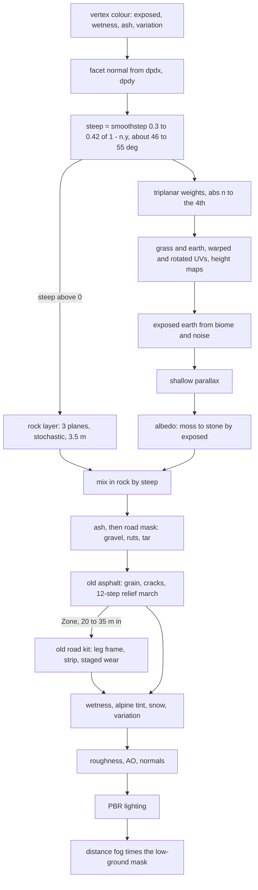

The fragment (`terrain.wesl:524-673`):

1. **Slope.** A facet normal from screen derivatives (`:536-539`) decides
   `steep` (`:540`); the projection normal blends toward the facet by `steep`
   but keeps the smooth heading (`:541-545`). Lighting keeps the smooth normal:
   "lit by the facets, the ground would show its triangles" (`:534-535`).
2. **Rock** (`rock_layer`, `:549-551`) only where steep, gated on the smooth
   slope: "a facet's own slope would be sharper but flips triangle by triangle
   on rough hillsides, a checkerboard of rock" (`:84-86`). Triplanar so quarry
   walls do not stretch (`:494`).
3. **Grass and earth** (`:553-584`) with patch-noise warp, two rotations, a
   parallax slide and a moss-to-stone mix by exposure.
4. **Roads** (`:587-614`): the world mask at the fragment's xz; old asphalt is
   a stochastic grain, crack decals and a 12-step relief march. In the Zone
   `old_road_wear` (`terrain.wesl:269`) rises from 0 at 20 m inside the
   Perimeter to 1 at 35 m, and `old_road` (`:414`) paints the retired road
   kit there: `old_road_legs` (`:311`) picks the texel's leg or a route
   neighbour by the side of the bend's bisector a point lies on
   (`past_bend`, `:306`) and blends their frames within `OLD_ROAD_BEND` of it,
   `strip_uv` (`:362`) maps across and along the road into the strip (with
   explicit gradients, so the modulo seam keeps its mip), `kit_hit` (`:400`)
   takes one parallax step near the camera, and two-octave noise under the
   wear lets the kit in, low spots first. Its gaps show the bare ground;
   today's grain modulates it only under 16 mm per pixel. One parallax step
   instead of a march: it looked the same in the playtest for one fetch.
5. **Climate** (`:615-621`): wetness darkening, alpine tint from 32 to 100 m,
   snow above `112 + noise x 29 + (1 - n.y) x 72`.
6. **Surface** (`:624-650`): roughness, AO and normals mixed the same way;
   roads flatten the ground normal.
7. **Fog** (`:652-671`): Bevy's `apply_fog` mixed in by
   `low_ground = 1 - smoothstep(fog_top - 0.7 x height, fog_top, p.y)`.
   `fog_top`/`fog_height` come from `follow_terrain_fog` (`ground_fog.rs:138-153`),
   written only on a change of 0.25 or more (`terrain_material.rs:148-152`).

**Why a masked distance fog.** It rolls the low ground into a cloud shelf while
the ridges stay crisp; re-enabling the material's own fog bypasses the mask and
washes the ridges out. `map_mean` reads each map's 1x1 mip, so "no per-map
constant has to be kept in step with the bake" (`:187-189`).

### 5.9 The pit roads and the cut scans

The Quarry rim and the Golden Sphere's crater are photogrammetry dioramas whose
stone fills the pits. Their haul roads are cut into them without editing either
scan.

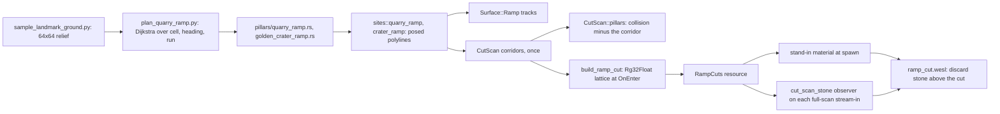

1. **Bake, offline.** `tools/plan_quarry_ramp.py` runs a Dijkstra over (cell,
   heading, distance bucket, steps since a turn), refuses grades above
   `--grade`, turns tighter than 9 m and clearances under the shoulder, rounds
   corners into 9.5 m arcs and resamples every 3 m
   (`plan_quarry_ramp.py:108, 127-128, 629-660`). The path is "baked here once,
   not searched at every load" (`:3-5`). The output is model-space
   `&[Vec2]` in `pillars/quarry_ramp.rs` and `golden_crater_ramp.rs`.
2. **Pose.** `sites::quarry_ramp()` (`sites.rs:789`) is the junction, the
   entrance, then the baked points; `crater_ramp()` (`:800`) starts where the
   quarry ramp ends, then the Sphere's junction and entrance, then the spiral.
3. **Road.** Both are `Surface::Ramp` tracks, re-applied over the diorama
   ground (`terrain.rs:230-232`).
4. **Collision.** `CORRIDORS` (`quarry_ramp.rs:27`) is every ramp leg within
   18 m of a scan's footprint; `PILLARS` (`:45`) drops the scan's pillars within
   9 m of a centerline (`in_cut_corridor`, `:78`); `Landmark::solids`
   (`sites.rs:580-582`) serves those. "The collision and the cut share this
   rule" (`quarry_ramp.rs:76-80`).
5. **Cut image.** `prepare_ramp_cut` (OnEnter, `ramp_cut.rs:100`), chained
   before `spawn_sites` (`world/mod.rs:165`), builds a 0.5 m `Rg32Float` lattice
   per scan (`build_ramp_cut`, `:122-158`): red is `mesh_height_at - BURY`
   (0.1 m) near the corridor, else `UNCUT`; green is the signed distance past
   the corridor's edge. It is built at entry rather than baked because it
   "follow[s] `Terrain`" and a bake would need a re-run on every terrain change
   (`:97-99`).
6. **Material.** `RampCutMaterial` wraps the scan's own `StandardMaterial`. The
   stand-in gets it at spawn (`sites.rs:964-968`); the full scan gets it in
   `cut_scan_stone` (`ramp_cut.rs:185-208`), an observer on its
   `WorldInstanceReady`, on **every** stream-in, because "handles cached
   elsewhere would keep the scan's textures in video memory" (`:180-184`).
7. **Shader.** `ramp_cut.wesl:34-56` reads the lattice with `textureLoad`,
   interpolates on the ground mesh's own triangle split and discards where green
   < 0 and the fragment lies above red. `AlphaMode::Mask` makes the shadow pass
   run it too, "shadow maps run a fragment shader only for materials that may
   discard" (`ramp_cut.rs:72-76`), so the road is lit, not shadowed by stone that
   is not drawn.

**Limits.** Only the main and depth-only pipelines are supported; a normal or
motion-vector prepass (TAA) would need the shader extended
(`ramp_cut.wesl:6-8`). `TEXEL` must divide `SPACING` (compile-time assert,
`ramp_cut.rs:33-36`). The corridor statics derive from the baked path and the
site poses, not from `Terrain`.

### 5.10 Survey, fog of war and the map

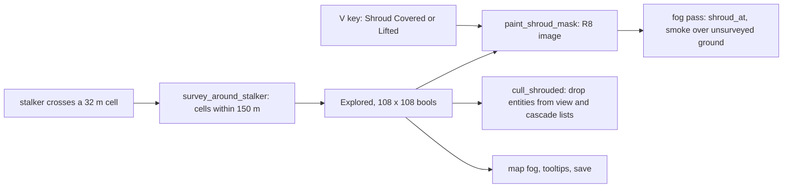

- `survey_around_stalker` (`places.rs:259-274`, Running) re-surveys when the
  stalker enters a new 32 m cell; `Explored::survey` (`:237`) marks cells
  within `SURVEY_RANGE` 150 m.
- `paint_shroud_mask` (`shroud.rs:114-136`, InGame, also while paused) repaints
  the R8 mask only when `Explored` or the `Shroud` state changed.
- The fog pass draws the smoke (section 8.4). Drawing it there, after
  `render_sky`'s aerial perspective, keeps it black from any height
  (`shroud.rs:3-6`).
- `cull_shrouded` (`shroud.rs:163-193`, PostUpdate after visibility and light
  visibility checks) removes an entity from the views' and the sun cascades'
  visible lists when all five probe points of its `Aabb` (centre and four
  corners at `min(radius, 64) x 0.7`) are unsurveyed. Terrain and water are
  exempt, because their "depth tells the fog pass where to draw the smoke"
  (`:154-155`); `NoFrustumCulling` entities and entities without an `Aabb`
  are never culled.
- `map(px, py)` (`map.rs:16-21`) is `((705 - px) x 2.4, (383 - py) x 2.4)`:
  the image's right is world -X, so the Zone lies to the right of the
  Perimeter as on the reference map.
- `place_at` (`places.rs:84-124`) names the ground: hangar, checkpoints,
  sites, water, yard, town, then landforms; `structure_on_ray` (`:128`) tests
  site cylinders and the hall box.

## 6. Things on the ground: scenery, vegetation, sites, collision, the Golden Sphere

There is no plugin per module here: every system below is registered in
`WorldPlugin::build` (`world/mod.rs:111-265`); the `add_systems` calls inside the
files are all in tests.

### 6.1 What is always there and what streams

| Kind | Lifetime | Anchor | Code |
|---|---|---|---|
| Terrain tiles, water, reed and rock batches, tree crown cards | Whole run, spawned at entry | Range and frustum culling only | `landscape.rs:206-258`, `canopy.rs:378` |
| Site stand-ins (`low/`), town, railway, marsh and rock props, hangar | Whole run | Always drawn until a full scan hides a stand-in | `sites.rs:939`, `town.rs`, `railway.rs`, `marsh.rs`, `rocks.rs`, `base.rs:132` |
| Tree trunk, rock, site and town colliders; vegetation clusters; plants | Per 128 m tile, 3x3 around each anchor | `StreamAnchor` | `scenery.rs:217-283` |
| Ground 2 m meshes | Radius 2 tiles | `StreamAnchor` | `landscape.rs:50-88` |
| Cordon wall drawn chunks | Within 800 m | `PlayerCamera` | `cordon.rs:882` |
| Cordon wall collision posts | 2 tiles | `StreamAnchor` | `cordon.rs:906` |
| Full site scans | 150 m reach, kept to +60 m | `StreamAnchor` | `sites.rs:1010` |
| Full tree scans | 16 m load, 21 m drop | `PlayerCamera` | `canopy.rs:426` |
| Full plant scans | nearest within 8 m, asked within 40 m | `Player` | `plants.rs:671` |
| Full artifact scenes | nearest table within 8 m | `Player` | `base/artifacts.rs:328` |
| The Golden Sphere's UHD scan (exceptional GPUs only) | 40 m shown, asked within 80 m | `StreamAnchor` | `golden_sphere/uhd.rs:65` |

**Why visuals are global and collision is local.** "Solid pillars are installed
only near the player" (`scenery.rs:1-3`); nothing else touches a collider. The
visual batches are cheap to keep (one entity per batch) and must be visible from
the tactical camera's 4.6 km zoom, so they are left to culling. The table also
shows that the streamers do **not** share one anchor; check which one a new
streamer should follow.

### 6.2 Tile streaming

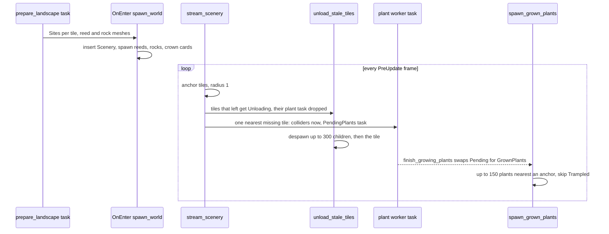

1. **Layout, once.** In the landscape task, `scenery::build_tile`
   (`scenery.rs:184`) works out each playable tile's canopies (belt trees plus
   tree spots), rock sites and undergrowth (`:186-201`). The result lives in
   `Scenery.sites` for the whole run (`Scenery`, `:78`).
2. **`stream_scenery`** (`:217`, PreUpdate, InGame) marks tiles outside every
   anchor's 3x3 `Unloading` and strips their `PendingPlants`/`GrownPlants`
   (dropping a task cancels it, `:232-241`), then spawns **one** missing tile,
   nearest first (`:242-245`). Its children are spawned immediately by
   `spawn_tile_objects` (`:283`): rock colliders, tree trunks (`Collider`,
   `Weight`, `StandingTree`), vegetation clusters (`trees::spawn_trees`), site
   colliders (`sites::spawn_solids`, `sites.rs:1084`) and town colliders. It
   hands workers one shared `Arc<Terrain>` (`:222-248`).
3. **`unload_stale_tiles`** (`:263`) despawns 300 children a frame from the
   tail, then the tile (`UNLOADS_PER_FRAME`, `:207`).
4. **Plants** grow on the async pool, "grown on a worker thread so streaming
   never stalls a frame" (`plants.rs:517`). `finish_growing_plants` (`:562`)
   polls; `spawn_grown_plants` (`:582`) spawns `PLANTS_PER_FRAME` 150 a frame,
   nearest an anchor first, skipping trampled spots; `note_growing_plants`
   (`:557`) publishes `PlantsGrowing` for the curtain.

**Why the caps.** "A tile holds thousands of plants, so a crossing that loaded
or unloaded a whole row at once stalled the frame" (`scenery.rs:213-216`), in
Bevy's per-entity material and visibility bookkeeping (`plants.rs:51-52`): 100+
ms to spawn a tile's plants, 20+ ms to despawn them. With the caps a walk's
worst frame fell from 180 to 23 ms and a drive's from 160 to 41 ms (commit
`374be19`).

### 6.3 Plants

```text
near entity   medium/ mesh, textured     0-30 m (+6 m fade)
far child     low/ mesh, same material   30-66 m (+10 m fade) + 75 m strategy reach
full scan     uhd/ scene via GpuScans    the one nearest plant within 8 m
```

- `prepare_plant_looks` (`plants.rs:187`, OnEnter) makes one `PlantMaterial`
  per model (`ExtendedMaterial<StandardMaterial, PlantWind>`, `:105`) and
  measures every mesh's `Aabb` once (`:196, 212-213`). `spawn_plants`
  (`:612`) inserts `Aabb` + `NoAutoAabb` (`:646-650`), because the meshes "keep
  their CPU copy, so Bevy would rescan every vertex for each new plant"
  (`:134-135`).
- **Instancing.** "Plants sharing a model are drawn as one GPU instance batch"
  (`:611`); rocks and marsh props use the same trick.
- **Wind** (`bend_plants`, `:233`) writes two `vec4`s, the wind now and a
  frame ago, into a `ShaderBuffer` every plant material shares (binding 100,
  `:114`); it runs while paused too, so the plants' motion settles. The
  material's `prepass_vertex_shader` is `plant_wind.wesl` as well: a
  motion-vector prepass (dormant: none runs today) bends each vertex again with last frame's wind
  for `previous_world_position`, so the upscaler does not smear the sway. `plant_wind.wesl` moves
  each vertex by its height above the instance origin (`flex`, line 24), so
  roots stay put and tips bend most. **Why a buffer:** "rewriting it each frame
  leaves the materials unchanged, where changing a material would re-specialize
  every plant drawn with it" (`:107-109`), which once cut 26 FPS to 7.
- **Full scan** (`stream_full_plants`, `:671`; `want_plant_scans`, `:718`)
  asks `GpuScans` for plants within 40 m (at distance - 8), spawns the nearest
  one's scene hidden as a child of its tile, and `reveal_full_plant` (`:748`)
  swaps it in. `sway_full_plants` (`:242`) rotates that scene about its root,
  since it keeps the scan's own materials.

### 6.4 Trees

- **Three species, pinned.** `pin_tree_scans` (`canopy.rs:345`) pins Small,
  Birch and Dead so "they load first, the entry curtain waits for them, and no
  other scan makes them leave the GPU" (`:343-344`).
- **Crown cards** are global `Mesh3d` entities with `CanopyVisual`
  (`:285, 386-393`). `update_canopy_motion` (`:492`, every canopy every frame)
  toggles shadows with 48/55 m hysteresis and leans and stirs the crown with the
  `Wind`.
- **Close scans** (`stream_close_trees`, `:426`) are wanted within 16 m of the
  camera, spawned hidden as a child of the tree, crossfaded in by
  `reveal_close_tree` (`:477`), dropped past 21 m or when the scan leaves the
  GPU (`:447-453`). As a child the scan sways and falls with the tree.
- **Weight.** `ForestTree::weight` is `density x scale^3` (`:241`); the test
  `the_stalker_fells_no_tree_and_a_car_fells_every_one` (`:525`) pins every
  tree between 90 kg and 12 t.

**A tree falls** (`tree_fall.rs`):

1. a `TreeBreak` comes from `pick_tree_to_break` (`:54`, every 9-23 s, a tree
   7-52 m away inside the camera's forward cone, falling away from the hangar)
   or from `knock_down_light_solids` (a heavier crusher touched it);
2. `break_selected_trees` (`:104`) finds the crown card by exact translation
   (`:118-127`), swaps `CanopyVisual` for `FallingTree`, **removes the tree from
   `Scenery.sites`** so it never respawns when the tile streams back (`:132`,
   test `a_fallen_tree_falls_and_stays_gone_across_chunk_reload`, `:224`) and
   despawns the trunk collider;
3. `animate_falling_trees` (`:188`) swings it down over 1.65 s, settles 0.9 s,
   sinks 0.55 s and despawns it.

### 6.5 Collision

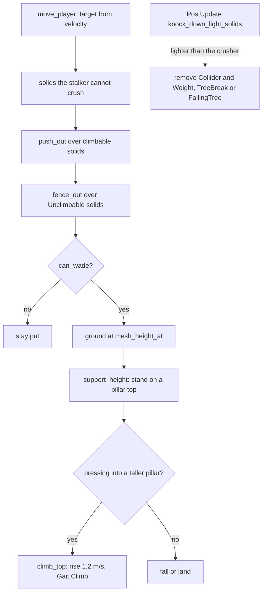

| Type | Where | Meaning |
|---|---|---|
| `Pillar { x, z, radius, bottom, top }` | `collision.rs:19` | Upright cylinder in the collider's local space; x/z/radius scale with the transform's x/z, bottom/top with y |
| `Collider(&'static [Pillar])` | `:42` | A static slice posed by `GlobalTransform`; `lift_booms` swaps the slice (`cordon.rs:690-692`) |
| `Weight(f32)` | `:48` | Kilograms; a collider without it is anchored |
| `Crusher { mass, half_size }` | `:59` | `blocked_by(weight)` (`:66`): blocked by no weight or a weight at or above the mass; `reaches` (`:72`): oriented box vs circle |
| `Unclimbable` | `:53` | `fence_out` blocks it at any height unless the body fits under its bottom |
| `Body { radius, height }` | `:86` | Stalker 0.35 x 1.8 standing, 0.35 x 0.5 prone |
| `STEP_HEIGHT` | `:15` | 0.4 m |

- `push_out` (`:107`) ignores a pillar whose top is within a step of the feet
  or whose bottom is above the head, otherwise pushes the point out to
  `radius x scale.x + body.radius` (`separate`, `:189`).
- `fence_out` (`:129`) ignores a fence only when the body fits under it; that
  is how a prone stalker crawls through the cordon's hole (its pillar bottom is
  -0.05 m, `cordon.rs:165-171`).
- `support_height` (`:139`) and `climb_top` (`:181`, a pillar ahead within ~45
  deg of travel) let the stalker stand on and climb solids.
- Vehicles use a yaw-rotated hull box against pillar discs (`hull_blocked`,
  `vehicle.rs:873-899`); route planning grows pillars by the mover's radius
  (section 7.3).

**Crushing** (`crush.rs`): `trample_plants` (`:39`) despawns plants under a
crusher's footprint within 2 m vertically and records them in `Trampled` to the
decimetre, "so a streamed tile grows back without them" (`:19-27`).
`knock_down_light_solids` (`:73`) removes `Collider` and `Weight` on first
touch, so nothing is knocked twice (`:88`), then sends `TreeBreak` for a tree or
inserts `FallingTree::knocked` (`tree_fall.rs:164`): slender props (over 3x as
tall as wide) topple, squat ones only sink.

**Why pillars instead of a physics crate.** The world is static except for a
handful of movers; upright cylinders answer the only questions asked (block,
step over, pass under, stand on, climb, crush) with no simulation step,
determinism issues or extra compile time (`collision.rs:1-3`, CLAUDE.md). The
limit is that pitch and roll are not folded into `bottom`/`top`: a strongly
tilted solid needs a conservative upright footprint.

**Generated data.** `src/world/pillars/` holds 75 generated files (~50k lines,
`// Generated by tools/... do not edit`): `tools/trim_tree_base.py` samples a
joined mesh into pillars (`--split-columns` for roofs and open bays);
`tools/sample_landmark_ground.py` bins a scan into columns split at vertical
gaps and, for a diorama, opens its top surface into a 64x64 relief;
`tools/plan_quarry_ramp.py` bakes the pit roads.

### 6.6 Sites

`sites.rs` is a registry, not an entity type per site:

- `Kind` (24 variants, `:31`) indexes `MODELS` (`:233`); a `Model` (`:123`)
  holds the UHD and `low/` paths, scale, `widen`, `Ground`, half extents, top,
  `Front` and the pillar slice (`include!`d by the `model!` macro, `:205`).
- `Ground::Level(datum)` for buildings, `Ground::Relief(&Relief)` for dioramas
  that carry their own land (`:67-103`, a 64x64 bilinear grid with a blurred
  margin).
- `LANDMARKS: [Landmark; 32]` (`:711`) place them by map pixel with a road
  junction; `Landmark::pose` (`:638-642`) turns each toward its road.
- The same placements feed the terrain (`foundation`, `diorama_ground`),
  vegetation clearance (`clear_footprint`, `grove`) and the road drives.

```text
sites::LANDMARKS
  -> RoadNetwork::new (drives, junction levels)
  -> Terrain height stack (pads, reliefs)
  -> road mask texture
  -> vegetation masks
  -> stand-in + full scan
  -> streamed collider tile
  -> road, pad and placement tests
```

The full-scan swap:

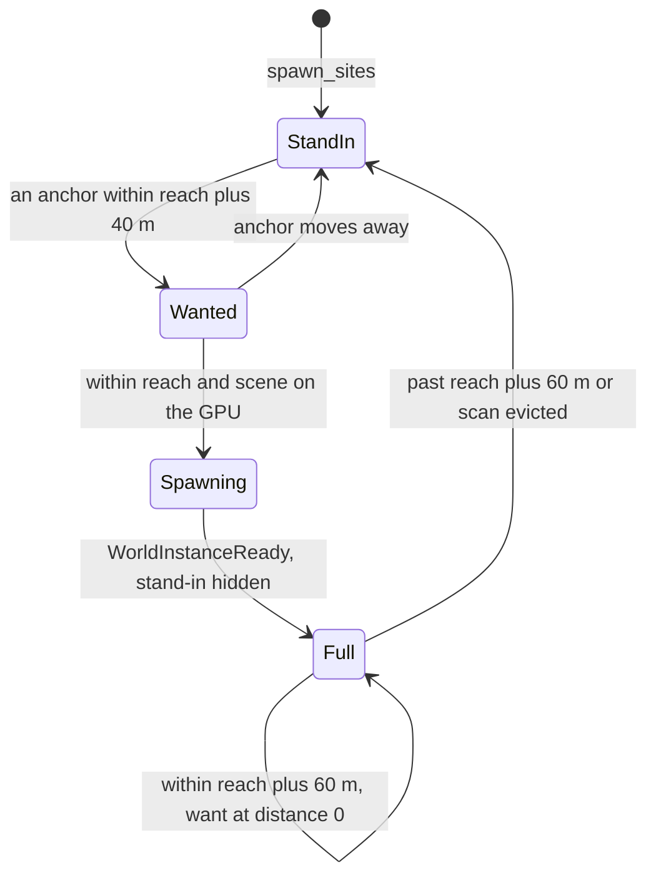

`stream_full_sites` (`sites.rs:1010`, PreUpdate, InGame) with `reach = radius +
FULL_SCAN_RANGE 150`:

- asks `scans.want(path, distance)` from 40 m before reach, and at distance 0
  while shown so the scan counts as on screen (`:1028-1033`);
- spawns a hidden `FullSite` + `WorldAssetRoot` child once `scene()` is `Some`,
  with `RampCutScan` and the `cut_scan_stone` observer for the two cut scans
  (`:1035-1047`); `reveal_full_site` (`:1067`) shows it and hides the stand-in;
- despawns it past `reach + FULL_SCAN_KEEP 60` or when the scan is gone,
  because "dropping the instance releases its hold on the scan's GPU copy, which
  an evicted scan frees only then" (`:1049-1050`).

Sites sharing one scan spawn their own instances; `want` keeps the smallest
distance (`gpu_scans.rs:342-348`). Site colliders belong to the tile holding the
site's centre (`sites.rs:1086`).

**Stand-ins are never grounded or recentred**: both files must share the scan's
model space, or the swap jumps.

### 6.7 Cordons

- `prepare_cordon` (`cordon.rs:523`) cuts the yard wall, the map edge and the
  two Perimeter runs into ~7.4 m panels filed per tile (`wall_chunks`, `:808`).
- `stream_wall_view` (`:882`) builds **one** drawn chunk per frame within
  `VIEW_TILES` 7 of the player's camera, nearest first; `spawn_wall_chunk` (`:965`) shears
  the baked box, razor wire and sandbags onto the ground (`WallModel::batch`,
  `:1119`). "The shear depends on each panel's ground, so it stays at runtime"
  (`:1117-1118`): the documented exception to "precalculate once", since baked
  tangents would not follow sheared faces. A chunk costs up to ~4 ms; drawn to
  800 m (`:837-839`).
- `stream_wall_solids` (`:906`) spawns `Collider + Unclimbable` posts every
  0.77 m within 2 tiles of an anchor (`WALL_PILLAR`, the 3x taller
  `PERIMETER_PILLAR`, or `HOLE_PILLAR` over the crawl hole).
- `show_with_wall` (`:949`) hides anything `OnWall` (the guns) whose chunk is
  not drawn.
- **Booms** (`lift_booms`, `:665`) open for an `InstitutePass` holder within
  40 m (the Institute gate) or the stalker (the yard gate, or leaving the Zone),
  and swap their collider to an empty slice once lifted past 0.7. The lowered
  arm starts below ground "so nobody crawls under it" (`:180`).

### 6.8 The hangar

- **Cutaway** (`base/cutaway.rs`, `cutaway.wesl`). `update_cutaway` (`:107`)
  cuts the roof at hall height + 6.5 m when the camera is within 120 m and the
  focus or eye is over the hall, hides `RoofFixture`s, and writes the material
  only on a change (`:145-151`). The shader discards above the cut, sorts
  fragments by normal into floor and wall, paints plates, walkway lines, the
  car's bay, the door band and grate on the floor and steel-grey paint on the
  walls, and computes every branch so `fwidth` stays in uniform control flow
  (`cutaway.wesl:92-153`). Only the main and deferred passes cut: "shadows still
  use the whole shell, keeping the hall dim" (`cutaway.rs:2-3`).
- **Props** (`base/props.rs:14`): hangar-local position, yaw, scale and
  hand-measured pillars.
- **Artifact showcase** (`base/artifacts.rs`): 14 pedestals at `TABLE_Z` with a
  collider, spotlight and `Describe`; `stream_full_artifacts` (`:328`) keeps one
  full scene within 8 m; `animate_artifacts` (`:429`) poses both tiers from
  `ArtifactIdle`. Today `ARTIFACTS` and `ARTIFACT_PREVIEWS` name the same
  `medium/` files, so the swap reloads the same model.

### 6.9 The Golden Sphere

Unlike the rest of this section, the Sphere has its own plugin,
`GoldenSpherePlugin` (`golden_sphere.rs:115`, added in `WorldPlugin::build`). It
owns a `GoldenSphere` entity with a mesh child (the medium preview model), a
`FerrofluidPool` disc under it and, on strong and exceptional GPUs, six probe
cameras. The numbers are in `doc/world-reference.md`.

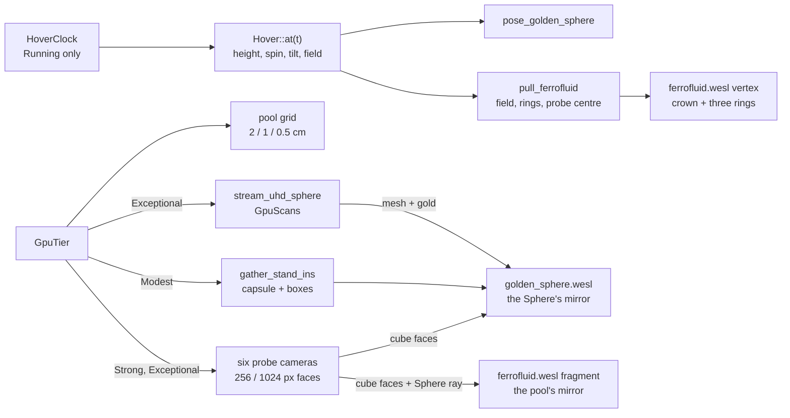

**One clock, one pose.** `Hover::at(seconds)` (`:70`) is a pure function of the
seconds the Sphere has hovered: its height (`HOVER` 2.25 m less `BOB` 0.15 m
times a cosine over `BOB_SECONDS` 7, so it starts at its lowest, 2.1 m), its
turn (`SPIN` 0.3 rad/s), its lean (`WOBBLE_DEGREES` 4, circling in
`WOBBLE_SECONDS` 23) and the field it puts on the pool. The field is a magnet's
cube law, scaled to 1 at the lowest point and `WEAKEST_FIELD` 1/3 at the
highest (`:72-77`). `HoverClock` (`:92`) counts `time.delta_secs()` in
`pose_golden_sphere`, which runs only while Running: "virtual time runs on
through the pause" (`:89-90`), so a clock taken from `Time<Virtual>`'s elapsed
time would jump on resume (`the_sphere_holds_still_while_paused`). The pose and
the pool's uniforms both come from the same `Hover`, so the spikes and the
Sphere cannot drift apart.

**Placement.** `golden_sphere_spot()` (`sites.rs:802`) turns the model-space
constant `SPHERE_POOL` (`:799`) through the core scan's pose. It was found once
(no tool is kept for it): the flattest floor within 20 m of the painted glow,
the pool's rim 3 m clear of the road's bed. The test
`the_golden_sphere_hovers_over_the_flattest_floor_clear_of_the_road` repeats that
search on a 0.5 m grid and fails if the floor at the constant rises more than
1 cm more across the pool than at the flattest spot it finds. Nothing is
searched at run time (precalculate once). `pool_level`
(`:156`) takes the highest `Terrain::mesh_height_at` over the disc plus `LIFT`
5 mm, "so the floor never shows through it", and `Ferrofluid::pool_mesh` bends
the disc's outer `RIM` 0.4 m down to the floor under it
(`ferrofluid.rs:144`, a smoothstep of `floor(at).min(0.0)`), so the pool meets
the ground with no lip. `POOL_SOLID` (`:107`) is one `Pillar` from 0.1 m under
the liquid to the Sphere's top (3.4 m), with `Unclimbable`: the stalker walks
round the pool and cannot pass under the Sphere. The glow painted in the core
scan's texture is still there, 14.7 m from the Sphere (an open follow-up).

**The spikes are made in the vertex shader.** The CPU builds a flat disc once and
sends four `vec4` uniforms (`field`, `shape`, `rings`, `flow`; `ferrofluid.rs:44`)
that change each frame; `pull_ferrofluid` (`:273`) writes only the ones that
move and leaves the six bound faces alone (`:282`). In `ferrofluid.wesl`:

- `crown` (`:187`) is a hexagonal lattice (`nearest_spike`, `:149`) turned by the
  Sphere's spin, each spike a concave cone (`cone`, `:171`) of foot radius half
  the 0.45 m spacing. Its height is the tallest spike's times a Gaussian of
  0.35 m sigma about the middle, gated by `smoothstep(CALM 0.15, RISEN 0.3,
  pull)` where `pull` is the field times that Gaussian: "like real ferrofluid,
  spikes stand only where the field passes a threshold", so the crown grows as
  the Sphere sinks (0.44 m out at the highest, 0.68 m at the lowest). The
  tallest spike is `SHORTEST_TALLEST` 1.0 m to `TALLEST` 1.4 m by the field
  (`Ferrofluid::under`, `ferrofluid.rs:81`), 0.2 m clear of the lowest Sphere's
  underside
  (test `the_central_spikes_stand_1_4_m_under_the_lowest_sphere_and_1_m_under_the_highest`).
- `small_ring` (`:201`) draws three rings of 12 small spikes, each ring's
  progress (0 to 1) in `rings.xyz`, staggered by a third. It returns at once
  for a point farther than `SMALL_FOOT` 0.09 m from the ring's radius, which
  keeps three rings cheap per vertex. A spike rises over the first 15% of its
  way in and sinks into the crown over the last 30%, and pulses on `rings.w`, the
  game seconds modulo `PULSE_WRAP` 60: each spike pulses `PULSES` 20 plus up to
  19 whole times in those 60 s, so the wrap never jumps.
- The slope of each cone is returned with its height, so the vertex stage tilts
  the normal analytically (`:256`) instead of recomputing normals.
- The shadow pass runs the same vertex function (`prepass_vertex_shader`,
  `ferrofluid.rs:187`; the `PREPASS_PIPELINE` branches). There `view` is the
  light's, so the fade by pixel size is skipped and `seen` stays 1: shadows keep
  every spike. `enable_prepass` is true (`ferrofluid.rs:230`): in a camera's
  motion-vector prepass (dormant: none runs today; a depth prepass without
  motion vectors would tear the pool) the vertex stage raises last frame's spikes too
  (`previous_field`, `previous_rings`, bindings 112-113) for
  `previous_world_position`. `pull_ferrofluid` keeps last frame's values
  (`Ferrofluid::follow`), and `hold_ferrofluid` (`golden_sphere.rs:339`) matches
  them while paused, so the still spikes report no motion.
- In the main view, `seen` (`:241`) is `smoothstep(3 px, 8 px, spacing in pixels)`
  from the pool's middle, so far spikes settle into smooth liquid instead of
  sparkling.
- The grid is the cost: `pool_mesh(level, ...)` steps 2 cm, 1 cm or 5 mm, so
  roughly 18 thousand, 71 thousand or 283 thousand vertices, each running the
  crown and the rings. The test holds the mean edge to 1.2 steps.
- The normals are area-weighted (`compute_area_weighted_normals`): Bevy 0.20's
  angle-weighted `compute_smooth_normals` drops a corner when its edges'
  squared lengths multiply to under `f32::EPSILON` (1.2e-7), true of every
  corner on the 1 cm and 5 mm grids. Every normal there was zero, and the
  liquid mirrored nothing. `the_pools_liquid_faces_up_on_every_tier` guards it.

**Reflections by tier.** `reflect_surroundings` (`golden_sphere.rs:296`) and
`gather_stand_ins` (`:322`) feed the two mirrors each frame.

| Tier | The Sphere shows | The pool shows | Per frame |
|---|---|---|---|
| Modest | up to three stand-ins ray-traced in its fragment shader: the stalker as a capsule, the car and carrier as boxes, within `REACH` 15 m (`mirror.rs:113`) | plain PBR, no Sphere | a few uniforms |
| Strong | the probe's cube faces (256 px), one face a frame while someone is within 15 m | the Sphere, traced analytically, and the faces; gold shows in the black metal | one extra view |
| Exceptional | the probe at 1024 px, one face a frame, and the UHD scan within 40 m | as Strong, at 1024 px | one extra view |

The reasons, where the code gives them:

- **Modest has no probe.** `spawn_reflection_probe` (`reflection.rs:70`) returns
  at once, so the pool has no faces to bind and `probe.w` stays 0, which the
  fragment shader tests (`ferrofluid.wesl:280`). The stand-ins cost a few
  uniforms and give the stalker and the car a plausible shape and paint: the
  paints are the models' mean linear albedo, measured once with PIL
  (`mirror.rs:20-26`), and the light is the Sun's illuminance and direction plus
  `SKY` 20% of it (`golden_sphere.wesl:36-37`), faded out as the Sun sets
  (`stand_in_light`): the `Sun` keeps its daytime illuminance at night (only its
  shadows go), and the night's EV 9 would otherwise light the stand-ins brighter
  than at noon. A card under 5 GB is the 4 GB laptop
  the project targets (section 3), where a view a frame is *(inferred)* too
  much.
- **The faces are a cube map kept in six images.** `new_target_texture` with
  `Rgba16Float`: the probe renders HDR light, which the player's camera tonemaps
  once, later *(inferred)*. Hence `Tonemapping::None`, `DebandDither::Disabled`,
  `Msaa::Off`, and the player's camera's `Exposure`, copied each frame by
  `steer_reflection_probe`: the player's exposure follows the clock and the
  clouds (EV 9 at night to 13 by day, `weather.rs`), and faces baked at a fixed
  EV 13 would mirror the night up to 16 times too dark. The cameras have no `Atmosphere` or fog, are
  cleared to `Color::NONE`, and so leave alpha 0 where nothing was drawn: the
  shaders mix the faces over the lit surface by that alpha, and the environment
  map's sky stays where the probe saw sky.
- **`FACES` (`:29`) and both shaders' `probe_sample` agree.** The camera for face
  *n* looks along `FACES[n].0` with that up; each shader picks the face from the
  ray's largest axis and the same up, and the twin functions in
  `golden_sphere.wesl:43` and `ferrofluid.wesl:77` must stay identical. Changing
  one of the three breaks reflections without any error.
- **The cameras are cheap to keep and wake on demand.** They exist, inactive
  (`is_active: false`, `order` -10 to -5, so before the main view), and
  `steer_reflection_probe` (`:137`) moves them to the Sphere and
  `faces_to_render` picks the ones to wake by the `Watch`: none on Modest or
  `Unseen` (the player's camera past `SEEN`, 300 m, the Sphere's
  `detail_range`); while `Close` (the stalker or a vehicle within 15 m) face
  `frame % 6` on both tiers (all six a frame on Exceptional cost a 2060 from
  42 to 17 FPS: each face is a full view with its own sun cascades); while
  `Resting` one face every `RESTING_EVERY` (10) frames. A sleeping face keeps its last
  image, so the resting refresh keeps the cube at most two seconds old: the
  time of day (and the T time-lapse) and a stalker who walked off never linger
  in a Sphere seen from afar, and a car parked beside it costs nothing while
  the player is elsewhere. `ClusterConfig::Single` is the comment at `:123-126`:
  clustering a view at the default grid cost tens of milliseconds of CPU a
  frame under Bevy's GPU clustering, and `None` crashes it; with CPU
  clustering (`render::use_cpu_clustering`) one cluster still keeps six
  more views' light assignment at next to nothing.
- **The faces live as long as the run, the cameras as long as the Zone.** The
  `ReflectionProbe` resource keeps the images; the cameras have
  `DespawnOnExit(InGame)` and are made again on each entry
  (`re_entering_the_zone_keeps_six_probe_cameras`).
- **The pool traces the Sphere itself.** The probe is at the Sphere's centre, so
  it cannot see the Sphere. `mirrored` (`ferrofluid.wesl:124`) tests the pool's
  reflection ray against a sphere at `probe.xyz` of radius `probe.w` (the centre
  is rewritten each frame in `pull_ferrofluid`); on a hit it reflects once more
  at the Sphere, samples the faces and tints with `GOLD`; on a miss it samples
  the faces along the ray. The result is mixed over the lit surface with a
  Schlick fresnel from the metal's base colour.

**Render layers.** The Sphere's mesh child alone is on `SPHERE_LAYER` (1,
`reflection.rs:21`): "out of its own probe's sight" (`golden_sphere.rs:197`). The
player's camera (`player/mod.rs:271`) sees layers 0 and 1; the probe cameras
see 0 only, so the probe renders the crater, the pool and the stalker but never
the Sphere from inside. The shown Sphere is a `NotShadowCaster`; a twin of its
medium model on `SPHERE_SHADOW_LAYER` (2, `reflection.rs:26`), with a plain
material, casts its shadow, and the Sun sees layers 0 and 2. No camera draws
layer 2. Bevy culls a directional light's casters by the light's layers, not
the camera's, and builds cascades for every active camera, so the UHD scan's
1.97 M triangles filled every camera's cascades, the probe faces' included
(they sit inside it). This is the reason camera lookups must filter `PlayerCamera`
(`pose_wildlife`, `stream_wall_view` did not; section 12.1).

**The UHD scan (exceptional GPUs).** `uhd.rs` keeps the medium mesh and paint in
`SphereSkin` and swaps them on the Sphere's child. `stream_uhd_sphere` (`:65`)
measures the distance to the nearest `StreamAnchor`, calls
`scans.want(GOLDEN_SPHERE_UHD, distance - UHD_RANGE)` from `UPLOAD_LEAD` short
of 40 m (and at 0 or less while it is shown, so it counts as on screen), and
`sphere_detail` (`:30`) picks `Uhd` only for an Exceptional card, within 40 m,
with the scan resident (`scene()` is `Some`). It reads the mesh and gold from
the loaded glTF by handle without loading anything (`uhd_parts`, `:124`: "`GpuScans`
alone loads scans"), and writes the Sphere's material only when the detail
changes. The scan is centred and 0.98 m across, so the child's scale becomes
`SOURCE_DIAMETER / UHD_DIAMETER`; the medium model returns when the anchors leave
40 m or the scan is evicted, and the hold on its GPU copy is dropped with it. The
file (`GOLDEN_SPHERE_UHD`, 1.97 M triangles, one 8192 px BC7 KTX2 texture, 70 MB,
138 MB measured on the GPU) is listed only on exceptional GPUs, last in
`UhdFiles` (`list_uhd_sphere`): the list is built with the plugin, before the
tier is known, so a `Startup` system ordered after `settle_gpu_tier` and before
`start_ram_fill` appends it. Last, because `prefill_scans` takes the first file
that fits: the scans every tier shows come first.

**What it costs.** Measured beside the Sphere on the 6 GB RTX 2060 (playtest
build, Xephyr): Modest 34 FPS, Strong 27 to 28, Exceptional (forced with
`--gpu-tier exceptional`) 10. The trace puts the cause on the CPU, not the GPU:
Bevy 0.20's GPU light clustering took 30 to 44 ms of CPU per camera view per
frame, and every probe face that renders is a view (it also gets its own four sun
cascades). The game now clusters lights on the CPU (`render/mod.rs`, 0.2 ms a
frame) and Strong measures 26 to 28 at full clocks; the numbers are in
`~/Projects/agentic/roadside-picnic-overwatch/reviews/2026-11-27-gpu-usage-findings.md`.

### 6.10 Invariants

- Tile entities and `WorldRoot` stay at the origin: `trample_plants` and
  `stream_full_plants` treat local transforms as world positions.
- A tree break matches its crown card by exact float equality; never move a
  crown card's translation.
- `spawn_world` is chained after `prepare_canopy_materials`, `spawn_sites` after
  `prepare_ramp_cut`; `spawn_grown_plants` needs `PlantLooks` from OnEnter.
- Plant, tree and artifact full-scan streaming run only while Running; tile,
  wall and site streaming also while paused.
- The hangar's wall pillars and pendant mounts, the walkway shader constants and
  `TABLE_Z`, and the cordon discs and `tools/bake_cordon_wall.py` change
  together.

## 7. The stalker, orders and vehicles

### 7.1 One chain for everything the player controls

`PlayerPlugin::build` (`player/mod.rs:147-204`) puts the player's frame in
**one `.chain()` of 17 systems** in `Update`, under `InGamePhase::Running`
(`mod.rs:166-182`):


Read the chain as input, then orders, then motion, then the camera that
follows the motion, then the markers and the body pose that follow the camera.
Any reordering changes one frame of lag somewhere, which is why it is one chain
and not a set of `.after()` pairs.

Outside the chain:

| System | Gate | Order | Why |
|---|---|---|---|
| `drive_patrol`, `drive_traffic`, `flash_beacons` | Running | free group, unordered | AI vehicles do not read the player's input |
| `drive_carrier` | Running | `.after(steer_carrier)` | The carrier's autopilot yields to a frame the stalker steered |
| `run_carrier_tracks` | Running | `.after(drive_carrier)` | Tracks scroll from the frame's final speed |
| `draw_order_route` | InGame | | The route line stays visible under the pause menu |
| `grab_cursor_while_orbiting` | InGame | | |
| `despawn_player` | OnExit(InGame) | | Despawns Player, Camera, `Ears` and the Patrol only |

### 7.2 Core types

| Type | Where | Holds |
|---|---|---|
| `Player` | `player/mod.rs` | Requires `Locomotion`, `MoveOrder`, `StreamAnchor`; walk 1.8, run 4.5, crawl 0.7 m/s, jump 3.65 m/s up |
| `Locomotion` | | Velocity, `Gait` (`Idle`, `Walk`, `Run`, `Crawl`, `Jump`, `Climb`), air state |
| `MoveOrder` | `player/orders.rs` | Waypoints, stops, pass flags, stall tracker; `give`, `append`, `hold`/`release` (Shift), `wants_replan`, `replace_leg`, `steer`, `track_progress`, `Turning{InPlace, Reversing}` |
| `Mobility` | `player/path.rs:24` | Per-mover radius, deepest water and steepest grade |
| `Driving(Entity)` | | On the stalker while seated; the vehicle entity |
| `Seat` | | `can_enter`, the door point |
| `Vehicle`, `Carrier` | `player/vehicle.rs`, `vehicle/carrier.rs` | Separate types: the carrier is **not** a `Vehicle` |
| `OrbitCamera` | `player/camera.rs` | Zoom, yaw, pitch, focus, `roaming` |
| `Ears` | `camera.rs:121-123` | `SpatialListener::new(0.85)`, `ViewFocus`, and `StreamAnchor` only while zoom < 250 m |

| Mobility | Radius | Max water | Max grade | Notes |
|---|---|---|---|---|
| `ON_FOOT` | 0.35 m | 1.05 m | 1.0 (45 deg) | Slope-blind retry allowed |
| `BY_CAR` | 1.7 m | 0.60 m | 0.66 | |
| `CARRIER_ROUTING` | 2.3 m | 1.5 m | 1.0 | Hull height 3.92 m |

**One `MoveOrder` for every mover.** The stalker carries it whether on foot or
seated, and `drive_vehicle`/`steer_carrier` read it through `Driving`. A flip of
`Driving` cancels the order (`sync_order_markers`), so a route planned for feet
is never driven.

### 7.3 A click, end to end

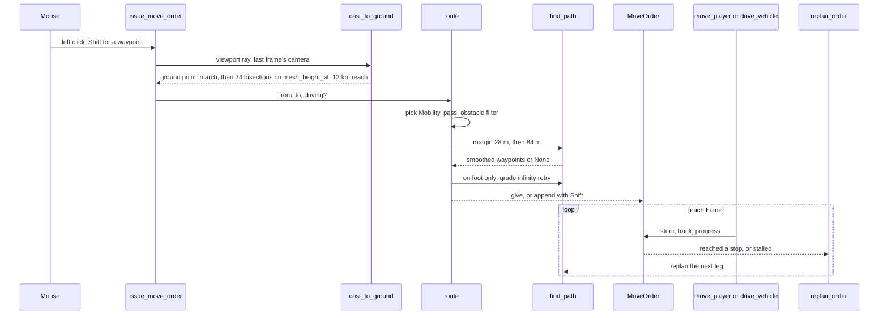

1. **Hit.** `cast_to_ground` (`orders.rs:495`) marches the ray in steps of half
   its clearance (0.25-64 m), then bisects 24 times against `mesh_height_at`.
   The same function serves the tooltip.
2. **Route.** `route` (`orders.rs:408`) picks the `Mobility`, whether the mover
   holds an Institute pass, and which colliders block it. A collider is skipped
   when the mover could crush it (`Weight` under its mass), when it is the
   mover's own hull, or when it is a boom that would open for this mover.
3. **Search.** `find_path` (`path.rs:79`) tries a box of the two ends padded by
   28 m, then by 84 m. `find_path_within`:
   - picks a cell of `max(0.5, sqrt(area / 260,000))` m, so a long trip stays
     under about 260k cells;
   - `rasterize`s the box: a cell is blocked by grade (from `MeshPatch`), water
     deeper than the limit, or a pillar grown by the mover's radius; steep rims
     are marked but **not grown**;
   - moves a blocked start or goal to the `nearest_free` cell within 48 rings;
   - runs 8-connected A* with an octile heuristic and no corner cutting;
   - string-pulls the result (`smooth`).
4. **Fallback.** For the stalker only, a failed search retries with grade
   infinity: "a steeper wall is a scramble, taken only when no gentler way joins
   the trip" (`orders.rs:33-35`). The stalker can scramble; a car cannot. A vehicle click with no path is
   refused silently.
5. **Order.** `give` replaces the order; Shift `append`s it and `hold`s it until
   Shift is released.
6. **Replan.** `replan_order` re-runs a leg when the mover reaches a stop or
   stalls: "scenery colliders stream in only near the stalker, so a far leg was
   planned without them" (`orders.rs:98-101`).

**Why a grid A* and not a navmesh.** The ground is a height function, obstacles
are upright pillars, and every mover has a different radius, grade and water
limit. A per-request raster over a bounded box needs no baked data that would
have to follow terrain edits, and the cell size adapts to the trip.

**Why the wide second box.** It covers "a winding road's laps (the crater's
spiral reaches 44 m past its floor) with room to spare" (`path.rs:15-17`).

**Why rims are not grown.** "Growing it too would close a road cut only a
little wider than a vehicle (the crater's deep laps leave 6.1 m of passable
ground for the carrier's 4.6 m)" (`path.rs:197-199`).

### 7.4 On foot

`move_player` (`player/mod.rs`) each frame:

1. WASD (camera-relative) cancels a click order; Shift runs.
2. Pick the gait: crawl on Ctrl, jump on Space while grounded.
3. Ease velocity toward the target at rate 18.
4. `push_out` then `fence_out` (section 6.5).
5. `can_wade` refuses water deeper than 1.05 m.
6. Ground at `mesh_height_at`, raised by `support_height` onto a pillar top.
7. `climb_top` lifts the stalker at 1.2 m/s onto a climbable solid ahead.
8. Snap down when within 0.5 m of the ground, else fall.
9. Set the gait for the animation (`animate_stalker`, `pose_stalker_body`,
   `swing_coat`).

### 7.5 Driving

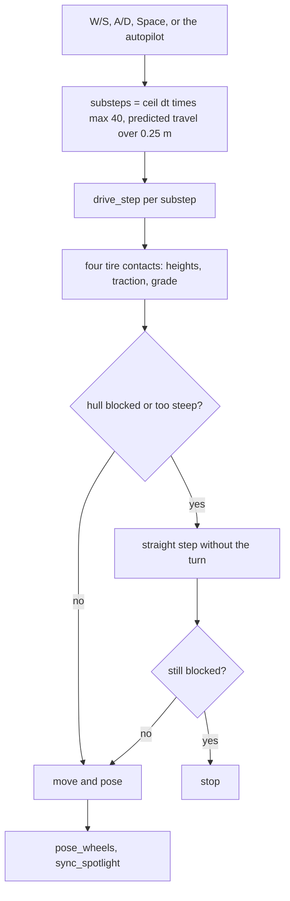

- **Substeps.** `drive_vehicle` runs `ceil(dt x max(40, predicted / 0.25))`
  substeps, so no step moves more than 0.25 m: "bound travel per sweep even at
  the higher top speed and when sliding" (`vehicle.rs:513`).
- **Contact.** `drive_step` samples four tire points on `mesh_height_at`,
  derives pitch, roll and traction, and refuses a step whose hull overlaps a
  pillar (`hull_blocked`, `vehicle.rs:873-899`). If the turn is what blocks it,
  a straight step is tried (`vehicle.rs:708-710`), so the car slides along a
  wall instead of sticking.
- **Autopilot.** It follows `MoveOrder::steer` (look-ahead with 1.7 m slack):
  - throttle drops when the stop is within the stopping distance `v^2 / 16`;
  - steering is the heading error times 2.2, clamped;
  - **bend braking** (`bend_limit`): a turn of over 0.35 rad within 8 m, seen 5
    m ahead, caps speed at `sqrt(bend^2 + 16 x room)`, with a bend speed of 8
    m/s for the car and 5 for the carrier. "At 8 m/s it turns an 8.7 m circle
    (the crater road's bends are 9.5-15 m), at its 24 m/s top speed 24 m"
    (`vehicle.rs:572-574`).
  - **Back-off.** `track_progress` calls a stall when speed stays under 0.15 of
    the intended speed for 0.8 s; the vehicle then reverses (throttle -1) up to
    6 m and retries the leg. "A car pressed nose-first against a rock cannot turn
    onto it in place, and needs more than its own length of room to swing
    round" (`orders.rs:56-58`). An order may spend 18 m of back-off in all,
    "three full back-offs" (`orders.rs:59-64`).
- **Camera.** The camera does not swing behind the car under the autopilot, so
  a tactical view stays put.

**Enter and exit** (`interact_vehicle`, E): enter takes the nearest `can_enter`
seat within 1.65 m. Exit tries the right side, then the left, the tail and the
nose, and needs the car on the ground. Respawning while seated parks the car.

### 7.6 The camera

- `orbit_camera`: wheel zoom x0.84 per notch, 6 m to 4,600 m; pitch log-
  interpolated through 0.3, 0.98 and 1.4 rad, so zooming out also tilts toward
  a map view. Right drag rotates.
- `pan_camera`: arrow keys, middle drag and screen edges roam; F holds the view
  (`roaming`), C returns to the stalker.
- `follow_player`: follow rate 22 on foot; (12, 7, 12) while driving; the lag is
  capped at 1.4 m. It also poses `Ears` at the focus.
- `fit_view_to_zoom`: far plane `max(CAMERA_FAR, 2.5 d + 800)`, sun shadow
  distance `clamp(2.5 d, 150, 3000)`.

**Why the ears are at the focus.** "Hears the Zone from the camera's focus, not
from the raised camera itself" (`camera.rs:120`): zoomed out to the map, the
camera is kilometres up.

### 7.7 The Institute carrier

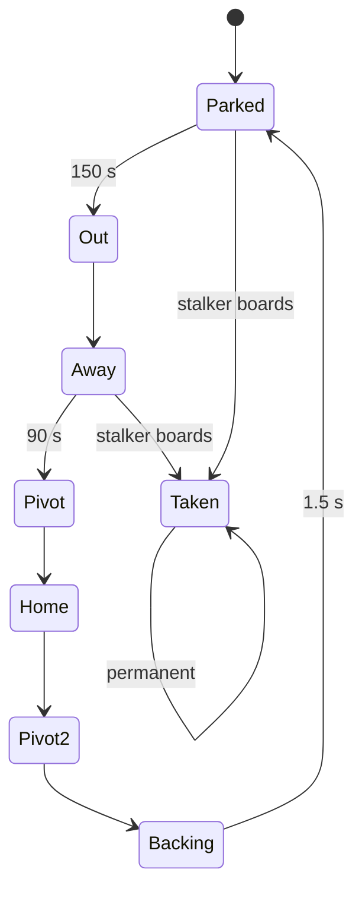

- `steer_carrier` (in the chain) drives it when `Taken`; `drive_carrier` (after
  it) runs the `Leg` machine otherwise. Cruise 7 m/s, 3 m/s in the yard (75 m)
  and on bends; `Footing` keeps the tracks on the ground.
- While driven: look-ahead 10 m forward and 3 m astern, turn rate 0.6 rad/s;
  fallbacks full step, straight step, turn in place, stop.
- `run_carrier_tracks` scrolls the `TrackLinkL/R` nodes.
- `Taken` is saved (section 4): once the stalker takes it, it stays where they
  leave it.

### 7.8 Patrol and traffic

- **UN patrol** (`vehicle/patrol.rs`) drives a fixed `track_loop` at 7 m/s,
  4 m/s on bends, ignoring traffic and pedestrians.
- **Harmont traffic** (`vehicle/traffic.rs`): cars keep 2.5 m right of the road
  centre, round corners on 9 m Bezier arcs, and stop when something is
  `in_the_way` (0-11 m ahead, under 3 m to the side). Two cars blocking each
  other yield to the lower `Entity` id, so they never deadlock.
- `flash_beacons` animates the light bars.

**GLB node-name contracts.** `pose_wheels` finds `WheelFrontRight`,
`WheelFrontLeft` and the rear wheels by name; the carrier's `WheelL*`/`WheelR*`
and `TrackLinkL/R`. A re-export that renames a node silently freezes it.

### 7.9 Invariants and pitfalls

- A stop must equal a waypoint exactly; `track_progress` compares them.
- The click ray uses last frame's camera transform (the chain runs before
  propagation).
- `find_path` is synchronous: a click can run up to four searches (two boxes,
  then the slope-blind pair) in one frame.
- Most player queries use `.single()`: there is one stalker, one camera, one
  `Ears`.
- The free group (`drive_patrol`, `drive_traffic`, `flash_beacons`) is unordered
  against the chain; nothing in the chain reads their output in the same frame.

## 8. Time, weather, light and fog

### 8.1 The atmosphere chain

`WorldPlugin` runs one `Update` chain under Running:

```mermaid
flowchart LR
    C["advance_clock"] --> W["blow_wind"] --> PL["bend_plants and canopy motion"]
    PL --> L["light_the_sky"] --> SV["survey_around_stalker"]
    SV --> GF["update_ground_fog"] --> TF["follow_terrain_fog"] --> DF["update_distance_fog"] --> CU["update_cutaway"]
```

`update_ground_fog` must follow `light_the_sky`: it reads the exposure the sky
just set, so the fog is lit for the same frame as everything else.

### 8.2 Weather is a function of the clock

- `WorldClock` holds hours. `Weather::at(clock)` is rebuilt **every frame** as a
  pure function of the day number and the hour, so the save only stores hours
  (section 4) and a reload shows the same sky.
- The first day is forced `Humid`; a new run starts at 06:15, so the first
  thing the player sees is a foggy dawn.
- Humidity follows the Magnus formula from the day's temperature and dew point;
  fog density is `smoothstep(0.84, 0.995, humidity)`.
- Two days blend across midnight, so the weather never jumps.
- **Wind** (`blow_wind`): `velocity = veer.rotate(weather.wind) x (1 + 2.5 x
  gust)`, with the gust and veer redrawn in 24 s slots and eased between them.
  `Wind` feeds the plants' `ShaderBuffer`, the crowns, the stalker's coat, the
  fog drift and the clouds.

**Why pure.** Nothing about the weather needs to be stored or simulated, so it
can't drift or desynchronise between systems, and time-lapse (T, 40x) is free.

### 8.3 `light_the_sky`

- The sun runs along a latitude of 50 deg. `RAW_SUNLIGHT` scales by elevation,
  cloud cover and haze. The moon is `MOON_LUX` 1,800, much brighter than a real
  moon, so that nights stay playable.
- Only one shadow-casting directional light at a time: the sun by day, the moon
  by night.
- Exposure: `EV = lerp(9, 13, day) - cloud x day`. Light and emissive values are
  tuned for EV 13 in physical units, never by adding ambient light (CLAUDE.md).

### 8.4 Ground fog and clouds: a custom render pass

```mermaid
flowchart TD
    subgraph MAIN["Main world"]
        GF["GroundFog component on the camera: 9 vec4"]
        FF["GroundFogField: 513 x 513 Rgba16Float, 8 m texels"]
        SM["ShroudMask: R8"]
    end
    subgraph RENDER["Render world"]
        EX["ExtractComponentPlugin, UniformComponentPlugin"]
        ER["ExtractResourcePlugin for the field and the mask"]
        IP["init_pipeline, RenderStartup"]
        SP["specialize_pipelines, Prepare"]
        DR["draw_ground_fog node"]
    end
    GF --> EX
    FF --> ER
    SM --> ER
    EX --> DR
    ER --> DR
    IP --> SP --> DR
    DR --> POS["Core3d: after MainPass and render_sky, before EarlyPostProcess"]
```

- **Where it sits.** `draw_ground_fog` runs in `Core3d` after the main pass
  (opaque, `render_sky`, transparents) and before `EarlyPostProcess`, so bloom
  and tonemapping see the fog like any other light.
- **Bindings.** Group 0 is the view's own mesh-view bind group, so the fog is
  lit by the sun and moon through the view's lights (`render.rs:4`). Group 1
  (`ground_fog.wesl:52-62`): 0 the `GroundFog` uniform, 1 the depth texture
  (multisampled or not), 2-3 the fog field and its sampler, 4-5 the shroud mask
  and its sampler.
- **Draw.** One fullscreen triangle, blend `One, OneMinusSrcAlpha`
  (premultiplied), GPU span `ground_fog`, in the main pass's render area
  (`render.rs:298`: `Viewport::from_viewport_and_override`, smaller under an
  upscaler's `MainPassResolutionOverride`; none runs today); the shader maps pixels to NDC through
  `view.main_pass_viewport`, so the fog meets the depth it reads.
- **Failure mode.** If an extracted resource is missing the node returns
  without drawing: no panic, no fog.

The WGSL (`ground_fog.wesl`):

1. **`march_ground_fog`**, up to 96 steps: jump to the fog ceiling, drop to the
   local fog top, take short steps through the layer with a jittered first step,
   `sample_fog` from the field, and re-light every 3 m in the Zone or 10 m in
   Harmont.
2. **`march_clouds`**: three layers at 170, 450 and 1,050 m, 18 steps each.
3. **Shroud**: unsurveyed ground (`shroud_at`, a +-9 m wobble on the mask) mixes
   toward smoke.
4. **Composite**: fog and clouds are ordered by the ray's direction (`ray.y`),
   so looking down shows fog over the clouds' shadow and looking up the reverse.

**The fog field** (`GroundFogField`, built in the landscape task): 513^2 texels
of 8 m over 4,096 m. Each texel stores the ground height as a coarse step plus a
remainder, since a half float alone has too little precision at hundreds of
metres; an affinity of 0.6 pulls fog into hollows; alpha marks Harmont, where
the fog thins and the light step is coarser.

**Why a custom pass instead of Bevy's volumetric fog (inferred).** The fog has to follow
the ground (pooling in the marsh, thin on ridges), carry the fog-of-war smoke
and clouds in the same march, and cost one fullscreen triangle at a map-scale
zoom. Bevy's fog volumes are boxes tied to lights and don't know the terrain.

**Distance fog** (`update_distance_fog`) sets the camera's `DistanceFog`; the
terrain applies it itself under its low-ground mask (section 5.8), and
`follow_terrain_fog` keeps that mask's `fog_top` 6 m above the focus ground.

## 9. Living things: wildlife, mutants, people, guns, helicopters

### 9.1 Where they run

| Group | Schedule, gate | Order |
|---|---|---|
| `(move_wildlife, move_mutants, fell_downed)` -> `pose_wildlife` -> `(fly_helicopters -> spin_rotors)` | PostUpdate, Running, before `TransformSystems::Propagate` | chain (`world/mod.rs:214-228`) |
| `mark_trespassers -> aim_turrets -> fire_turrets -> fly_tracers -> (draw_beams, pose_turret_parts)` | Update, Running | chain (`turrets.rs:84-95`) |
| `patrol_guards -> animate_guards`; townsfolk `watch_the_way -> walk -> show -> animate -> follow_near_animators`; `lift_booms`; `notice_crawl_hole` | Update, Running | chains as listed (`world/mod.rs:247-264`) |

Creatures run in `PostUpdate`, after the stalker has moved in `Update`, so they
react to this frame's position, and before transform propagation, so their
pose is drawn this frame. `move_wildlife`, `move_mutants` and `fell_downed`
touch disjoint sets of entities (plain wildlife, mutants, downed creatures) and
run in parallel.

### 9.2 Rigs without animation files

- `Kind` has 13 species; `Rig::build` (`wildlife/rig.rs`) takes the two
  strongest bone influences per vertex from the skinned scan, computes skinned
  bounds once and writes the inverse bind poses as `translation(-pivot)`.
- Motion is procedural: `pose_wildlife` swings legs from gait phase and clamps
  each foot to 1.12x the leg length; it skips creatures beyond their draw
  distance + 27 m from the player's camera (`PlayerCamera`; with the Golden
  Sphere's six probe cameras a plain `Camera3d` `single()` would fail and skip
  nothing).
- Routes are prechecked against the terrain and water when the creature spawns,
  not each frame.

**Why procedural rigs (inferred).** The scans come unrigged or with a bare skeleton; a
handful of bones posed from the gait covers 13 species with no clip assets and
no animation graph per kind.

### 9.3 Mutants

`Mutant::decide` (`wildlife/mutants.rs:107`) runs a small `Activity` machine
(`:41-51`) per mutant, leashed to its home route:

```mermaid
stateDiagram-v2
    [*] --> Patrol
    Patrol --> Patrol : Neutral, stalker within 5 m, back away
    Patrol --> Inspect : Curious, within 18 m, 7.5 s
    Inspect --> Recover : time up or past 22 m
    Patrol --> Chase : Aggressive, within notice, 8 s
    Chase --> Attack : within reach and facing the stalker
    Chase --> Recover : time up or past notice plus 8 m
    Attack --> Recover : windup 0.52 s plus lunge 0.38 s
    Recover --> Patrol : 6 or 12 s, back within 13 m of home
```

| Temperament | Behaviour | Numbers |
|---|---|---|
| `Neutral` | Backs away from a stalker within 5 m | |
| `Curious` | Walks up to 4.2 m and looks | notices at 18 m, follows to 22 m |
| `Aggressive` (mutt) | Chases, braces, lunges | notice 22 m, reach 1.76 m, sprint 5.3 m/s (`:71-73`) |
| `Aggressive` (chimera) | | notice 27 m, reach 2.45 m, sprint 6.1 m/s (`:80-82`) |

- **The dodge.** The mutant tracks the stalker while it braces (`WINDUP` 0.52
  s), then commits to one direction "so the strike can be dodged"
  (`mutants.rs:180`). The hit lands at `IMPACT` (windup + 0.58 of the 0.38 s
  lunge, `:23`) and only if the stalker's feet are between 0.9 m below and 0.58
  m above the mutant (`:328`): sidestep or jump.
- **Where they may go.** A mutant never leaves `LEASH` 37 m of its home
  (`:20`), keeps out of `SANCTUARY` 40 m around the hangar (`:19, 250`), and
  stays in the Zone; Harmont, the yard and an occupied vehicle are safe.
- A hit writes `Respawn` (section 10.4).

### 9.4 Perimeter guns

"The beam is the only eye the gun has" (`turrets.rs:8-10`): a gun sees only what
its laser scan touches.

```mermaid
flowchart LR
    MT["mark_trespassers: Trespasser on whoever crosses, cleared on Respawn or leaving via the hole"] --> AT["aim_turrets: sweep +-60 deg, swept-arc touches, 450 m"]
    AT --> FT["fire_turrets: spin 1 s, within 3 deg, 0.6 s bursts, 0.35 s pause"]
    FT --> HIT{"hit after 0.3 s creature or 0.5 s stalker, plus flight"}
    HIT -- "stalker" --> RS["Respawn"]
    HIT -- "creature" --> DW["Downed: 0.6 s fall, 8 s down, 2.5 s fade, reborn at 45 s"]
    FT --> GS["GunSound"]
    FT --> TR["tracers from a pool of 64"]
```

- 12 guns stand on the Perimeter wall (`OnWall`, hidden with their chunk).
- `touches` tests the whole arc the beam swept this frame, so a fast sweep can't
  skip over a target between frames.
- In the ground fog (`ground_fog::in_ground_fog`, from the fog tendency and the
  ground's height, mirroring `sample_fog`'s inputs on the CPU) a touched body is
  seen on 60% of the passes (`Turret::sees`): one `lattice_hash` roll per pass,
  the misses kept in `Turret::unseen` until `forget_missed` sees the beam leave
  them, so a slow pass does not reroll every frame.
- The beam's `LaserMaterial` (`turrets/beam.rs`) widens a sub-pixel beam to
  1.5 px in its vertex stage and fades it by the same factor in its fragment
  stage, instead of turning on TAA or SMAA for the whole view.

### 9.5 Townsfolk and helicopters

- **Townsfolk** (`world/townsfolk.rs`): 15 walkers in New Harmont.
  `watch_the_way` makes a walker wait while traffic is within 90 m of a
  crossing; Institute scientists go `Inside` for 30-90 s. Far walkers share one
  painted material; `follow_near_animators` animates only the near ones.
- **Helicopters** (`world/helicopters.rs`): `Landed -> SpinUp (8 s) -> Climb ->
  Cruise -> Descend -> SpinDown -> Landed (120 s)`, two of them staggered by 20
  and 110 s, with a look-ahead altitude so they clear the ridges.

### 9.6 Pitfalls

- `Kind` and the townsfolk `Role` index tables by discriminant (`calls[kind as
  usize]`, `CREATURE_COPY`, `TOWNSFOLK`): keep the enum order and the tables in
  step.
- The clip indices 1 and 4 in the creature rigs are hard-coded.
- A creature beyond 152 m may keep a stale pose (it is not posed out there),
  which is invisible at that range but shows if the draw distance grows.
- `GunSound` is registered twice (audio and turrets); `add_message` ignores the
  second, so it is harmless.

## 10. Audio, UI, the Zone loop and messages

### 10.1 Audio: synthesized at startup, played in `Last`

"Game audio, synthesized once and played through the system's default output"
(`audio/mod.rs:1`); "no audio files, everything is generated"
(`audio/ambience.rs:1`). Cargo enables only Bevy's `wav` decoder
(`Cargo.toml:14`), so the code writes its own 16-bit mono WAV
(`encode_wav`, `audio/mod.rs:309`).

```mermaid
flowchart TD
    subgraph STARTUP["Startup"]
        LS["load_sounds: 150 s ambience, steps, jump, land, doors, engine"]
        LC["load_creature_sounds: 26 clips"]
        LG["load_gun_sounds: gatling, naval"]
    end
    subgraph LAST["Last, after Bevy's audio in PostUpdate"]
        TM["toggle_mute, no state gate"] --> GROUP["InGame only, unordered among themselves"]
        GROUP --> PA["play_actions: steps, jump, land, doors"]
        GROUP --> SE["sync_engine"]
        GROUP --> PC["play_creature_sounds"]
        GROUP --> PG["play_gun_sounds"]
    end
    LS --> PA
    LS --> SE
    LC --> PC
    LG --> PG
    PC --> SINK["Bevy creates SpatialAudioSink next PostUpdate, heard by Ears"]
    PG --> SINK
```

| Path | How |
|---|---|
| Ambience | 150 s at 22,050 Hz: wind, drone, birds, moans and pings from a seeded `XorShift64`, 0.5 s edge fades, RMS 0.19, `tanh` soft clip (`ambience.rs:45-70`); looped from `OnEnter(InGame)` |
| Hangar hum, ready chime | 8 s loop on `OnEnter(Loading)`, two notes on `OnEnter(SplashPhase::Ready)`; both `DespawnOnExit(Loading)` |
| Footsteps | `StepClock::advance` (`audio/mod.rs:179`) counts planar travel: a step every 0.64 m walking, 1.20 running, 0.39 crawling; pitch cycles 0.93/1.06/0.98/1.11; over 1.5 m in one frame counts as a teleport and resets |
| Engine | `sync_engine` (`:269`): speed `0.82 + 0.95 load`, volume `0.30 + 0.45 load`; paused with the game |
| Creatures | `CreatureSound` cues, sorted by (priority, distance), at most 20 voices and 11 of them steps, each alive 2.4 s (`audio/creatures.rs:9-10, 156-172`) |
| Guns | `GunSound` at each burst; heard to 650 m, spatial scale 0.02 (`audio/guns.rs:16-20, 74-110`) |

**Why `Last`.** Bevy turns an `AudioPlayer` into a sink in `PostUpdate`.
Running after that lets `toggle_mute` reach this frame's new sinks, and lets the
spawners read the new `AudioMode` in the same frame (inferred from the chain at
`audio/mod.rs:54-67`).

**Mute (N)** (`toggle_mute`, `:142`): flips `AudioMode`, mutes live sinks
through the sink API (so their gain is untouched), sets `PlaybackSettings.muted`
on entities without a sink yet, and every later spawn goes through
`AudioMode::settings`. Creature and gun cues are dropped while muted.

**Why steps follow distance.** A key held against a wall would otherwise tap
forever; a respawn would play a burst. The test name says it:
`steps_follow_distance_instead_of_keys_and_do_not_play_on_teleport`
(`audio/mod.rs:335`).

**Why the voice limits.** Fight cues must survive a herd's footsteps: steps
sort last and have their own budget (test
`a_busy_encounter_keeps_fight_cues_and_discards_muted_events`,
`audio/creatures.rs:208`).

**Open tension.** Re-synthesizing every launch costs 382-456 ms of the first
frame; the precalculate-once inventory lists it as not baked yet.

### 10.2 The HUD, tooltip, map and locator

`UiPlugin` (`ui/mod.rs:80-120`):

| System | Schedule, gate | Writes |
|---|---|---|
| `spawn_hud`, `spawn_locator`, `spawn_map` | OnEnter(InGame) | HUD nodes, the ring mesh, the map overlay |
| `toggle_map` -> `update_map` -> `fly_map_birds` | Update, Running | Map marker and fog texture |
| `update_hud_stats`, `update_hud_weather` | Update, Running | Zone counters, clock and weather line |
| `update_fps`, `update_hud_position` | Update, InGame (also paused) | Upper-right FPS and X/Y/Z |
| `update_vehicle_prompt`, `update_artifact_readout`, `update_free_camera_banner`, `show_saved_notice`, `update_tooltip`, `update_locator` | PostUpdate, InGame | Prompts, readouts, tooltip panel, ring vertices |
| `spawn_pause_menu` / `despawn_pause_menu` | OnEnter/OnExit(Paused) | Pause overlay |

Every displayed string lives in `ui/text.rs`: "Kept in one place so they can
move into a localization table later" (`ui/text.rs:3-4`).

**The tooltip** (`ui/tooltip.rs:71`), every 0.08 s while Running and no camera
drag is held:

```mermaid
flowchart TD
    R["viewport_to_world ray"] --> G["cast_to_ground: reach = hit + 0.5 m"]
    G --> T["nearest Describe sphere before reach"]
    G --> S["structure_on_ray: site and town cylinders, checkpoints, hall box"]
    T --> P{"described thing?"}
    P -- "yes" --> X["describe: kind and entry from text.rs"]
    P -- "no" --> Q{"structure?"}
    Q -- "yes" --> X
    Q -- "no" --> W["place_at ground: hall, checkpoint, site, water, yard, town, landform"]
    W --> X
    X --> E{"Explored at that point?"}
    E -- "yes" --> F["title and description"]
    E -- "no" --> U["Unexplored kind and a generic line"]
```

"A described thing first (even inside a building's outline), then the nearest
building or site, then named ground" (`tooltip.rs:148-149`). "Places outside
the surveyed land show only what kind of place they are" (`:3`).

**The map** (M, `ui/map.rs`): a UI overlay over `doc/Roadside_map.jpg` with a
106 x 58 fog image, one texel per 32 m survey cell, "redrawn only when the map
opens or the survey grows" (`map.rs:5-7`); opaque because "the UI blends in
linear light" and any transparency shows the paper (`:23-25`). Opening it does
not pause the game.

**The locator ring** (`ui/locator.rs`) is a world-space mesh, not a UI node: 96
segments laid on `mesh_height_at + water_depth_at` every frame, never under 34
px across, with a depth bias that puts it over the road and stones but behind
the stalker (`locator.rs:1-4, 32-34`). It pulses once the stalker stands still.

### 10.3 The Zone loop (placeholder)

`ZonePlugin` (`zone/mod.rs`) spawns, on entry, a `ZoneRoot` with 7 artifact
spheres and 3 anomaly cylinders, "placeholder geometry for now"
(`zone/mod.rs:3-4`). `trigger_anomalies` (`:113`, Running) counts a touch
within 0.85 m horizontally and 1.5 m vertically and writes `Respawn`.

There is no pickup yet: `ZoneRun.artifacts_collected` is never incremented, so
the HUD always shows 0. These collectibles are not the hangar showcase
(section 6.8): don't conflate them.

### 10.4 Messages

"A message is an event, not storage" (`arch-readme.md`). Registered in
production (test-only `add_message` calls left out):

| Message | Declared | Registered by | Writers | Readers |
|---|---|---|---|---|
| `Respawn` | `player/mod.rs:135-136` | `PlayerPlugin` (`:149`) | `trigger_anomalies` (`zone/mod.rs:115`), `fire_turrets` (`turrets/fire.rs:178`), `move_mutants` (`wildlife/mutants.rs:365`) | `respawn_player` (`player/mod.rs:284`), `mark_trespassers` (`turrets/scan.rs:177`) |
| `CreatureSound` | `wildlife/sound.rs:18-23` | `GameAudioPlugin` (`audio/mod.rs:41`) | `move_wildlife` (`wildlife/movement.rs:323`), `move_mutants`, via `MotionSound::emit` (`sound.rs:48`) | `play_creature_sounds` (`audio/creatures.rs:129`) |
| `GunSound` | `turrets/fire.rs:30-34` | Audio (`audio/mod.rs:42`) and turrets (`turrets.rs:82`) | `fire_turrets` | `play_gun_sounds` (`audio/guns.rs:85`) |
| `TreeBreak` | `tree_fall.rs:46-52` | `WorldPlugin` (`world/mod.rs:131`) | `pick_tree_to_break` (`tree_fall.rs:54`), `knock_down_light_solids` (`crush.rs:73`) | `break_selected_trees` (`tree_fall.rs:104`) |
| `ProgressSaved` | `save.rs:24-25` | `SavePlugin` (`save.rs:29`) | `save_progress` | `show_saved_notice` (`ui/mod.rs:466`) |
| `AppExit` (Bevy) | | Bevy | `quit_on_q` (`main.rs:74-76`), GPU recovery (`gpu_scans/recovery.rs:66`) | `save_due` (`save.rs:190-194`) |

```mermaid
flowchart LR
    TA["trigger_anomalies"] --> MR(["Respawn"])
    FT["fire_turrets"] --> MR
    MU["move_mutants"] --> MR
    MR --> RP["respawn_player"]
    MR --> MT["mark_trespassers"]
    WL["move_wildlife"] --> MC(["CreatureSound"])
    MU --> MC
    MC --> PC["play_creature_sounds"]
    FT --> MG(["GunSound"])
    MG --> PG["play_gun_sounds"]
    KD["knock_down_light_solids"] --> TB(["TreeBreak"])
    PT["pick_tree_to_break"] --> TB
    TB --> BT["break_selected_trees"]
    SP["save_progress"] --> PS(["ProgressSaved"])
    PS --> SN["show_saved_notice"]
    Q["quit_on_q"] --> AX(["AppExit"])
    AX --> SD["save_due"]
```

**Timing.** Messages live two frames, so a reader must run within one frame of
the write:

- wildlife writes `CreatureSound` in `PostUpdate`; audio reads it in `Last` of
  the same frame;
- `TreeBreak` is written and read in one `PostUpdate` chain;
- `move_mutants` writes `Respawn` in `PostUpdate`; `respawn_player` reads it in
  the next frame's `Update`;
- `ProgressSaved` is written in `Last` and read in the next `PostUpdate`.

**Lopsided registration.** `CreatureSound` is registered only by the audio
plugin, `Respawn` only by the player plugin, while other plugins write them. An
app built without `GameAudioPlugin` or `PlayerPlugin` would leave those writers
without a `Messages<T>`; plugin tests register them themselves.

## 11. Anatomy of one in-game frame

Every project system that runs in `AppState::InGame`, by schedule. "R" means
gated on `InGamePhase::Running` (frozen while paused); "G" means gated on
`AppState::InGame` only (keeps running while paused).

```mermaid
flowchart TD
    subgraph FIRST["First"]
        F1["G: track_vram_budget, note_resident_scans"]
    end
    subgraph PRE["PreUpdate: streaming, G"]
        P1["stream_scenery -> unload_stale_tiles -> finish_growing_plants -> spawn_grown_plants -> note_growing_plants"]
        P2["stream_ground_detail"]
        P3["stream_wall_view -> stream_wall_solids -> show_with_wall"]
        P4["stream_full_sites"]
    end
    subgraph UPD["Update: input and simulation"]
        U1["R: player chain, 17 systems"]
        U2["R: atmosphere chain, clock to cutaway"]
        U3["R: turrets chain"]
        U4["R: guards, townsfolk, booms, crawl hole"]
        U5["R: patrol, traffic, carrier"]
        U6["R: trigger_anomalies, map, HUD stats"]
        U6b["R: Golden Sphere chain: pose, pull ferrofluid, reflect, stand-ins (modest) or UHD stream (exceptional)"]
        U7["G: paint_shroud_mask, lift_curtain, restore_progress, HUD fps and position, pause, quit"]
        U8["always: measure_scans, mipmap_filtered_textures, grab_cursor"]
    end
    subgraph POST["PostUpdate"]
        Q1["R: wildlife -> pose -> helicopters, before Propagate"]
        Q2["R: trample -> knock down -> full plants -> artifacts -> trees fall -> crowns -> close trees, before Propagate"]
        Q3["Bevy: transform propagation, visibility, light visibility"]
        Q4["G: cull_shrouded, after visibility"]
        Q5["G: tooltip, locator, prompts, readouts"]
        Q6["Bevy: audio sinks created"]
    end
    subgraph LAST["Last"]
        L1["toggle_mute -> G: actions, engine, creatures, guns"]
        L2["G: admit_scans -> prefill_scans"]
        L3["save_progress when due"]
    end
    subgraph RW["Render world"]
        R1["Extract: fog uniform, fog field, shroud mask, scan handles"]
        R2["Prepare: specialize fog pipelines, publish_scan_residency"]
        R3["Core3d: main pass, sky, transparents, ground fog, post-process"]
        R3b["Probe cameras, order -10 to -5, before the main view: awake faces only (strong, exceptional)"]
        R4["publish_pipeline_backlog"]
    end
    FIRST --> PRE --> UPD --> POST --> LAST --> RW
```

### 11.1 Why this split

- **First: read the GPU's state.** The budget and the residency back-channel
  from the render world are read before anything decides what to stream, so a
  frame plans against the freshest numbers.
- **PreUpdate: streaming.** Tiles, ground detail, walls and site scans are
  settled before the game moves. Streaming runs while paused (G), so a paused
  view that the camera roams over still fills in.
- **Update: the frame's decisions.** Input, orders, motion, the camera, the sky
  and every Running simulation. The player chain ends with the camera and the
  body pose, so what follows sees the frame's final stalker.
- **PostUpdate before Propagate: things that react to the stalker.** Creatures,
  crushing and tree falls read where the stalker and vehicles ended up and write
  local transforms that must be propagated this frame (CLAUDE.md "Ordering").
- **PostUpdate after visibility: culling by the survey.** `cull_shrouded` must
  run after Bevy fills the visible lists, or it would have nothing to remove.
- **Last: consumers.** Audio needs Bevy's freshly created sinks; scan admission
  needs every `want` made this frame; the save needs the frame's final state and
  `AppExit`.
- **Golden Sphere chain, in Update.** It reads where the stalker and the car
  are but is not ordered against the player's chain, so it may see last
  frame's position: harmless at the 15 m reach of its mirror. Its probe
  cameras are the only cameras in the Zone besides the player's, and run
  before the main view (orders -10 to -5).
- **Render world.** Bevy's extraction copies the fog, shroud and scan state;
  two project systems publish back to the main world through atomics or shared
  resources (the pipeline backlog for the curtain, the scan residency for
  `GpuScans`).

### 11.2 Paused frame

While paused only the G and ungated systems run: streaming, the shroud mask,
the curtain, the HUD's FPS and position, `draw_order_route`, the UI's
PostUpdate prompts, scan admission and the save. Nothing simulates, nothing is
despawned, and `Time<Virtual>` is not paused: the ambience and sounds already
playing continue, the engine pauses and creature voices are dropped.

## 12. Invariants, observed inconsistencies and glossary

### 12.1 Invariants that cross modules

| Invariant | Breaks if ignored |
|---|---|
| Sample ground through `Terrain` (`height_at`, `mesh_height_at`, `water_depth_at`); never hardcode a height | Feet float or sink; the ramp cut and the movers disagree |
| Movers, clicks, pads and the cut follow `mesh_height_at`, not `height_at` | Up to 4 m error on banks |
| Every solid has a `Collider`; fences are `Unclimbable`; regenerate `world/pillars/` from the tools | Walk-through models; climbable walls |
| A site's placement, road drive, foundation, clearance masks, stand-in, full scan and collider move together | Floating sites, roads into walls, vegetation inside buildings |
| Stand-ins are never grounded or recentred | The full-scan swap jumps |
| UHD scans load only through `GpuScans` (`assets::uhd`) | VRAM overrun on 6 GB cards |
| Everything an `OnEnter(InGame)` spawn needs is in `PreloadedAssets` | The splash reports Ready early; `spawn_world` panics on the landscape |
| Per-frame streaming caps stay in place | Frame stalls of 100+ ms |
| Tile roots and `WorldRoot` stay at the origin | Trampling and plant streaming compare the wrong positions |
| Crown-card translations never move | `break_selected_trees` misses the tree (exact float match) |
| Index-by-discriminant tables match their enums (`SITE_COPY` 24, `CREATURE_COPY` 13, `ARTIFACT_COPY` 14, creature `calls`) | Panics on hover, wrong sounds |
| Every sound goes through `AudioMode::settings` | It plays while muted |
| Player-facing strings live in `ui/text.rs` | Localization breaks |
| GLB node names (`Wheel*`, `TrackLink*`) survive re-exports | Wheels or tracks freeze |
| `compress_glb_textures.py` runs last on every runtime GLB | Uncompressed textures, missing tangents |
| A system that wants the player's view queries `PlayerCamera`, never `Camera3d` | The Golden Sphere's six probe cameras make `single()` fail, or stream the wall and pose creatures around themselves |
| Only the Sphere is on `SPHERE_LAYER`; the probe cameras see layer 0 only | The probe renders the Sphere from inside, or the player's camera loses it |
| `FACES` (`reflection.rs`) and the two `probe_sample` twins (`golden_sphere.wesl`, `ferrofluid.wesl`) change together | Reflections show the wrong side of the world, with no error |
| Effects scale with `GpuTier` (the card's size, decided once at `Startup`), never with the live VRAM budget | An effect flips tier when another program takes VRAM; a pool or probe sized at entry meets another level |

### 12.2 Observed inconsistencies

Found while writing this document; none was fixed here. Each is small; listed
so the next change in the area can fix it.

**Code.**

1. `ZoneRun.artifacts_collected` (`zone/mod.rs:17`) is never incremented: there
   is no pickup yet, and the HUD always shows "Artifacts: 0".
2. `CreatureSound` is registered only by `GameAudioPlugin` and `Respawn` only by
   `PlayerPlugin`, while other plugins write them (section 10.4).
3. `FIRING` 0.6 (`audio/guns.rs:19`) duplicates `BURST` (`turrets/fire.rs:21`);
   change them together or derive one from the other.
4. `roads::SWAMP` and `hydrology::SWAMP` share a name for different things.
5. `despawn_world` leaves `Explored`, `RampCuts` and `ShroudMask` in place.
   Harmless today because `InGame` is entered once per run.
6. The artifact showcase's preview and full tiers both name the `medium/` files
   (`ARTIFACTS`, `ARTIFACT_PREVIEWS`), so the 8 m swap reloads the same model.
7. With no audio device, gun-sound entities never get a sink and so are not
   despawned until the run ends (creature voices expire by timer; steps check
   for a sink).
8. `update_hud_stats` writes its `Text` every frame; the other HUD systems write
   only on a change.
9. *(hypothesis, not verified)* `trigger_anomalies` is unordered against
   `respawn_player`, so one touch could be counted on two frames.
10. The fog's wind offset accumulates without wrapping; over a very long session
    its float precision falls and the drift could start to step *(inferred)*.
11. Audio is re-synthesized at every launch (382-456 ms of the first frame), an
    open item against "precalculate once".

**Comments and docs.**

12. `sites.rs:859-861`: doc lines that belong to the next item.
13. `tools/plan_quarry_ramp.py:3-6` may describe the core relief as it was
    before the crater road.
14. The test `m_mutes_newly_queued_sounds_...` (`audio/mod.rs:357`) is named for
    the old M key; mute is N.
15. The pause backdrop's comment says "Dimmed" but the node has no
    `BackgroundColor` (`ui/mod.rs:555-563`).
16. The locator's `dt <= 0.0 // paused` guard (`ui/locator.rs:56`) never sees a
    pause, since nothing pauses `Time<Virtual>`; it only guards the first frame.
17. `doc/world-reference.md:705` and `:744` describe the pedestrians differently.
18. The ground fog's `clouds.y` field does not match its doc comment.
19. `arch-readme.md` describes the artifact full scenes as distinct 4K scans
    (see item 6).

### 12.3 Glossary

| Term | Meaning |
|---|---|
| **Anchor** | An entity with `StreamAnchor` (the stalker; the camera's `Ears` under 250 m zoom) that tile streaming follows |
| **Cut scan** | The Quarry rim and Golden Sphere crater scans, whose stone is discarded above the ramp cut lattice |
| **Diorama** | A site scan that carries its own ground (`Ground::Relief`), overriding the terrain |
| **Ears** | The listener and view-focus entity at the camera's focus |
| **Explored** | The 108 x 108 survey grid of 32 m cells |
| **Full scan** | A site's, plant's, tree's or artifact's `uhd/` model, streamed near and swapped for its stand-in |
| **GpuScans** | The resource that admits UHD scans to the GPU within a budget |
| **GpuTier** | The session's GPU level (`Modest`, `Strong`, `Exceptional`), decided once from the card's size and its ray tracing; forced by `--gpu-tier` |
| **Leg** | A road segment (`roads.rs`), or a carrier route phase (`carrier.rs`); context tells which |
| **Mobility** | A mover's radius, deepest water and steepest grade for route planning |
| **Pillar** | An upright collision cylinder in a model's local space |
| **Probe** | The Golden Sphere's six inactive cameras at its centre (`ProbeFace`), rendering the cube faces its mirrors sample |
| **Ramp** | `Surface::Ramp`, a pit's haul road at a constant grade |
| **Relief** | A 64 x 64 height grid sampled from a diorama scan |
| **Shroud** | The fog of war over unsurveyed ground (V lifts it) |
| **Sphere layer** | `SPHERE_LAYER` (1): the render layer only the Golden Sphere is on, seen by the player's camera, not by the probe; its shadow twin is on `SPHERE_SHADOW_LAYER` (2), seen by the Sun alone |
| **Stand-in** | A site's `low/` model, drawn everywhere the full scan is not; also the capsule or box the Golden Sphere's mirror traces for the stalker or a vehicle on modest GPUs |
| **Tile** | A 128 m square of terrain, the unit of scenery and collider streaming |
| **The workspace** | `~/Projects/agentic/RoadSide-Picnic`, the asset sources |
| **The Zone** | Everything on the -X side of the Perimeter (`in_zone`) |

