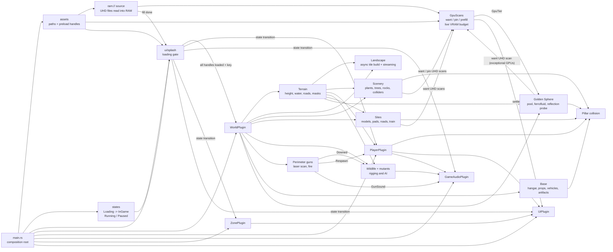

# Roadside-Picnic Architecture Readme

This document is the bird's-eye map of the codebase: what owns what, which
systems run when, how data reaches the player, and where to make a safe change.
For contributor rules, read [`CLAUDE.md`](./CLAUDE.md) as well; for each
system's details and asset recipes, [`doc/world-reference.md`](./doc/world-reference.md).
For each code path end to end, with diagrams and the reasons behind each design,
read [`arch-readme-detailed.md`](./arch-readme-detailed.md).

## Project shape

Roadside-Picnic is a Bevy 0.20 ECS application. The top-level composition root
is [`src/main.rs`](./src/main.rs). It installs Bevy's default plugins, the
state machine, shared asset preloading, and six project plugins:

- `GameAudioPlugin`: synthesized audio, footsteps, engine, mute, and creature cues.
- `WorldPlugin`: terrain, water, roads, scenery, base, sites, wildlife, and lighting.
- `PlayerPlugin`: stalker, animation, camera, input, collision, and armored vehicle.
- `ZonePlugin`: the current run's anomaly and collectible-object loop.
- `UiPlugin`: splash, loading state, entry curtain, HUD, vehicle prompt, pause menu, FPS and the stalker's x, y, z.
- `SavePlugin` (`src/save.rs`): saved progress (survey, clock, stalker, car and a taken carrier).

There is deliberately no separate engine, physics crate or networking layer.
Most runtime state is local ECS data, and the world is rebuilt
deterministically from fixed seeds and placements. Only the player's progress
is saved: `read_progress` reads the save at `Startup` into `SavedProgress`
(unless `--new` is passed), `restore_progress` applies it on the first
in-game frame (the `Explored` grid, `WorldClock`, the stalker's and the car's
transforms) and removes it, and `save_progress` runs in `Last` when
`save_due` says so: on F5, every 60 s, or on an `AppExit` message. It writes
a plain text file atomically (temporary file, then rename) and sends
`ProgressSaved` for the HUD notice. A stalker saved at the wheel is restored
on foot beside the car. The web build reads and writes nothing.

## Bird's-eye runtime graph



## Module map

| Area | Source | Owns |
|---|---|---|
| Entry point | `src/main.rs` | App composition, global pause and quit |
| Saved progress | `src/save.rs` | `SavePlugin`: the progress file, F5/autosave/quit saves, restore on entry |
| States | `src/states.rs` | `AppState::Loading/InGame`, `InGamePhase::Running/Paused` |
| Asset paths | `src/assets/` | Canonical paths, preload handles, shared GLB loader helpers |
| Render tuning | `src/render/mod.rs` | `RenderTuningPlugin`: lights clustered on the CPU (`use_cpu_clustering`, in `finish` after `PbrPlugin`'s) |
| RAM and GPU | `src/assets/ram_source.rs`, `assets/gpu_scans.rs`, `gpu_scans/{streaming,residency,vram,tier}.rs`, `src/launch.rs` | `ram://` fill behind the splash, `assets::uhd`, `GpuScans` budget, admission, prefill and eviction, render-world residency, live `VK_EXT_memory_budget` reading, `GpuTier` (modest, strong or exceptional from the card's size, or forced by `--gpu-tier`) |
| Player | `src/player/` | Stalker, camera, input, gravity, crawling, vehicle interaction |
| Vehicle | `src/player/vehicle.rs`, `vehicle/contact.rs` | Throttle/steer, traction, four-tire terrain fit, wheels, spotlight |
| World | `src/world/mod.rs` | World plugin, terrain/material setup, sky, fog, spawn and teardown |
| Terrain | `src/world/terrain.rs`, `hydrology.rs`, `roads.rs` | Deterministic heights, water, road grading and masks |
| Quarry ramp | `src/world/quarry_ramp.rs`, `ramp_cut.rs`, `assets/shaders/ramp_cut.wesl` | The haul roads down the Quarry rim's pit and the Golden Sphere's crater: per cut scan (`CutScan`), the pillars dropped from its cut corridor (`CutScan::pillars`), and its cut image and `RampCutMaterial` that hide the scan's stone over the road (and, in the core, over its dark generated backdrop) |
| Golden Sphere | `src/world/golden_sphere.rs`, `golden_sphere/{ferrofluid,mirror,reflection,uhd}.rs`, `assets/shaders/{ferrofluid,golden_sphere}.wesl` | `GoldenSpherePlugin`: the hovering Sphere and its `HoverClock`, the ferrofluid pool (vertex-shader spikes, `Collider`), the six-camera reflection probe (strong and exceptional GPUs), ray-traced stand-ins (modest GPUs), the streamed UHD scan (exceptional GPUs), `SPHERE_LAYER` |
| Day/night and weather | `src/world/weather.rs` | `WorldClock`, daily `Weather` (temperature, humidity, fog tendency), sun/moon, exposure |
| Ground fog | `src/world/ground_fog.rs`, `ground_fog/{field,render}.rs` | Fog field texture, terrain-hugging raymarch pass with the clouds and the shroud's smoke, regional distance fog |
| Places | `src/world/places.rs` | Named places at a point or along a ray, `Describe`, the `Explored` survey grid |
| Fog of war | `src/world/shroud.rs` | `Shroud` state (V), survey mask texture for the ground fog pass (opaque drifting black smoke, drawn after the sky), culling of shrouded entities |
| Streaming | `src/world/landscape.rs`, `scenery.rs` | Async terrain build, LOD swaps, 3x3 scenery/collider streaming |
| Site content | `src/world/sites.rs`, `institute.rs`, `cordon.rs`, `base/` | Landmarks, the Institute's lamps, wall/yard, hangar, props, vehicles, artifact showcase |
| Cordons | `src/world/cordon.rs` | Yard wall and gap checkpoint, 3× Perimeter built from a baked box with relief parallax, a razor-wire strip and a sandbag row along the foot (`WallModel::batch` shears all three onto the ground, corners lap), the gates' `Boom`s (`Gate::Yard` lifts for the stalker, `Gate::Institute` for an `InstitutePass`), crawl hole (`hole_depth`) and its thicket, shelterbelts and belt trees (`tree_belt`) |
| Vegetation | `src/world/trees.rs`, `canopy.rs`, `plants.rs` | Imported trees, dense woods and weeds/bushes (no procedural ones), LOD tiers, wind, fall |
| Map dressing | `src/world/map.rs`, `town.rs`, `railway.rs`, `marsh.rs`, `rocks.rs` | Harmont map projection, New Harmont, kit-laid railway, marsh props, big rocks |
| Cordon guards | `src/world/guards.rs` | Two pacing, rigged UN soldiers at each gate and five sentries by the checkpoints |
| Townsfolk | `src/world/townsfolk.rs` | Fifteen rigged pedestrians on New Harmont's sidewalks; scientists walk to the Institute's door, hide inside and come back. `watch_the_way` → `walk_townsfolk` → `show_townsfolk` → `animate_townsfolk` in Update while running; `Place::Townsfolk(Role)` |
| UN patrol | `src/player/vehicle/patrol.rs` | Four white armored cars lapping the Perimeter wall, flank plates, shared `CarWheel`/`in_the_way` |
| Harmont traffic | `src/player/vehicle/traffic.rs` | Sweeper, sedans, ambulance, fire engine and panel van on `roads::traffic_routes`: right-hand lanes, U-turns, right of way, flashing roof beacons |
| Institute carrier | `src/player/vehicle/carrier.rs` | Tracked carrier's expedition cycle (bay → Zone → pivot → home → back in), `InstitutePass`, counter-rolling track wheels (sprocket and idler at the belt's wrap radius from `carrier_track.rs`) and scanned track links (`CarrierLink`, `run_carrier_tracks`, loops in `carrier_track.rs`); patrols and traffic stop for it. The stalker can take it standing still (`Leg::Taken`, `steer_carrier`): tracked driving that fords 1.5 m, climbs 45° and rides over low rocks (`Footing`), its expedition over for the run; lamps lit out on an expedition or driven |
| Institute helicopters | `src/world/helicopters.rs` | Two helicopters: rotor spin-up, climb from the Institute's roof pads, survey passes over the Zone, landing; `fly_helicopters` → `spin_rotors` in PostUpdate before propagation |
| Wildlife | `src/world/wildlife/` | Shared rigs, gaits, flyers, predator/mutant AI, spatial cues, the Perimeter herd, `Downed` creatures |
| Perimeter guns | `src/world/turrets.rs`, `turrets/{scan,fire,beam}.rs` | `TurretPlugin`: twelve guns on the Perimeter wall, Lissajous green laser scan (`LaserMaterial`), beam-touch detection (60% in ground fog), `Trespasser` marking, lock/spin/burst fire, pooled tracers, `GunSound` |
| Collision | `src/world/collision.rs`, `world/pillars/` | Static `Pillar` colliders, push-out, climbing, `Weight`/`Crusher`/`Unclimbable` |
| Crushing | `src/world/crush.rs` | Trampled plants, knocking down lighter solids |
| Audio | `src/audio/` | Synthesized ambience/effects and live audio sinks |
| UI | `src/ui/` | Splash, entry curtain, HUD, FPS and position, weather line, controls, hover tooltips, stalker locator ring, map overlay (M), pause |
| Zone loop | `src/zone/` | Current placeholder anomalies, collectible markers, run counters |
| Asset tooling | `tools/` | Texture/GLB preparation, grounding, rigging, collision generation |
| Shaders | `assets/shaders/` | Terrain, water, hangar cutaway and floor/wall paint, quarry ramp cut, plant wind, ground fog, the Golden Sphere's mirror and its ferrofluid WESL entry points |

## State and lifecycle

### 1. Startup and loading

Startup work is split between `preload_game_assets` and `WorldPlugin`'s startup
systems:

1. `src/assets/mod.rs` puts the critical file and scene handles into
   `PreloadedAssets`, and `assets/ram_source.rs` starts reading every file of
   `UhdFiles` (the trees, the plants, the Golden Sphere's scan, then the sites
   nearest the hangar) into the `ram://` source, four at a time, while 4 GiB of
   RAM stay free; a file left out loads from `assets/` through the same source.
2. `world/landscape.rs` starts an asynchronous CPU task that builds the distant
   terrain, water, scenery layout, and streamed site data.
3. The world preloads canopies, wildlife primitives, cordon assets, sites, the
   town, railway, old-road and marsh kits, plants, and materials.
4. `ui/splash.rs` displays the hangar backdrop and repeatedly checks both the
   direct load state and recursive dependency state of every preload handle,
   and waits for the RAM fill (`Read N UHD files (X GB) into RAM in S s`).
5. `SplashPhase` becomes `Ready` only after the preload list is complete and
   non-empty. An asset failure moves it to `Failed`.
6. A new key press transitions `AppState::Loading` to `AppState::InGame`.
7. `ui/curtain.rs` covers the new world with an "Entering the Zone" screen. A
   render-world system publishes `PipelineCache::waiting_pipelines().count()`
   through a shared atomic, and the world publishes `PlantsGrowing` while any
   streamed tile still has plants to grow or spawn, and `GpuScans::settled`
   stays false while a UHD scan is loading or a pinned one (the three trees,
   pinned by `canopy::pin_tree_scans`) is not yet on the GPU; the curtain
   lifts after all stay idle for 0.4 s (12 s cap) and logs `Entered the
   Zone`, hiding shader compilation, first-frame spawn hitches, the trees'
   scan uploads and the plants filling in around the stalker. Until it lifts
   (`GpuScans::entered`), every scan admission leaves `PREFILL_HEADROOM_GB`
   free, as the world's own uploads still raise the rest of the game's VRAM
   and the live budget shrinks with them. `prefill_scans`
   (`assets/gpu_scans/streaming.rs`, `Last`, after `admit_scans`) then fills
   the scan budget from `UhdFiles` in order, one scan at a time, stopping
   `PREFILL_HEADROOM_GB` (0.5) short of it so a dip in the live budget does
   not evict what was prefilled. A prefill (`GpuScans::prefill`) queues
   after every ask, never evicts anything and is not stamped as shown, so a
   real want or a shrinking budget drops a prefilled scan before a shown one.

The preload list is also a contract. If a model is needed during `OnEnter` and
is not preloaded, the splash can report ready before that asset is available.

### 2. Entering the Zone

`OnEnter(AppState::InGame)` runs the world and player spawn paths:

- `WorldPlugin` uploads the completed landscape meshes and spawns terrain,
  water, vegetation batches, the clock and weather, sky, sun and moon, the
  fog field resource, hangar, props, yard vehicles, artifact pedestals, cordon,
  wildlife, sites and a fresh `Explored` grid. `prepare_ramp_cut` runs before
  `spawn_sites` (chained), because the cut scans' stand-ins are spawned with
  their cut images' materials. The Golden Sphere's own chain
  (`spawn_reflection_probe` -> `spawn_golden_sphere` -> `spawn_ferrofluid_pool`)
  runs here too: the probe's faces must exist before the two materials bind them.
- `PlayerPlugin` spawns the stalker and its skinned scene, camera, exposure,
  atmosphere, `GroundFog` and distance-fog settings. The camera's depth texture
  is bound for sampling, because the fog pass reads it.
- `GameAudioPlugin` starts the Zone ambience.
- `ZonePlugin` spawns its per-run anomaly and collectible placeholders.
- `UiPlugin` creates the HUD.

Most persistent roots are tagged and despawned on leaving `InGame`. Pausing does
not leave `AppState::InGame`; it switches the `InGamePhase` substate, so the
world stays alive.

### 3. Per-frame schedule

```text
PreUpdate
  stream_scenery -> unload_stale_tiles -> finish_growing_plants
    -> spawn_grown_plants -> note_growing_plants
  stream_ground_detail
  stream_wall_view -> stream_wall_solids -> show_with_wall
  stream_full_sites

Update, only while InGamePhase::Running
  clock + weather -> wind gusts -> ground-cover wind uniform, bush sway
    -> sun/moon, exposure, distance-fog color
  survey around the stalker
  ground-fog uniforms, terrain fog ceiling, distance-fog range, cutaway
  shroud toggle (V) and survey mask repaint
  map overlay toggle (M), marker, fog and birds
  player/camera input
  click orders (Shift holds a new route), leg replanning
  respawn handling
  vehicle enter/exit
  on-foot motion + collision
  vehicle simulation
  wheel pose + spotlight
  camera follow
  order rings (pulsing) and route line
  stalker animation, body pitch, coat swing
  anomaly checks
  Perimeter guns: mark trespassers -> sweep beams / lock on -> spin, fire
    bursts (tracers, Downed, Respawn, GunSound) -> fly tracers
    -> beams, spots, muzzle flashes + head yaw / barrel spin
  Golden Sphere: pose_golden_sphere -> pull_ferrofluid -> reflect_surroundings
    -> gather_stand_ins (modest GPUs) -> stream_uhd_sphere (exceptional GPUs)

PostUpdate, before Transform propagation
  wildlife route/mutant AI (Downed creatures skip it), downed creatures fall
  shared creature rig pose
  trample plants, knock down lighter solids
  artifact idle motion
  tree fall
  canopy motion, UHD tree scan streaming

PostUpdate, after CheckVisibility and CheckLightVisibility
  cull_shrouded (drops shrouded entities from VisibleEntities and the sun's
  cascade lists while the shroud covers the map)

Last
  mute processing
  footsteps / door / engine
  spatial creature sounds, Perimeter gunfire
```

The transform-changing creature, tree, artifact, and player chains intentionally
run before `TransformSystems::Propagate`. If a new system writes local
transforms after propagation, descendants can appear one frame behind.

Streaming systems run in `PreUpdate` whenever the top-level state is `InGame`,
including while paused. Gameplay and animal motion run only in
`InGamePhase::Running`.

## Terrain, roads, water, and streaming

`Terrain` is the shared source of truth for ground-related systems.

- `height_at(x, z)` samples the analytical terrain in this order: the landform
  (`landform_height`: hills, the Zone's ridge mountains, bald hill, marsh
  hollow, quarry basin), the site foundations (level pads, and the dioramas'
  own ground with a blurred margin), the roads graded over that sited land,
  the wetlands, the dioramas reclaiming their footprints, and the hangar yard.
- `mesh_height_at(point)` follows the rendered triangles, including the 2 m,
  8 m, and horizon interpolation/stitching rules.
- `water_depth_at(x, z)` is used by walking, driving, wildlife validation, and
  scenery rejection.
- `normal_at(x, z)` drives slope checks and grounding.
- `woodland_at` and the site masks decide where vegetation belongs.
- `road_mask` drives terrain exposure, grading, and scenery clearances.

### Tile scales

```text
Playable world:      3,440 m x 3,440 m (half size 1,720 m)
Terrain chunk:       128 m
Nearby sample grid:  2 m
Distant sample grid: 8 m
Horizon chunk:       512 m
Horizon sample grid: 16 m
```

The async landscape build prepares coarse scenic terrain and all site/scenery
layouts up front. Nearby ground tiles swap to their detailed mesh on demand.
Collision, imported trees, and plants stream around the player in a 3x3 tile
neighborhood rather than following the distant visual range. Every streamed
system caps its work per frame, so crossing into a new tile never stalls one:
`stream_scenery` spawns at most one new tile per frame, nearest an anchor
first, and marks tiles that left `Unloading`; `unload_stale_tiles` despawns
300 of their children per frame, then the tile. `stream_ground_detail`
switches one tile to its 2 m mesh per frame (back to the distant mesh at
once). `stream_wall_view` builds one drawn wall chunk per frame (its three
sheared meshes, up to ~4 ms) within 800 m of the player's camera, nearest first;
`stream_wall_solids` spawns the wall's collision posts around the anchors, and
`show_with_wall` hides anything `OnWall` (the Perimeter guns and their effects)
whose chunk is not drawn. Colliders spawn with the tile; each tile's plant sites are grown by a
`plants::PendingPlants` task on the async compute pool, `finish_growing_plants`
turns a finished task into `GrownPlants`, and `spawn_grown_plants` spawns at
most `PLANTS_PER_FRAME` of them per frame, nearest an anchor first.
Every weed and bush is an imported model (`assets::PlantModel`): an entity with
the textured `medium/` mesh within 30 m of the camera and a child with the
texture-free `low/` mesh (same material) out to the scenery range, so plants
sharing a model draw as one GPU instance batch. `stream_full_plants` wants the
full `uhd/` scans of plants within `UPLOAD_LEAD` (40 m) of the stalker from
`GpuScans`, and once the scan of the one plant nearest the stalker within 8 m
is on the GPU, puts it in place of that plant and hides the plant. If the scan
leaves the GPU the instance goes (that is when the GPU frees it) and the plant
shows again.
Dry-weed seeds grow patches of up to 5 plants, other weeds and bushes up to 15;
every placement passes the road, water, yard, and site-clearance filters.

`RoadNetwork` indexes route segments by terrain tile. It produces both:

1. a smooth graded height surface for walking/driving, and
2. a world-space RGBA8 texture with gravel (R), tire-rut (G), asphalt (B) and
   old-asphalt (A) masks, which `terrain.wesl` turns into gravel, ruts, smooth
   tar and, where A is set, the old broken asphalt.

Each route has a `Surface`: dirt, `Asphalt` (the old roads, painted by the
terrain shader from the A mask and four asphalt maps; from 20 m inside the
Zone they degrade over 15 m into the retired road kit, baked into one
road-aligned strip by `tools/bake_road_kit.py` and laid along each road
through `RoadNetwork::leg_frame`), `Street` (New
Harmont's smooth streets, B only: no A, no cracks) or `Ramp` (a pit's haul
road, the quarry's or the Golden Sphere's: a narrow dirt bed, graded by `graded_track` at one constant grade from the
entrance of the track's drive, its second point, to its end (the first leg, the drive,
follows the land; a 24 m parabolic crest rounds the break at the entrance), and applied
by `Terrain` after a diorama's own ground, which hides every other road).

Road legs must connect to a real route vertex, stay below the grade and water
thresholds tested in `world/roads.rs`, and avoid cutting through site pads.
Leg endpoints take their level from the sited land, so a spur meets a building's
pad or a diorama's front edge exactly. Near tiles always stitch their edges
at 8 m spacing, so a narrow road in a deep cut or fill dips where it crosses a
tile edge; keep pits and steep relief back from the road (see the quarry rim).

## Fog and draw distance

`world/weather.rs` runs a 24-minute day. It places the sun and a full moon by
solar geometry, and hands shadow maps to whichever is above the horizon.
Exposure eases from EV 13 by day to EV 9 at night. Each day rolls a sky
(clear, humid, overcast, rain) with its own temperature curve and dew point.
Relative humidity (Magnus) therefore peaks late at night and at dawn, and
`Weather::fog` turns near-saturated air into fog. Days blend across midnight.
`update_ground_fog` raises that tendency to at least 0.7 every night
(`night_fog`: it gathers 19:00-21:00 and lifts 07:30-09:30), whatever the day.

The ground fog is a custom render pass (`ground_fog/render.rs`), not Bevy's
`FogVolume`. A single box cannot follow hills, and Bevy attenuates the sun's
in-scattering by the box's bounding radius, which turns a dense thin layer
black. The pass runs in `Core3d` after the main pass and before early
post-processing, in the main pass's render area (smaller under an upscaler, none today:
`Viewport::from_viewport_and_override`, and the shader maps pixels through
`view.main_pass_viewport`). It binds the view's own `MeshViewBindGroup` (lights, shadow
cascades, atmosphere transmittance), the view depth, the per-camera `GroundFog`
uniform, the fog field and the shroud mask (`ShroudMask`, extracted from
`shroud.rs`). `ground_fog.wesl` marches each pixel's ray from the camera to the
depth buffer:

- It jumps toward the local layer's ceiling (the Zone's or Harmont's) over
  rising ground.
- It drops through clear air to the local fog top.
- It crosses the soft top in short, per-pixel jittered steps (longer ones in
  Harmont's thin fog).
- Inside, it follows the fog's mean free path until the scene is hidden.
- Direct light (shadow, atmosphere, billow self-shadow, phase) is reused over
  3 m of ray in the Zone's fog and 10 m in Harmont's.
- The whole pass costs about 2 ms of GPU time at 1280x720 in the densest dawn
  view on an RTX 2060 (`render/ground_fog/elapsed_gpu`).

The fog field (`ground_fog/field.rs`) is a 513x513 `Rgba16Float` texture
covering the 4,096 m scenic square at 8 m. `prepare_landscape` fills it from the
distant tiles' vertices. It stores the surface height (water level where
flooded, split into coarse and remainder halves for precision), a fog
affinity and which side of the Perimeter the texel lies on (alpha: 0 in the
Zone, 1 on Harmont's side, blended over 60 m across `PERIMETER_X`). The
affinity is 0.6 on all low ground, falls to zero over 22-45 m of surface height
so the hills stay clear, and is higher over water and its banks (the marsh, the
coast and the lake basin), the quarry basin and the three dense woods
(`canopy::wood`). `sample_fog` multiplies the layer by that place mask, frayed
by the drifting banks noise, so saturated air decides when fog forms and the
field decides where. In the Zone a second noise opens small clear patches,
and the layer's top lies between 1.25 and 2.6 m above the surface with
visibility inside of 1 to 5 two-metre ground tiles. On Harmont's side (the
town, the hangar yard, the Institute) the `GroundFog::harmont` uniform gives a
thinner fog, 90-150 m visibility, densest on the ground and thinning upward,
whose top rises and falls between 1.5 and 8 m with a 210 m noise. The hangar
hall is a fog-free box. The density fades out above 140-520 m of camera height.

The same pass marches three cloud layers (`cloud_layer` in `ground_fog.wesl`:
bases near 170, 450 and 1,050 m, each a slab with its own cell size, drift and
cover). `cloud_density` shapes value-noise cells into domes with billowed
edges. `light_cloud` takes two light probes toward the sun or moon
(`light_radiance`, the same atmosphere transmittance as the fog), a dual-lobe
phase and a sky ambient, and rain darkens it. `march_clouds` visits the slabs in
ray order with 18 steps each, fades clouds within 20-120 m of the camera and
beyond 7 km, and stops once the ray is opaque. The fragment composites both
marches in the order the ray meets them: clouds first looking down, the ground
fog first looking up. `update_ground_fog` feeds the cover in
`GroundFog::clouds`, 0.3 on a clear day up to 0.6 in rain
(`Weather::cloud`).

The pass also draws the fog of war. Where the depth buffer meets unsurveyed
ground (`shroud_at`: the survey mask at the hit, its edge wobbled), the ground
and the fog over it give way to opaque, drifting black smoke (`smoke_at`) under
the clouds. Drawing it here rather than in the terrain and water shaders keeps
it black from any height: Bevy's `render_sky` lays the atmosphere's aerial
perspective over the opaque scene first, which would lighten a black ground
into blue haze from a raised camera.

`update_distance_fog` derives a regional visibility from a periodic cloud field
and lowland height, shortened by humid air. It varies between 1,280 and 2,048 m
(10-16 terrain tiles) plus a clearance for camera height, and `CAMERA_FAR`
starts at 16 tiles. The squared falloff keeps nearby ground crisp and rolls
distant low ground into a cloud shelf. The terrain extension receives the
current fog ceiling, and `terrain.wesl` applies Bevy's distance-fog result
through a low-ground mask while automatic material fog stays disabled. Bird
bodies and procedural wings also set `fog_enabled = false`. `light_the_sky`
darkens the distance-fog color at night and removes its sun glow below the
horizon. Re-enabling classic fog on `TerrainMaterial` bypasses the height mask
and will wash the ridges.

## Sites, base, and static props

`world/sites.rs` is a registry, not a separate runtime entity per site type.
`LANDMARKS` lays out the Harmont map from `doc/`: Harmont on the hangar's side
of the Perimeter (+X), the Zone beyond it (-X), deepening toward the quarry.
Seen from above with +Z up, -X lies to the right, so the world reads like the
reference map (the code's compass, +X "east", shows on the left of such a view).
`cordon::in_zone` is the one test for which side a point is on.
Each placement references a `Kind`, then shares:

- one UHD scan and a light `low/` stand-in built from it,
- one scale and `Ground`: a level datum for buildings, or a `Relief` grid for
  dioramas that carry their own landscape. A building may also be `widened`
  along its model x (the Borscht is twice its scan's width); `Model::size`
  carries that stretch into the pose, footprint, pad and local relief lookups,
- one entrance axis (`Front`),
- one pillar-collider slice,
- one road junction,
- one foundation and vegetation/grove mask.

`tools/sample_landmark_ground.py` measures a scan into its pillars and, for a
diorama, its `Relief`: the top surface opened to drop buildings and posts, on a
64x64 grid. A diorama is anchored with the middle of its road-facing edge on the
land at its entrance; the terrain lies 0.12 m under its ground inside the
footprint, and outside it blends to the landform over a margin whose target is
the edge blurred more the farther out, so clefts don't streak across the land.

The scans together outgrow a 6 GB GPU (about 160 MB each). Every site preloads
and shows its `low/` stand-in; `stream_full_sites` wants the full scan from
`GpuScans` once any `StreamAnchor` is within `FULL_SCAN_RANGE` plus
`UPLOAD_LEAD` (40 m) of the footprint, and spawns its scene within
`FULL_SCAN_RANGE` once the scan is on the GPU. It swaps the stand-in out once
the instance is ready, and despawns the instance again past `FULL_SCAN_KEEP`,
or if the scan leaves the GPU (that is when the GPU frees it), and the
stand-in shows again.

Changing a placement can affect several subsystems at once:

```text
sites::LANDMARKS
  -> RoadNetwork::new
  -> terrain road grading
  -> visual road texture
  -> vegetation masks
  -> rendered model
  -> streamed collision tile
  -> road and placement tests
```

The base is different from the outlying sites. Its root is spawned at
`terrain::BASE`, and the hangar-local furniture uses coordinates relative to
that root. `base/props.rs` owns existing workshop props. `base/artifacts.rs`
owns the fourteen display pedestals, their spotlights, and idle animation.
The static crawler, quarry truck, sedan, and train are in the level rear yard.

The hall shell's `CutawayMaterial` (`base/cutaway.rs`, `shaders/cutaway.wesl`)
does two jobs: it cuts the roof for the tactical view, and it repaints the
scan. Fragments are sorted by their geometric normal and height above the
floor (`Cutaway::floor`). Floor fragments get the tiling steel plates from
`textures/hangar/` and procedural paint. Wall fragments keep the scan's
luminance under steel-grey paint. The paint is antialiased with `fwidth` and
computed for every fragment, so derivatives stay in uniform control flow.
The car's bay comes from `parked_vehicle` as a uniform. The walkway lines,
grate and door band are shader constants in hall meters (+Z toward the door),
so moving the exhibit rows or the door means moving them too.

`RampCutMaterial` (`world/ramp_cut.rs`, `shaders/ramp_cut.wesl`) is the other
`ExtendedMaterial` that discards fragments: it hides a cut scan's stone (the
Quarry rim's, the Golden Sphere's crater, `quarry_ramp::CutScan`) above the haul
ramps' corridor, in the main pass and the shadow
pass (the extension's `AlphaMode::Mask` is what makes the shadow maps run the
shader), so the road is lit rather than shadowed by stone that is not drawn.
The shader's deferred-prepass variant is written but never exercised: the camera
is forward. Each cut scan has its own cut lattice (heights and the distance
past the corridor's edge, interpolated on the mesh's triangles) and bounds (`RampCuts`, one
`RampCut` extension per scan; the shader is the same), built once from `Terrain`
at entering the Zone. `cut_scan_stone`, an observer on the scan's
`WorldInstanceReady`, swaps the material for its scan's (`RampCutScan`) on every
stream-in of the full scan; the stand-in gets it at spawn. A new camera prepass (normals, motion
vectors) needs the shader's depth-only variant extended.

The hangar artifacts are display models only. Each of the fourteen tables
preloads a 1536 px scene from `artifacts/lod/`; `stream_full_artifacts` keeps at
most one nearest 4K source active within 8 m and restores the preview after the
player leaves. The golden sphere's metallic/roughness override is applied to
both its preview and streamed full scene. The collectible `Artifact` component
in `src/zone/mod.rs` is a separate gameplay placeholder sphere used by the
current Zone run loop.

## Golden Sphere

`GoldenSpherePlugin` (`world/golden_sphere.rs`, added by `WorldPlugin`) puts the
Golden Sphere, a 1 m mirror-gold ball, over a ferrofluid pool on its crater's
floor. The numbers are in `doc/world-reference.md`.

- **Placement.** `sites::golden_sphere_spot()` is a model-space constant of the
  core scan (a test pins it to the flattest floor near the painted glow, clear
  of the road). `pool_level` reads `Terrain::mesh_height_at` once per entry; the
  Sphere and the pool share that centre.
- **One clock.** `HoverClock` counts game seconds only while Running.
  `Hover::at(seconds)` gives the bob, the spin and the field the Sphere puts on
  the pool; `pose_golden_sphere` poses the Sphere from it and `pull_ferrofluid`
  hands the pool the field, the spin and the small rings.
- **The spikes are in the vertex shader.** The pool's mesh is a flat disc
  (`Ferrofluid::pool_mesh`, finer on stronger GPUs, its normals area-weighted
  since Bevy's angle-weighted ones vanish on cells that small); `ferrofluid.wesl` raises the
  crown and the creeping rings and tilts the normals. The shader is also the
  material's `prepass_vertex_shader`, so the shadow pass raises the same spikes.
- **`GpuTier` decides the rest** (cost on a 2060 at 1440p: the same frame on
  every tier away from the Sphere; at it, Strong 38 FPS, Exceptional 42). It
  is settled once at `Startup` from the
  card's size (`--gpu-tier` forces it) and read through `Option<Res<GpuTier>>`,
  with `Strong` where it is missing (tests). Modest GPUs get no live map: the
  Sphere's fragment shader traces stand-ins for the stalker (a capsule) and the
  vehicles (boxes) that `gather_stand_ins` hands it. Strong and exceptional ones
  get the probe: six cameras at the Sphere (`reflection.rs`), rendering cube
  faces that the Sphere and the pool sample, one face a frame (256 px on strong
  GPUs, 1024 px on exceptional ones), only while someone is within 15 m. The faces
  share the player's camera's exposure and sky light (`light_probe_faces`), or the
  shaded crater renders black in them. Exceptional
  GPUs also stream the Sphere's UHD scan through `GpuScans` (`uhd.rs`) and swap
  it for the medium model while the stalker is near and the scan is resident.
- **The Sphere is alone on `SPHERE_LAYER`.** The player's camera sees it; the
  probe cameras do not, so the probe never renders the Sphere it is for. Its
  shadow comes from a medium-model twin on `SPHERE_SHADOW_LAYER`, which only
  the Sun sees, so the UHD scan never fills the cascades. See pitfall 28.

## Player, camera, and vehicle

### On-foot code path

`Player` holds movement speeds. `Locomotion` holds live velocity, vertical
velocity, grounded state, and `Gait`. `MoveOrder` holds the waypoints of a
point-and-click order and its clicked stops: `issue_move_order` ray-casts the
click onto the rendered terrain (`orders::cast_to_ground`) and plans the route
with grid A* around collider pillars, deep water and ground too steep for the
mover (`player/path.rs`, each mover's own `Mobility`: the stalker, the car and
the carrier); where no such route joins a foot click's ends, `route` searches
once more over any slope for the stalker alone, as `move_player` has no slope
limit, and refuses the vehicles. With Shift held it plans from the last stop
and appends the leg (`MoveOrder::append`), and a route Shift starts on a standing
mover is held (`MoveOrder::hold`) until Shift is released. `replan_order`
pathfinds the leg to the next stop again from the mover's position when a stop
is reached or the mover stalls (`MoveOrder::wants_replan`), because scenery
colliders stream in only near the stalker; after a stall `drive_vehicle`'s
autopilot first reverses while `MoveOrder::backing_off` holds, passing no
waypoint meanwhile (the stalker walks on during their back-off and does).
Planning ignores a `Boom` that opens for the mover
(`Boom::opens_for`): the yard's always, the Institute's for a driven car with
an `InstitutePass`. `sync_order_markers` keeps one ground ring per stop,
spawning more from `OrderMarkerLook` as needed, and `route::draw_order_route`
draws a thin gizmo line (`RouteGizmos`) from the player through
`MoveOrder::waypoints`, keeping the draped line in a `RouteCache` until the
waypoints change. `move_player`:

1. reads camera-relative WASD input (which cancels an order), otherwise
   steers toward the order's next waypoint,
2. eases planar velocity,
3. resolves pillar collisions with `push_out` against climbable solids the
   stalker's 90 kg doesn't knock down, and with `fence_out` against
   `Unclimbable` ones,
4. rejects moves into disallowed deep water,
5. samples `Terrain::mesh_height_at`, raised to a pillar top the body stands
   on (`support_height`),
6. climbs a blocking solid ahead (`climb_top`, 1.2 m/s) or applies jump/gravity,
7. selects `Idle/Walk/Run/Jump/Prone/Crawl/Climb`.

The stalker scene is skinned in `player/animation.rs`. Animation order in the
GLB is an asset contract: the rig script exports the clips sorted as
`Crawl, Idle, Jump, Run, Walk`.

### Armored vehicle code path

`Driving` points from the player entity to the occupied vehicle. A click while
driving plans a route with the vehicle's footprint and ford depth; `autopilot`
in `drive_vehicle` steers toward the next waypoint and brakes in time to stop,
and any drive key takes back manual control. Vehicle simulation is bounded by
small substeps even at release speed:

1. ease throttle and steering,
2. sample terrain at four tire points,
3. fit the chassis plane from those contacts,
4. apply limited suspension travel,
5. enforce slope, water, border, and collision constraints,
6. update speed/sliding/fall,
7. roll each accepted wheel distance into wheel animation,
8. copy the vehicle translation to the driver.

Wheel children are discovered from stable GLB node names:

```text
WheelFrontRight
WheelFrontLeft
WheelRearRight
WheelRearLeft
```

Renaming these nodes breaks wheel attachment without changing the Rust types.

## Collision model

Collision is intentionally small and bespoke:

- a `Collider` is a static slice of upright `Pillar` values,
- a `Pillar` has local `x`, `z`, radius, bottom, and top,
- `GlobalTransform` positions/scales the local pillar,
- `push_out` separates a walking body or vehicle swept point from pillar
  cylinders.

Pillars below `STEP_HEIGHT` can be stepped over. A pillar above the body can be
passed under. Crawling uses the smaller prone body.

Weight and climbing:

- a collider without a `Weight` is anchored; one with a `Weight` gives way to
  any heavier `Crusher` (stalker 90 kg, car and patrol 12 t). `orders.rs` and
  the vehicle skip such colliders when planning and colliding, and
  `crush::knock_down_light_solids` removes its `Collider` and `Weight` at the
  first touch, then fells a tree through `TreeBreak` or knocks a prop down
  with `FallingTree::knocked`,
- `crush::trample_plants` despawns the plants under a crusher's footprint and
  records their decimeter spots in `Trampled`, which `spawn_grown_plants`
  filters when tiles stream back,
- the stalker climbs a solid pressed into from within ~45° of its travel
  (`climb_top`) and stands on pillar tops under its footprint
  (`support_height`); `Unclimbable` solids are fenced at any height
  (`fence_out`).

Generated arrays live under `src/world/pillars/`. Use
`tools/trim_tree_base.py` to regenerate them after a mesh or pivot change:

```bash
blender -b --python-exit-code 1 --python tools/trim_tree_base.py -- \
  assets/models/example.glb - 0 src/world/pillars/example.rs
```

Use `--split-columns` for roofs, tunnels, and open bays where one x/z column
must be represented by multiple separated vertical intervals.

`pillars/quarry_ramp.rs` is generated differently: `tools/plan_quarry_ramp.py`
bakes the quarry ramp's centerline (model units) from
`pillars/uhd_quarry_pit_ground.rs`. `sites::quarry_ramp()` places it with the
site's pose; `CutScan::Quarry.pillars()` (`world/quarry_ramp.rs`) is the quarry
scan's collision with the pillars in the ramps' cut corridor left out, filtered
once at first use. Regenerate
the path after changing the relief file, then rerun `cargo test`.

The Golden Sphere's crater road is baked the same way, from the core scan's relief
(`pillars/uhd_core_ground.rs`, `--scale 120`, a right-hand spiral): `pillars/golden_crater_ramp.rs`,
placed by `sites::crater_ramp()` under the core's pose after the quarry ramp's last
point, the Sphere's junction and the core's entrance. It is the second `Surface::Ramp`
track, the only road to the Sphere (the Chapter 4 route ends at the quarry).
`CutScan::Core.pillars()` clears the core scan's collision along it, and its first
leg, on the Quarry rim's floor, is in the quarry's cut corridor too: a cut scan's
corridor is every ramp leg that reaches its footprint. The core's corridor also takes
in the scan's dark backdrop, the near-black face its generation painted a Sphere on:
`tools/trace_crater_backdrop.py` traces its outline from the workspace scan into
`pillars/golden_crater_backdrop.rs` (model x, z), and `CutScan::past_cut_corridor`
takes the lesser of the road's distance and the signed distance past that outline.

The cordon walls' posts are not generated: `cordon::WALL_PILLAR` holds two hand-set
discs every 0.77 m along the wall, `WALL_DISC` sized to the baked box's half thickness
(`WALL_HALF_WIDTH`) and height (`WALL_TOP`) and `BAG_DISC` to the sandbag row's
reach and height (`BAG_REACH`, `BAG_TOP`). Resize them, the scenery clearance
(`FOOT_REACH`) and the crawl hole's checks together when `tools/bake_cordon_wall.py`
changes the box or the sandbags.

### Collision limitation

The solver assumes upright pillars. Yaw is supported because pillar centers are
transformed, but arbitrary pitch/roll is not mathematically folded into
`bottom`/`top`. A strongly tilted solid should use a conservative upright
footprint or be decorative rather than blocking movement.

## Wildlife and mutants

All animals share the `Kind` registry and the `Rig` builder:

```text
GLB primitive
  -> mesh loaded once
  -> vertices assigned to procedural joints
  -> SkinnedMesh + inverse bindposes
  -> Wildlife motion
  -> pose_wildlife
  -> optional MotionSound
```

Static source meshes do not need baked walk clips. `Rig::build` weights the
vertices against species-specific feet, heads, wings, or grazing heads. The
rig samples the terrain under each foot and keeps the body and head off slopes.

`world/wildlife/mutants.rs` owns the gameplay temperaments:

- bovine: neutral; gives a close player room,
- fleshdeer: curious; turns, approaches, and inspects,
- mutt/chimera: aggressive; notices, chases, braces, lunges, impacts, then recovers.

Mutant patrols are prechecked for dry/flat ground, road clearance, route
separation, and habitat bias, and stay in the Zone (`cordon::in_zone`), off the
Perimeter wall. `move_mutants` can send a `Respawn` message after a valid
strike. Harmont, the sanctuary near the hangar and an occupied vehicle prevent
the hostile loop from targeting the player there.

`LANDMARKS` also seed local wildlife coverage: a deterministic site index
chooses a ground-animal, mutant, or flight route; Harmont's sites only get
birds. Ground routes reject the
site pad and road, while birds orbit the site at a terrain-relative altitude.
Every original sky lane is expanded into a five-bird flock with staggered phase,
radius, and altitude; landing ravens keep the original dry perch circuit.
The cross-module test in `wildlife.rs` verifies that every site has a nearby
route rather than relying on accidental grid overlap.

Creature motion also writes `CreatureSound` messages. The audio plugin limits
voices, spatializes world positions, and emits footfall, call, growl, takeoff,
strike, alarm, and impact cues without tying the AI directly to an audio sink.

## Wind

`weather::Wind` is the day's breeze (`Weather::wind`) with gusts of 4-10 s in
about two of every three 24 s slots, veering it a little while they blow.
`Wind::strength` (about 0.1-0.3 in a breeze, near 1 in a gust) and
`Wind::seconds` (the flutter clock) drive every consumer:

- `canopy::update_canopy_motion` leans trees downwind and stirs them,
- `plants::bend_plants` writes the wind, now and a frame ago, into one storage
  buffer shared by every plant material, read by `shaders/plant_wind.wesl`, a
  vertex shader: each vertex moves by its height above the instance's origin
  (the root), so roots stay put and tips bend furthest; a motion-vector prepass
  (dormant: no camera runs one today) bends them again with last frame's wind. It runs while paused too,
  so their motion settles,
- `plants::sway_full_plants` sways the nearest plant's full scan from its root
  (its scene keeps the scan's own materials),
- `ground_fog::update_ground_fog` drifts the fog with the wind and churns it in
  gusts,
- `player::animation::swing_coat` swings coat bones when the rig has them
  (`rig_stalker.py --coat`; the soldier rig has none).

## UI and player-facing text

All display strings live in `src/ui/text.rs`. Do not put new player-visible
strings directly in systems.

Useful query relationships:

- the HUD reads `ZoneRun`,
- FPS reads Bevy's smoothed frame-time diagnostic,
- the position line reads the `Player` transform (the car carries it while driving),
- the vehicle prompt checks `Seat::can_enter` (the car and the Institute
  carrier both carry a `Seat`; `interact_vehicle` boards the nearest open one),
- controls change with `Driving` and `AudioMode`,
- pause UI follows `InGamePhase`, not the world lifetime,
- the weather line reads `WorldClock` and `Weather`,
- the free-camera banner reads `OrbitCamera::roaming` (F toggles it in
  `pan_camera`, C always clears it to follow the stalker again),
- hover tooltips (`ui/tooltip.rs`) cast the pointer's ray and choose, in order,
  a `Describe`d entity (creatures, the car, exhibits), a site or building
  outline (`places::structure_on_ray`; the hall uses its cut-away box), then the
  named ground under it (`places::place_at`). Places outside the `Explored`
  survey grid show only their kind.
- the map overlay (`ui/map.rs`, M) stretches `assets::UI_MAP` over a frame
  with the map's aspect; `world::map_pixel` places the stalker's marker, and a
  fog texture of one texel per survey cell is redrawn only when the map opens
  or `Explored` changes,
- the locator ring (`ui/locator.rs`) is a world-space mesh, not a UI node: each
  frame `update_locator` lays its vertices on `Terrain::mesh_height_at` plus
  `water_depth_at` around the `Player` (wider while `Driving`), widens it to
  a minimum size in screen pixels, and pulses it while the player's ground
  position stays put. Its material's `depth_bias` is relative to depth on the
  float depth buffer, so it shows over the road surface at every zoom.

## Audio

Audio is synthesized in Rust at startup; the game does not depend on audio
files. `Sounds` contains shared ambience, gait steps, jump/landing, vehicle
door, and engine handles.

Important paths:

- footsteps are distance-driven, not keypress-driven,
- teleport distances reset the step clock,
- door sounds follow actual `Driving` transitions,
- engine sound follows occupied vehicle load,
- `N` mutes live `AudioSink`/`SpatialAudioSink` values and pending playback
  settings,
- one-shot sounds are despawned through `DespawnOnExit(AppState::InGame)`.

## Common coupling points and pitfalls

1. **Do not hardcode a ground height.**
   Use `Terrain::height_at` or, when matching visible geometry,
   `Terrain::mesh_height_at`. Grounding from one tile LOD can float on another.

2. **Do not treat `height_at` and `mesh_height_at` as interchangeable.**
   `height_at` is the source sample. `mesh_height_at` matches the rendered
   triangles and is the safer choice for objects, feet, wheels, and pads.

3. **Preload anything required by an `OnEnter` spawn.**
   A missing handle lets the splash look correct until a panic or missing-scene
   observer fires after state transition.

4. **Run the game from the repository root.**
   Use `cargo run` or `cargo run --release`; running `target/...` directly can
   make Bevy resolve its `assets/` root under the executable directory.

5. **One primitive is an explicit contract for helper paths.**
   `assets::load_single_primitive` assumes mesh 0, primitive 0, material 0.
   Use a `WorldAssetRoot` scene for multipart/multimaterial GLBs.

6. **Preserve glTF axes.**
   The game treats glTF `Y` as up. The stalker and many wildlife rigs are
   authored as local `+Z` forward. Measure forward direction in the imported
   GLB; do not infer it from the filename or the artist's Blender camera.

7. **A site move changes the road and terrain.**
   `RoadNetwork` consumes `sites::LANDMARKS` while `Terrain::new` builds. Moving
   a site can create a new grade, water crossing, seam, or vegetation conflict.
   Always run the road-continuity and site-pad tests.

8. **Avoid close or coincident road segments.**
   Crossing routes with different endpoint heights makes the nearest sampled
   leg win abruptly. Prefer a separate turnout/junction before merging back.

9. **Keep placement deterministic.**
   Terrain, trees, patrols, and scattered content use fixed seeds and route
   candidates. Do not use runtime randomness in generation unless the result
   is intentionally per-run.

10. **Collision and visuals must share a pose.**
    Ground a model, generate pillars from the installed runtime GLB, and spawn
    both using the same translation, rotation, and scale.

11. **Do not put solid tilted objects through the pillar solver.**
    A vertical pillar approximation may still be appropriate for a small
    visual tilt, but large roll/pitch values need an alternative collider.

12. **Use roots and child relationships consistently.**
    Add `WorldRoot` to top-level world entities, or use `ChildOf` under a root,
    so exiting the Zone despawns everything. Use `DespawnOnExit` for state-local
    one-shots where appropriate.

13. **Do not use a boolean resource for a top-level game state.**
    Extend the existing Bevy `States`/`SubStates` design. Pause/resume must not
    recreate the Zone.

14. **Transform order matters.**
    If a system changes a parent/child pose, arrange it before
    `TransformSystems::Propagate`. If a system consumes another system's
    component change, use `.chain()` or explicit ordering.

15. **Asset watching is not full hot reload.**
    `bevy/file_watcher` reloads file assets. Procedural terrain, masks, generated
    scenery, synthesized audio, and Rust component changes still need a restart
    or rebuild. Code hotpatching is limited to existing system bodies.

16. **Respect the physical lighting setup.**
    The game camera uses HDR exposure `EV100 13.0` by day (eased toward 9.0 at
    night), an atmospheric sun at raw sunlight, a stylized moon, and no
    artificial ambient fill outdoors. A material that looks correct at default
    Bevy exposure may be washed out or black here; check emissive and interior
    lights at night too.

17. **Keep fog height-aware.**
    Use `ground_fog.rs` for the low layer; its pass needs the camera depth
    texture bound (`TEXTURE_BINDING`) and the fog field resource. Anything that
    hangs from the hangar roof must be a `RoofFixture` so it hides with the
    cutaway instead of cutting through the view. The custom terrain and birds
    intentionally opt out of automatic Bevy distance fog; terrain applies that
    same falloff only through `terrain.wesl`'s height mask, while birds skip it
    entirely. Keep skyline and flyer exceptions in those explicit shader paths.

18. **Be conservative with always-on work.**
    Terrain/scenery are batched and streamed for a reason. Avoid an entity per
    grass blade, rock, tree, or distant plant. Add a `VisibilityRange` and
    streaming owner when the object is not always local.

19. **Keep WASM in mind.**
    New game code should not use `std::thread` or `std::net`; gate unavoidable
    platform behavior. Never enable hotpatching, file watching, or dynamic
    linking by default in release/WASM builds.

20. **Ship GLB textures precompiled.**
    Runtime GLBs embed BC7/BC5 KTX2 textures with baked mips
    (`tools/compress_glb_textures.py`, last pipeline step). A PNG/JPEG GLB still
    loads, but it decodes on the loader, gets CPU mips on the main thread, and
    takes four times the VRAM. BC formats need desktop-class GPUs (WebGPU with
    `texture-compression-bc`). Normal-mapped GLBs also ship with baked tangents,
    or Bevy generates them at every load (5–6 s per 1M-vertex scan): run
    `~/Projects/agentic/agentic-tooling/media/glb-bake-tangents/glb_bake_tangents.py <glb>...`
    after a re-export (it works on the compressed file, KTX2 images untouched).

21. **Keep heavy per-tile work off the main thread, and cap it per frame.**
    Build streamed meshes in an async task (see `plants::PendingPlants`) and
    hand results over a few per frame; a burst of new meshes also costs a
    long `allocate_and_free_meshes` on the render thread. Bevy's own
    per-entity work (`calculate_bounds`, material specialization, the
    hierarchy observers that fire on every despawned child) made a whole
    tile's plants cost 100+ ms to spawn and 20+ ms to despawn, so spawn and
    despawn in budgets (`PLANTS_PER_FRAME`, `UNLOADS_PER_FRAME`). GLB meshes
    keep their CPU copy, so `calculate_bounds` rescans every vertex for each
    new entity: give mass-spawned meshes a precomputed `Aabb` with
    `NoAutoAabb` (`plants::PlantLook`).

22. **Stream around every `StreamAnchor`, not the player.**
    The stalker and (while zoomed in) the camera focus are anchors; scenery,
    ground LODs and cordon walls stream around each. Fog layers follow the
    `ViewFocus`. Add both markers' implications when adding a streamed system.

23. **Do not change a widely shared material every frame.**
    `Assets::get_mut` on a material marks it changed, and Bevy re-extracts and
    re-specializes every mesh drawn with it. On the plants' materials that cut
    the frame rate from about 26 FPS to 7. Write only on a real change, or put
    per-frame values in a shared `ShaderBuffer` (`plants::bend_plants`) or the
    view globals.

24. **Stream UHD scans and keep large meshes out of shared slabs.**
    Bevy grows a shared vertex slab 1.5x at a time, holding the old and the new
    buffer while it copies; at the default 512 MiB cap that spike ran a 6 GB
    card out of memory ("general mesh slab ... is invalid", then OutOfMemory).
    `world::mesh_allocator_settings` caps shared slabs at 128 MiB and gives a
    mesh's vertex data, and separately its index data, its own buffer when that
    allocation is 4 MiB or more. Every site and landmark scan has 16-50 MiB of
    vertices and 7-22 MiB of indices, and the single-primitive tree and plant
    scans 45-52 and 21-23 MiB, so each is exactly sized, never copied by a
    growth and freed when it unloads; the sub-4 MiB town, road and prop meshes
    (and most parts of the multipart plant scans) stay batched. Load dense
    scans only through `GpuScans` (want, pin, prefill within the live budget)
    rather than outright. A freed buffer goes back to wgpu's allocator, which
    holds video memory in blocks and returns a block to the driver only
    once it is empty. With wgpu's default 256 MiB blocks `nvidia-smi` dropped
    by a whole block now and then but mostly stayed level (in a drive away
    from the hangar, eight scans, about 1 GB, left and it went from 5439 to
    5427 MiB), and ~1.2 GB of the 2060 sat reserved but unused, enough for the
    next block to run the GPU out of memory; `main` now asks for 8-64 MiB
    blocks (`MemoryHints::MemoryUsage`), which leaves ~0.45 GB unused and
    lets frees reach the driver more often. The driver's usage behaves the
    same. So `GpuScans::apply_reading` counts a
    dropped scan's bytes as scan memory, not the rest of the game's, until a
    reading shows them freed or reused by a later load, and sizes the budget
    by the most the rest of the game has used this run: a scan that leaves
    never shrinks the budget (it did, which emptied the GPU of scans one per
    second). Bytes still held after `FREE_WAIT_SECONDS` stop holding room for
    new scans, but never make another scan leave, which would free nothing
    either. Only a reading after a new scan lands can show it reused them, so
    a wanted scan short of other room may try that room, one at a time
    (`try_stuck_room`); a try that does not reuse it pauses the next for
    `FREE_WAIT_SECONDS`. Without it, one burst of evictions lost that room,
    and the UHD close-ups with it, for the rest of the run.

25. **Mind the shroud when adding meshes or materials.**
    `shroud::cull_shrouded` drops any entity with an `Aabb` that stands wholly
    on unsurveyed ground from the views' visible lists. The ground and the
    water stay drawn (`shroud::Shroudable`'s exemptions): the fog pass finds
    unsurveyed ground through their depth and draws the smoke over it, so no
    material needs shroud code of its own. A new ground-like material belongs
    in those exemptions; `NoFrustumCulling` entities are never culled.

26. **Read a render-only mesh before it reaches the GPU.**
    UHD scans load with `RenderAssetUsages::RENDER_WORLD`, so render extract
    moves their vertex data out of the main world instead of cloning it. After
    that, `Mesh::attributes()` (and `RenderMesh::byte_len`, which calls it)
    panics on the emptied mesh. Read or measure vertices in the frame the load
    finishes, before extract (`gpu_scans::streaming::measure_scans`), and check
    `Mesh::try_attributes()` first (`residency::scan_bytes`).

27. **A scan's images are its materials' five core PBR maps.**
    `streaming::material_images` tracks base color, emissive,
    metallic-roughness, normal and occlusion, all this build reads. Enabling a
    `bevy/pbr_*_textures` feature (specular, clearcoat, anisotropy,
    transmission...) would bind images it does not track: they would go
    unmeasured, and the residency check would not wait for them.

28. **Look up the player's view by `PlayerCamera`, never `Camera3d`.**
    The Golden Sphere's probe adds six more `Camera3d`s (`ProbeFace`), inactive
    except while someone is near the Sphere. A system that took every
    `Camera3d` would work around the probe's cameras too, or lose its
    `single()`: `stream_wall_view` would draw the wall around them, and
    `pose_wildlife` would pose every creature instead of skipping the far
    ones. Both now filter `PlayerCamera`. The probe's cameras see render layer 0
    only; the Sphere sits alone on `SPHERE_LAYER` (1), which the player's
    camera sees, and casts no shadow: a medium-model twin on
    `SPHERE_SHADOW_LAYER` (2), seen by the Sun alone, casts it. A camera sees the Sphere only if its
    `RenderLayers` include 1; the default (layer 0) does not. Each active
    camera is a full view with its own light clustering and shadow cascades
    (the probe renders one face a frame: six a frame cost a 2060 25 FPS), so
    add cameras sparingly and wake them only when something can show in them.

29. **Scale effects to the GPU through `GpuTier`, not the live VRAM budget.**
    `GpuTier` is decided once at `Startup` from the card's size and its
    hardware ray tracing (capped by `--vram`, forced by `--gpu-tier`) and does not change in a session. The
    live budget falls whenever another program holds VRAM and would flip an
    effect between tiers. Read the tier through `Option<Res<GpuTier>>` and fall
    back to `TierLevel::default()`; build anything sized by it (the pool's
    grid, the probe's faces) at entering the Zone, after `settle_gpu_tier`.

## How to add a static site model

Use this path for factories, railway scenes, landmarks, and other fixed props
placed on the Harmont map.

1. Inspect the GLB from its JSON: one primitive (`load_single_primitive`
   takes mesh 0, primitive 0, material 0), Y-up bounds, forward axis, material
   and image slots. Keep the UHD scan's geometry and texture as supplied.
2. Compress its textures last with `tools/compress_glb_textures.py` into
   `assets/models/<landmarks|sites>/uhd/`.
3. Build its far stand-in in `low/` from the JPEG source: glTF Transform
   `simplify --ratio 0.02 --error 0.002`, `resize --width 1024 --height 1024`,
   then compress. Do not ground or recenter either file: both must share the
   scan's model space.
4. Measure collision, and for a diorama with its own ground the relief:

   ```bash
   python3 tools/sample_landmark_ground.py <scan>.glb \
     src/world/pillars/uhd_<name>.rs --cell C \
     [--relief src/world/pillars/uhd_<name>_ground.rs --opening O --scale S]
   ```

   Use a cell of about 1.5 m in model units (`1.5 / scale`, within 0.008-0.03).
   For a building, read the floor datum from its lowest walkable level (the
   printed `Y1%` is a first guess; a stray low part can sit below it).
5. Add a `model!` row to `MODELS` (UHD/low file, scale, `Ground`, half extents,
   top, front axis, collider slice) and a `Landmark` with its road junction to
   `LANDMARKS`, plus its hover copy at the same index in `ui::text::SITE_COPY`.
   That is all the UHD scan needs: `sites::uhd_files` lists every landmark's
   model, so the RAM fill reads it, and `stream_full_sites` wants it from
   `GpuScans`, which loads it through `assets::uhd`. Never load a streamed UHD
   scan with the `AssetServer` directly (only the always-shown ones, such as
   the stalker and the checkpoints, are preloaded); a streamed UHD file owned
   by another module goes in that module's `uhd_files()`, which
   `world::uhd_files` collects.
6. Run the site, road, scenery and wildlife tests. Inspect the placement in a
   release build from multiple angles, near (full scan) and far (stand-in).

If the new model is not a site, put its ownership in the nearest plugin rather
than stretching `sites.rs` into a universal object registry.

## How to add a new hangar prop

1. Put the prepared GLB under `assets/models/base/props/`.
2. Add its path to `src/assets/mod.rs` and the global preload list.
3. Add a `Prop` descriptor in `src/world/base/props.rs`.
4. Measure coordinates in the hangar frame:
   - translation relative to `BASE`,
   - yaw,
   - uniform scale,
   - collision pillars.
5. If it needs a light, reuse the prop's `spotlight` pattern.
6. Extend or add a route-clearance test. The north door and diagonal armored
   vehicle route are both invariants.

## How to add an artifact or exhibit

1. Preserve the full source GLB in `assets/models/artifacts/` without
   simplifying its geometry or resizing its texture maps.
2. Add its path to `assets::ARTIFACTS`.
3. Add an `ArtifactModel` descriptor in `world/base/artifacts.rs`:
   - display name,
   - scale,
   - spin/bob/tilt,
   - spotlight palette.
4. Let the showcase assign a pedestal from `TABLE_Z`; do not position the
   artifact directly in world space unless it is outside the hangar display.
5. Ground centered-on-origin sources with
   `python3 tools/ground_full_asset.py <source.glb> <runtime.glb>`. Copy
   already-grounded dense PBR scans without changing their materials.
6. Create a 1536 px preview under `artifacts/lod/`, add it at the matching
   index in `assets::ARTIFACT_PREVIEWS`, and let the showcase stream the full
   source mesh only within 8 m. Never substitute the preview for the near-view
   artifact.
7. Keep the model's grounded origin at the tabletop and let `ArtifactIdle`
   animate from a stable `rest` transform.
8. If the artifact is meant to be collectible in the Zone, add gameplay state
   and a `ZonePlugin` entity separately from the hangar exhibit.

## How to add a creature or mutant

1. Add the optimized, grounded GLB and canonical asset path.
2. Add the species to `wildlife::Kind::ALL` and its model/scale/yaw tuple.
3. Add measured foot/head/wing bones to `wildlife/rig.rs`.
4. Confirm the source's +Z-forward orientation and scale in `Kind::model`.
5. Add routes to normal wildlife, `mutants::routes`, or `flight_routes`.
6. For a mutant, select exactly one temperament:
   - `Neutral`,
   - `Curious`,
   - `Aggressive { notice, reach, sprint }`.
7. Keep AI decisions separate from rig/visual posing:
   - activity state changes in `mutants.rs`,
   - movement and gait in `movement.rs`,
   - bone transforms in `rig.rs`,
   - sound events in `mutants.rs`/`sound.rs`.
8. Add pure route checks and a focused encounter test. Do not use runtime
   randomness to make a test pass.

## How to add a terrain feature or road

1. Define the feature in the owning world module, not in the renderer.
2. Add the analytical height/hydrology/mask contribution in
   `terrain.rs`/`hydrology.rs`.
3. If it is a road, add route legs and any site junctions in `roads.rs`.
4. Update vegetation rejection and any material/shader weight.
5. Test the route with three lanes, including:
   - every connected leg,
   - maximum grade,
   - water depth,
   - site entrance,
   - route mask pixels.
6. Test terrain/chunk stitching and a release view at a tile boundary. A road
   that only works at analytic height samples can still crack visually at LOD
   edges.

## How to add a shader or material feature

1. Keep runtime image paths in `src/assets/mod.rs`.
2. Load file shaders through `AssetServer`.
3. Put world-space shader masks on the material resource, not in an entity
   transform that can drift with chunk origin.
4. Preserve sRGB for albedo and linear data for normal/AO/roughness/height maps.
5. Add an asset-preparation tool or script if texture channels are packed.
6. Rebuild/generate mipmaps where the renderer expects sampled data; file
   textures inside GLBs get them from `tools/compress_glb_textures.py`.
7. Validate in release mode; `cargo check` cannot compile a WESL shader at
   runtime or prove a texture channel is correct.
8. A vertex shader that moves geometry (the ferrofluid's spikes) must also be
   the material's `prepass_vertex_shader`, or the shadow pass draws the
   unmoved surface. In the shadow pass `view` is the light's, so a fade by
   distance (the ferrofluid's, by pixel size) is skipped there and shadows keep
   every spike. Where a camera runs a motion-vector prepass (none does today;
   one with a depth prepass must have `MotionVectorPrepass` too), also write
   `previous_world_position` from last frame's inputs
   (`get_previous_world_from_local` and last frame's uniforms, as the ferrofluid
   and `plant_wind.wesl` do) under `@if(PREPASS_PIPELINE && MOTION_VECTOR_PREPASS)`
   (the forward pass defines `MOTION_VECTOR_PREPASS` too), or the upscaler smears
   the moving surface.

## How to add gameplay events

Use Bevy messages for one-shot communication, matching the existing patterns:

- `Respawn`: sent by anomaly/mutant attacks and the Perimeter guns, read by
  `PlayerPlugin` (and by the guns, to clear `Trespasser`).
- `CreatureSound`: written by movement/AI, read by the audio plugin.
- `GunSound`: written when a Perimeter gun starts a burst, read by the audio plugin.
- `TreeBreak`: read by tree-fall systems.

Rules:

- a component owns persistent state,
- a message is an event, not storage,
- a resource owns shared state/configuration,
- player-facing text belongs in `ui/text.rs`,
- state transitions belong in the existing `States`/`SubStates`.

## Development workflow

```bash
# Fastest normal iteration
cargo check

# Focused test
cargo test world::base::artifacts
cargo test world::wildlife::mutants
cargo test world::roads

# Full correctness gate
cargo fmt -- --check
cargo test
cargo clippy -- -D warnings

# Real graphics, animation, and framerate validation (rebuilds in ~35 s)
cargo run --profile playtest

# The shipping build (cross-crate thin LTO, one codegen unit; ~3.5 min)
cargo run --release
```

GLB validation:

```bash
npx @gltf-transform/cli validate path/to/model.glb
```

Development-only asset watching:

```bash
cargo run --features bevy/file_watcher
```

Fast linking plus watching (the `dev` feature; `cargo dev` is the alias in
`.cargo/config.toml`):

```bash
cargo dev
```

Code hotpatching is a Dioxus/Subsecond development workflow, not a replacement
for builds:

```bash
dx serve --hotpatch --features bevy/hotpatching
```

It can patch logic inside existing system bodies. New components, resources,
messages, changed system signatures, and newly registered systems require a
normal Rust rebuild.

## Verification checklist

Before declaring a visual or gameplay feature complete:

- `cargo fmt -- --check`
- `cargo test`
- `cargo clippy -- -D warnings`
- `git diff --check`
- validate new GLBs
- verify generated collision from the same runtime GLB
- verify the model is preloaded
- verify the model roots and colliders despawn with their state
- inspect a release run from the repository root
- inspect near and distant views, including a terrain tile boundary if relevant
- verify pause behavior and N mute behavior if the feature affects motion/audio
- verify the feature with the shroud covered and lifted (V) if it adds meshes

## Troubleshooting map

| Symptom | First places to inspect |
|---|---|
| Splash stays loading | `PreloadedAssets`, `SplashPhase`, asset log, missing recursive dependency |
| Splash shows failure | first `Could not preload ...` log entry and its exact asset path |
| `Path not found` under `target/release/assets` | launched the binary directly; use `cargo run --release` from the repo root |
| Model is invisible | state spawn schedule, `WorldAssetRoot`, scene label, `VisibilityRange`, missing material, the shroud (press V), the GLB's own geometry (`glb-preview`) |
| `invalid glTF file: expected value at line 1 column 1`, `Invalid PNG signature` | Git LFS pointer files; `git lfs install && git lfs pull` |
| Model floats | grounded origin, `datum`, `mesh_height_at`, parent transform, scale |
| Collision does not match mesh | stale `world/pillars/*.rs`, different runtime GLB, mismatched yaw/scale |
| Site appears but terrain tilts through it | `sites::foundation`, pad radius, LOD stitching, road overlap |
| Road has a seam or sudden grade | route intersection, endpoint levels, tile edge, `RoadNetwork::sample`, broad-grade mask |
| Scenery fills a site/yard/road | `clear_footprint`, `reserve_scenery`, `base_mask`, `road_mask` |
| A tree or solid reappears after leaving range | expected if the source tree is reusable; tree-fall state must track "gone" separately |
| Mutant never notices the player | sanctuary/vehicle, dry traversable route, view range, temperament, `target` filtering |
| Mutant looks static | `Mutant` component, `move_mutants`, `Wildlife`, `Rig::build`, `pose_wildlife` schedule |
| Vehicle is stuck at bay | collider route test, wheel/chassis height, site/prop collision, blocked-wheel acceptance |
| Mute does not silence a cue | live sink plus pending `PlaybackSettings`; global volume alone is insufficient |
| Pause still moves content | missing `run_if(in_state(InGamePhase::Running))` on the gameplay system |
| Shader change did not apply | only file-backed assets hot reload; procedural material rebuild may need restart |
| A camera-driven system acts on the wrong view, or its `single()` fails | a `Camera3d` query; filter `PlayerCamera` (the Golden Sphere's probe adds six cameras) |
| The Golden Sphere shows no reflection of the stalker or the car | the `GPU: effects at the ... tier` log line (`--gpu-tier` forces it), `reflect_surroundings` (the player's camera within 300 m; someone within 15 m for every frame), the probe cameras' `is_active`, `SPHERE_LAYER` on the Sphere and not on the probe, `gather_stand_ins` on modest GPUs |

## Architecture rules to preserve

- Plugins own their components, resources, messages, and systems.
- Systems are functions, not trait objects.
- Use states for lifecycle/overlay changes.
- Spawn state-owned content in `OnEnter` and clean it in `OnExit`.
- Keep route, height, render, collision, and animation data in the same owning
  domain.
- Prefer precise ECS queries and `ChildOf` relationships over global scans or
  hidden mutable singletons.
- Never make a success-shaped fallback hide an invalid asset, state, or input.
- A visual-only feature still needs an ownership, preload, despawn, and
  performance story.
